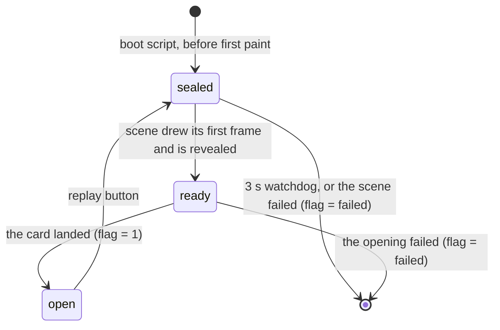

# Envelope opening

A couple on Crimson (or holding `premium_templates`) can put an envelope in
front of their invite ([[cire-invite-builder#Organiser UI]]). On a guest's
first visit the page opens behind it: a paper envelope sealed with wax, in a
Three.js scene. The guest taps, the phone buzzes, the seal breaks one of three
ways, the flap lifts, and the card slides out and grows until it fills the
screen. The card is the invite's own hero, drawn live into the scene with the
HTML-in-Canvas API, so when it lands it is the page underneath pixel for pixel,
and the overlay steps aside over an identical picture.

The envelope is its own axis, above the design pack: the scene knows nothing
of the pack beneath it, and clones whichever hero the pack rendered
([[cire-invite-designs#The envelope above the pack]]).

## Pieces

| Where | What |
|---|---|
| `@cire/envelope` `.` | The catalog (`ENVELOPES`, `isEnvelopeId`), `BREAK_STYLES` and `pickBreak`. No DOM: cire-api imports it |
| `@cire/envelope/boot` | The head boot script, the head stylesheet, the `<html>` attribute names, the seen flag's reads and writes, and `envelopeKey` (the server's SHA-256). No `three` |
| `@cire/envelope/scene` | `createEnvelopeScene`: the overlay, the card's clone and texture, the paper envelope, the seal, the timeline. Loaded on demand; the only module with `three` |
| `@cire/envelope` `src/seal/` | `buildSeal`: the wax seal and its three breaks, behind one interface |
| `cire/invites` `components/envelope-key.ts` | The key a pack's `Document.astro` renders, or none |
| `cire/invites` `components/envelope-mount.ts` | `startEnvelope()`: loads the scene for a sealed page, owns the `<html>` states, consent order, seen flag and replay button |

## Who sees it

The server renders `data-envelope-key` on `<html>` only when the wedding is
served a catalog envelope (cire-api serves `null` to a wedding not entitled,
[[cire-entitlements]]) and the hero is shown (`heroState` says `shown`): an
envelope opens onto the hero. The key is the hex SHA-256 of `slug:envelopeId`,
so storage never holds the couple's names, and choosing another envelope is a
new key that every guest sees once.

The boot script in each pack's `<head>` seals the page (`data-envelope="sealed"`)
only when all of these hold:

| Condition | Why |
|---|---|
| `HTMLCanvasElement.prototype.requestPaint`, `WebGL2RenderingContext` and its `texElementSubImage2D` exist | The API. Only the constructors are checked: creating a WebGL context in a blocking head script would start the GPU process before first paint |
| `prefers-reduced-motion` is not `reduce` | The opening is motion |
| `data-envelope-key` is set | This invite has an envelope over a shown hero |
| No `?code=` in the address | That guest is mid-claim, or the organiser is previewing a household |
| No seen flag, and reading it did not throw | Once per browser; without storage it would replay every visit |

`?envelope=1` plays a stored envelope despite `?code=` and the seen flag; the
organiser's **Preview invite** link always carries it. It never overrides the
first four rows. `?envelope-break=split|peel|crumble` names the break;
otherwise `pickBreak` draws one with `crypto.getRandomValues`.

Whenever the first two rows hold, the boot script also sets
`data-envelope-capable`, seen or not, key or not. The replay button shows only
under `html[data-envelope-capable][data-envelope-key]`.

**Browsers.** Chrome 157 and later, on Android and desktop, has the API on by
default. Chromium 156 has it behind `--enable-blink-features=CanvasDrawElement`
(the E2E flow passes that flag). Safari and Firefox have none, so iPhone guests
get the page as it is. There is no fallback rendering, by the owner's choice.

## States

`<html data-envelope>`, owned by the boot script and the mount script:

While `sealed` or `ready`, the head stylesheet covers the page with its own
ground colour (`body::before`, `--color-bg`), locks scrolling with
`scrollbar-gutter: stable` (so the hero keeps its width when scrolling
unlocks), and holds the hero's animations at their start. Nothing on the page
is made `inert` or hidden, so the consent dialog in it works as ever. With no
`data-envelope`, the overlay is `display: none` and the page is exactly the
page without an envelope.

The overlay (`[data-envelope-overlay]`) carries `data-phase`
(`sealed`, `breaking`, `flap`, `slide`, `fill`, `done`), `data-armed` once taps
count, and `data-prompt` once the prompt words show.

## Consent first

The consent prompt on the invite's pages is a modal dialog in the top layer, so
it sits over the envelope and holds the page until it is answered. The mount
script calls `hydrateConsent()` and arms the envelope only once
`consentRecord()` is not null; until then taps do nothing and the idle timer
has not started. If no answer is on record 8 s after the reveal and no dialog is
open, the prompt never mounted, and the envelope arms anyway rather than strand
the guest.

## Failure and time limits

No guest is left behind a cover or an overlay:

- **Readiness, 3 s.** The boot script's watchdog removes `sealed` if the scene
  has not drawn its first frame by then, and writes the seen flag as `failed`,
  so the device pays the wait once. A scene that turns up later is thrown away
  unseen: the mount watches the attribute and disposes it.
- **The opening, 6 s from the first tap.** A seal whose break never lets go,
  or frames that never come, end in the page as it is.
- **A lost WebGL context** (Android drops them for backgrounded tabs), a throw
  in the frame loop, or a refused scene module: the attribute goes, the overlay
  goes, the flag says `failed`.
- **The replay** starts its own 3 s readiness watchdog.

The guest site has no client error reporting, so each of these is silent: the
guest sees the invite without an envelope. If client reporting lands, the mount
script's `catch` is the one place to report from.

## The card is the hero

At mount the scene waits for the hero's backdrop to settle
(`data-hero-backdrop` on the hero section: `loaded`, `error`, or `none` with no
image), then:

1. Fetches the hero image again in CORS mode, with the `Accept` Chrome sends for
   an `` so cire-api negotiates the same format, and makes a `blob:` URL.
   Cross-origin pixels never paint into a canvas, and the image is on cire-api's
   origin; the blob is same-origin. cire-api already allows the invite origin.
2. Clones the hero section into a `<canvas content="drawable">` that fills the
   overlay: `inert`, `aria-hidden`, every `id` and `data-*` removed, sized to the
   viewport and clipped, with the `` and every crop layer's
   `background-image` pointed at the blob.
3. In the canvas's `paint` event, allocates an `RGBA8` texture the size of the
   drawing buffer and copies the clone into it with `texElementSubImage2D`
   (rows flipped for three's UVs). three 0.186's own `HTMLTexture` calls only the
   pre-155 `texElementImage2D`, so the scene wraps its own WebGL texture in
   `ExternalTexture`.

The overlay is painted from the moment it is added, looking exactly like the
cover beneath it: a drawable child that is not painted has no paint record, and
the upload throws.

The card mesh is a window onto that texture: full width, its height growing.
Inside the envelope it shows the hero's middle at a smaller scale; in `fill`
the card and the window grow together until the plane is the viewport at
`z = 0`, with the camera at `fitDistance` (half the viewport height over
`tan(fov / 2)`). Colour management is off for the scene, every material sits in
three's transparent list ordered by `renderOrder`, and at opacity 1 the texel
reaches the screen unchanged.

The clone is made again at the start of `slide` from the live hero, so a title
a returning household's restore changed is on the card when it lands; `done`
waits up to 300 ms for that upload. The clone's animations are held at their
start like the hero's, so the scroll cue matches at the hand-over and begins its
own entrance after it.

*Measured 2 Nov 2026 — spike at Pixel 7 size (412 x 839, DPR 2.625) on Chromium 156 with the flag: 0.023% of pixels differ by more than 2%, all on glyph edges; without the `blob:` rewrite, 17%.*

## Taps, timeline and breaks

One `<button>` covers the overlay and takes every tap, click, Enter and Space.
Its text, "Open your invitation", is its name and is the prompt that fades in
3 s after the envelope is armed. The first tap fires the haptic (`web-haptics`,
the `success` preset, inside the tap's own handler, the only place Chrome allows
a vibration) and starts the opening; each tap after it steps the playback rate
1, 3, 8. At rate 1:

| Phase | Animation seconds |
|---|---|
| `breaking` (at least; longer only if the seal has not let go) | 0.45 |
| `flap` | 0.55 |
| `slide` | 0.6 |
| `fill` | 0.8 |

Two quick taps land in about 0.8 s.

The seal is `buildSeal({ radius, flap, layers, font })`, returning
`{ group, break(style), update(dt), setOpacity(alpha), dispose() }`. `break`
resolves once the seal no longer holds the flap; the scene owns the clock and
calls `update` with animation seconds already scaled by the rate, so a tap
speeds the break too. A piece that rides the flap is attached to `flap` and
takes the flap's layer. The three breaks:

- **split** — a crack along the flap's edge; the upper half opens with the flap,
  the lower stays on the pocket.
- **peel** — lifted from its left edge like a sticker, then falls away.
- **crumble** — a shiver, then six jagged crumbs fly off and fall.

## Look

The opening has no design document of its own; these are its settled choices.
The seal is a placeholder until the owner's references for the real one arrive.

| Element | Choice |
|---|---|
| Ground | The invite's `--color-bg`: the cover, the overlay and the canvas's clear colour behind the scene |
| Envelope | Warm ivory paper (`#f2ebdd` family), portrait on a portrait screen, landscape on a landscape one, a little over half the screen's height, below centre. Side and bottom flaps in slightly different shades with a soft edge shadow, fine paper grain from a fixed seed |
| Liner | The open flap's inside: `--color-surface-raised` with a diagonal hatch in `--color-gold`, so it follows the couple's palette |
| Seal (placeholder) | Crimson wax (`#7d1622`), an irregular poured rim, a pressed ring and a raised "C" in `--font-display`, lit by one key light |
| Card | The hero, with a 5 px paper edge (`#fbf8f1`) that shrinks to nothing as it fills |
| Prompt | "Open your invitation", `--font-body`, 0.8125 rem, 0.2 em tracking, upper case, `--color-text-muted`, near the bottom edge, fading in over 0.6 s |
| Focus | A 2 px `--color-gold-ink` ring inset on the overlay's button while sealed; none once the opening starts |
| Replay | "Open the envelope again", a quiet underlined text button above the footer in the footer's type and colour |
| Layer | `Z_LAYER.ENVELOPE` (160): above menus and toasts, below `CONSENT`; the consent dialog is in the top layer above it |

## Storage

The seen flag is `localStorage` key `cire:envelope:<key>`, value `1` once the
opening has played and `failed` once it could not. It is rated strictly
necessary, listed in the guest notice as "Your opened envelope"
(`cire/ui/src/consent-vendors.ts`), and has a row in the [[eprivacy]] register.
Every read and write is in a `try`; a throwing read means no envelope.

## Build output

The scene is a client chunk in `dist/client/_astro/`. The mount script loads it
only for a sealed page, so no other guest downloads `three`. `cire/invites`'s
`build` runs `scripts/guard-no-scene-in-server.sh` after the bundle-size guard
and fails if `WebGLRenderer` appears anywhere in `dist/server`.

The scene chunk is **146,513 bytes** gzip; `dist/server` stayed at 183,627 bytes
gzip against its 200,900 budget.

*Measured 2026-11-02 — `bun run --cwd cire/invites build`, then `gzip -c dist/client/_astro/scene.*.js | wc -c`*

`astro dev`'s toolbar audits every `` by fetching its `src`, the card's
`blob:` included, which logs a report-only `connect-src` line in development
only.

## Testing

- **Isolated** (`cire/envelope/tests/`): the boot script run as a string against
  stubbed globals, one test per condition above, the watchdog, a throw; the
  seen-flag writes swallowing a throwing storage; the rate steps; the fit
  distance projecting a viewport-sized plane onto the viewport exactly.
  `cire/invites/tests/components/envelope-key.test.ts` holds the key to a shown
  hero and a catalog id.
- **E2E** (`tools/e2e/tests/flows/cire-invite-envelope.flow.ts`): Pixel 7 profile,
  Chromium with `CanvasDrawElement`. Sealed behind consent, the prompt, the split
  with one haptic, two taps landing within 1000 ms of page time on a frame that
  matches the hero, the seen reload, peel by tap and crumble by Enter from the
  replay button, a hero with no image, reduced motion and no API getting the page
  as it is, a refused scene module, a lost WebGL context, a consent prompt that
  never mounts, and a shown hero with no envelope. Every other flow takes the API
  away by default (`NO_HTML_IN_CANVAS`, the fixture's `envelope` option); see
  [[testing-patterns#The end-to-end suite]].

To try it on a phone, run cire-api and `astro dev` for `cire/invites` on the
LAN address (`--host 0.0.0.0`), with `CIRE_E2E_ORGANISER=1` for the seeded
weddings, and open `/cire/invite?slug=envelope-wedding&envelope=1` in Chrome 157.
