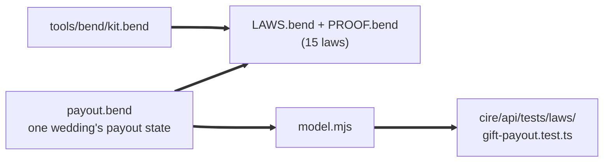

# Gift payout laws

The rules of a cire wedding's payout account ([[cire-registry#Retiring an account]]) written as a small model in [Bend](https://bend-lang.org/) 2, with fifteen laws proved about the model, and a test that runs the same events through the model and through cire-api's services and fails when the two disagree. The set lives beside the code, in [`cire/api/laws/gift-payout/`](../../cire/api/laws/gift-payout/); the Bend toolchain every set shares is in [`tools/bend/`](../../tools/bend/), and [[account-deletion-laws]] says how a set is laid out, run and changed.

> [!important] What a proof shows here
> A proof shows a law holds in **the model**, over every state or every sequence of events. It says nothing about the TypeScript by itself. The agreement test is what ties the model to the code, and it checks only the cases it runs. A law is as true of the code as the model is faithful to it.

## How it fits together



| File | Holds |
|---|---|
| `payout.bend` | One wedding's payout state and every event that moves it |
| `SPEC.bend`, `LAWS.bend` | What each law means, and the 15 laws |
| `proof_base.bend` | One lemma per event that may or may not write, splitting on its condition |
| `proof_seats.bend`, `proof_refl.bend` | Who holds an owner seat after a seat change; each payout field equals itself |
| `proof_account.bend`, `proof_holder.bend`, `proof_money.bend` | The proofs, by area; `PROOF.bend` fills each law from them |
| `model.bend`, `model.mjs`, `model.d.mts` | `payout.bend` compiled for the agreement test, committed, and its types |

The state is one wedding's `registry_settings` payout columns — the account, its holder (`stripe_connected_by_osn_profile_id`), Stripe's charges flag, the money-gifts switch and `stripe_account_generation` — with its `registry_retired_accounts` rows, its seats and whether it is deleted. A seat below owner is an editor in the model: no payout rule reads which lower role it is. Each event is one whole service call:

| Event | The code |
|---|---|
| `Connect` | `registryService.attachStripeAccount` with the generation the create route read ([`registry.ts`](../../cire/api/src/services/registry.ts)) |
| `Join` | a connect that carries no generation: the OAuth attach ([`registry-stripe-oauth.ts`](../../cire/api/src/routes/registry-stripe-oauth.ts)) and `adoptStripeAccount` |
| `Retire` | `retireStripeAccount`, with the account the route read (or none) and the generation the page showed |
| `Detach` | `detachStripeAccount`: cire handing an OAuth account back passes no Stripe time; Stripe's deauthorization webhook passes its `created`. The test drives both shapes, with Stripe's time after every connection, so the time guard never spares a row |
| `Update` | `applyStripeAccountState` (`account.updated`, the live refresh) |
| `Gifts` | `updateSettings`' money-gifts switch, behind the organiser routes' gate |
| `Add`, `Remove`, `SetRole` | `hostsService` `add`, `remove` and `setRole` ([`hosts.ts`](../../cire/api/src/services/hosts.ts)), behind the same gate |
| `Discard`, `Revive` | `weddingLifecycleService` `softDelete` and `restore` |
| `Erase` | `accountErasureService.erase` for an OSN account's erasure ([`account-erasure.ts`](../../cire/api/src/services/account-erasure.ts)) |

`absent` in the model is `payoutHolderAbsentSql` ([`payout-holder.ts`](../../cire/api/src/services/payout-holder.ts)): an account is named and its holder holds no owner seat, or none is recorded. `block` is `accountMoneyBlock` with the currency fixed to the wedding's: the holder first, then Stripe's flag, then the switch.

## The laws

| Law | Says | Kept in the code by | Agreement test |
|---|---|---|---|
| `generation_counts_clears` | The account generation rises by one exactly when a step clears the account, and otherwise stays | The trigger `registry_settings_stripe_account_generation` ([`setup.ts`](../../cire/api/src/db/setup.ts), the `0001_initial` migration): it fires only when the id goes from a value to NULL; an erasure clears the holder, not the id | every case compares the generation after each event; "a detach clears with no record and moves the generation" |
| `account_never_repointed` | No step moves the wedding from one account to another: the account stays, or none is named | The attach's `coalesce` on the existing id; the reuse's `setWhere` on a NULL id; the retire and the detach only clear | every case |
| `retire_writes_one_record` | A retire that clears the account writes exactly one retired-account record, naming that account, unreleased, with the reason the caller's standing gives; no other step writes one | `retireStripeAccount`'s one batch: the `INSERT … SELECT` and the `UPDATE` carry the same `WHERE`, and the reason is the `CASE` on the row's standing | "hands over, the partner connects their own, another owner replaces it…", "retires only for an owner, hands over only from the holder…", "an erasure of the holder keeps the account…" |
| `clear_is_retire_or_detach` | Every clear of the account is a retire, or a detach of that account | Only `retireStripeAccount` and `detachStripeAccount` write the id to NULL in `cire/api/src` | "a detach clears with no record and moves the generation" |
| `stale_retire_changes_nothing` | A retire whose caller read another account, none, or another generation changes no payout field | The retire's `WHERE` names the account and the generation; a read of no account skips the batch | "refuses a retire that read a stale generation, even on the same account, or another account, or none" |
| `stale_connect_changes_nothing` | A connect carrying a generation other than the wedding's changes no payout field | The attach's `setWhere` on `stripe_account_generation` when the create route passes it. The OAuth attach and the reuse pass none, by design: each proves control of its account another way | "refuses a connect on a generation another owner moved" |
| `retire_needs_an_owner` | A retire clears the account only for a caller holding an owner seat on the live wedding | `ownsLiveWedding` in the retire's `WHERE` | "retires only for an owner…" (the owner seat), "a deleted wedding refuses connect, retire and the gated writes…" (the live wedding) |
| `handover_by_holder_to_another_owner` | A retire naming someone to hand money gifts to clears the account only when the caller holds it and the one named is another current owner | The retire's `handToAllowed` | "retires only for an owner, hands over only from the holder to another owner…" |
| `erasure_keeps_account` | An erasure never changes the account the wedding names | `eraseAccountRows` clears only `stripe_connected_by_osn_profile_id` | "an erasure of the holder keeps the account…" |
| `holder_unseated_only_by_erasure` | No step but an erasure makes the holder absent | The holder rule in `hostsService.remove` and `setRole` (409 `holds_payout_account`); a connect records an owner of the live wedding as holder | "refuses to remove or demote the holder, and lets them go once they hand money gifts over" |
| `holders_seat_kept` | While someone holds the account and an owner seat, no step but an erasure takes the seat: after it they keep an owner seat, or no longer hold the account | The same holder rule, in each hosts write's own guarded statement | same |
| `money_closed_while_holder_absent` | Money gifts are closed whenever the holder is absent | `accountMoneyBlock` answers `payout_holder_absent` first | every case compares `moneyGiftsBlockedBy` and `payoutHolderAbsent` |
| `money_open_only_with_seated_holder` | In every state a wedding reaches, money gifts are open only with an account named, its holder in an owner seat, Stripe taking charges and the switch on | `accountMoneyBlock`, which never reads the account id: it leans on every clear turning `stripe_charges_enabled` off and on `account.updated` writing only a row naming its account. The proof carries that as an invariant over every run | "turns money gifts on only with a seated holder and charges, and off always" |
| `holder_erasure_closes_gifts` | An erasure of the holder's profile leaves money gifts closed | The erasure clears the holder and keeps the account, so `payoutHolderAbsentSql` holds | "an erasure of the holder keeps the account…" |
| `gifts_on_only_when_ready` | A step turns money gifts on only while the holder is not absent and Stripe can take a charge | `moneyOnRefusal` in `updateSettings` | "turns money gifts on only with a seated holder and charges, and off always" |

The agreement test, [`gift-payout.test.ts`](../../cire/api/tests/laws/gift-payout.test.ts), runs twelve named cases, one for each way the model and the code could part, and sixty fixed-seed traces. After every event it compares the wedding's liveness and seats, the account, holder, charges flag, switch, generation, retired rows (`account:reason:released`), `moneyGiftsBlockedBy` and `payoutHolderAbsent`, and that a gated write reached its service exactly when the wedding was live. It also checks each service's answer: a refusal must be one that service gives (never a write error), a retire must succeed exactly when the model clears the account, and the money-gifts save must give the model's answer, an absent holder refused before an account that cannot charge.

Each trace draws its next event against the model's state. Half start with a second owner and an account the creator connected; a connect or a retire carries the wedding's generation four times in five, a retire reads the account the wedding names nine times in ten (the route reads the account itself and takes only the generation from the page), and the caller is the holder or an owner more often than not. One more test replays the sixty traces through the model alone and fails unless they reach each of 24 outcomes the laws turn on: each retire reason, a stale connect and a stale retire refused, a retire by someone with no owner seat and a hand-over to someone who is not another owner refused, a detach that clears and one that releases a record, the switch turned on and off and refused for an absent holder and for an account that cannot charge, each half of the holder rule, an erasure that leaves the holder absent, money gifts open, and a delete and a restore. A drawer change that stops reaching one fails by name.

## What the proofs and the test do not show

- **Races inside one call.** Each event is atomic in the model. `updateSettings` reads whether money may be turned on before its write, and its write re-checks only the currency, so a retire, a detach or an erasure of the holder between the two can leave the switch on with the holder absent. Money stays closed — the guest gate reads the holder itself — and the switch is the couple's intent, which a later account takes up. `gifts_on_only_when_ready` holds for calls run one at a time.
- **D1.** The test runs on bun:sqlite, which runs a batch one statement at a time; D1's batch is one transaction. The retire's two statements landing together is covered by `cire/api/tests/db/d1-integration.test.ts`.
- **Which checker said so, and the compiler.** As for the deletion sets ([[account-deletion-laws#What the proofs and the tests do not show]]): `ALL PROOFS CHECK` comes from Bend's own checker, and `model.mjs` from Bend's compiler, which the agreement test runs.
- **Not modelled:** the payout account's currency (every account here settles in the wedding's); the attach's insert arm, which runs only at generation 0 with no account; a detach whose Stripe time is before the row's connection, which its guard spares; the hosts people limit; several weddings sharing one account (`adoptStripeAccount`'s rules across weddings); who is emailed, and what an editor or a viewer is told; the gift events' matching by the gift's own account; the purge.
- **"Remove my Cire data"** (the erasure's `host` scope) is not modelled. It keeps the holder's owner seat only on a live wedding with another owner (`payoutHeldSeat`), so it can take the holder's seat on a deleted wedding, or delete a wedding whose only owner is the holder; the two holder laws exempt every erasure for that reason.
- **Paths not driven:** `adoptStripeAccount` (the `Join` event drives the OAuth attach's call shape); a role change by another owner (self only, as the deletion test); `account.updated`'s time-order guard (every update the test sends is newer than the row) and the live refresh (`refreshStripeStatus`), which passes no Stripe time.
- **Direct charges.** That cire never moves gift money through its platform account is the `Stripe-Account` header on each Checkout session (`cire/api/src/services/stripe.ts`), which no service the model follows writes. [`stripe.test.ts`](../../cire/api/tests/services/stripe.test.ts) checks the header on the gift session; it is not a law here.
- **Cases not run.** A disagreement on a case neither the twelve named cases nor the sixty traces reach goes unseen.

## Not proved

- **The tier upgrade rule** ([[cire-upgrades]], "a paid upgrade always grants its tier or is refunded automatically") has no set. Its state machine ends in `refund_failed` as well, and "eventually grants or refunds" is a claim about what a sweep will do, which a model of single steps cannot state. A safety form would need its own model of `upgrade.ts`.

## Next

- **The Standard hand-back sweep and the erasure email** (the gift-payout design's pull request 5, `docs/superpowers/specs/2026-11-17-cire-gift-payout-design.md`). The sweep releases retired rows and may clear a wedding that connected the account while it was handing it back, a clear with no record: `clear_is_retire_or_detach` must take that event when it lands, and `release` gains a second writer.

## Running it

```bash
bash tools/bend/bend.sh prove cire/api/laws/gift-payout   # ALL PROOFS CHECK
bun run --cwd tools/bend check                            # every set, and each model.mjs against a fresh build
bun test --preload ./tests/test-helpers/metrics-harness.ts tests/laws/   # in cire/api
```

After any change to `payout.bend`, rebuild and stage `model.mjs` (`bun run --cwd tools/bend build`); CI's `Bend proofs` job fails when it is not byte for byte what `model.bend` builds. A law changes only by the owner's decision.
