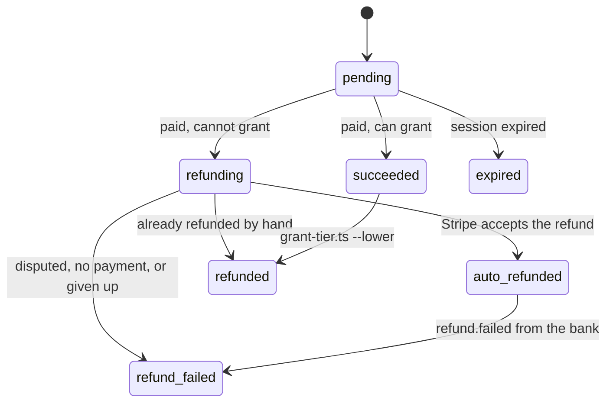

# Self-serve upgrades — buying a plan tier

An owner of the wedding presses **Upgrade** on a locked module's nav row, pays on a
Stripe-hosted page, and the wedding moves up a plan tier — every module that
tier includes opens at once. The tiers themselves, and what each one opens,
are [[cire-entitlements]].

Two tiers are sold: **Gold** and **Crimson**. A wedding on Ivory can buy
either; a wedding on Gold can buy Crimson at an upgrade-from-Gold price; a
wedding on Crimson has nothing to buy. The one-off `premium_templates`
entitlement is comp-only.

A wedding can also reach a paid tier without paying: an operator's comp, or an
unlock code an owner redeems ([[cire-entitlements#Unlock codes]]). A code is
refused (409 `purchase_in_flight`) while a checkout for the wedding can still be
paid. A checkout paid after a code had raised the wedding anyway — once the
checkout's 24 hours had passed with its webhook still failing — is refunded
automatically (`already_held`, below), never kept for a tier the wedding
already held.

---

## The one rule everything else follows

**Only Stripe's own word raises a wedding's tier for a purchase**: a
signature-verified webhook, or the daily reconciliation's read of the session
with the platform's secret key. The browser's return from Stripe polls; it
never asserts. A hand-typed `?upgrade=…` therefore buys nobody anything.

---

## Two Stripe relationships, deliberately kept apart

This is the fact that shapes the whole design.

|                    | Gifts                              | Upgrades                            |
| ------------------ | ---------------------------------- | ----------------------------------- |
| Merchant of record | The couple                         | **cire**                            |
| Charge type        | Direct, on their connected account | Platform                            |
| Endpoint           | `POST /api/stripe/webhook`         | `POST /api/stripe/platform-webhook` |
| Signing secret     | `STRIPE_WEBHOOK_SECRET`            | `STRIPE_PLATFORM_WEBHOOK_SECRET`    |
| `event.account`    | Always present                     | Must be **absent**                  |

> [!important]
> A Stripe endpoint is scoped either to the platform or to connected accounts, and each carries its own signing secret while a verifier holds exactly one. So an upgrade branch inside the Connect route would be a branch **no event could reach** — unreachable in production and green in every test, because a test signs with whatever secret it is handed. That is why there are two endpoints rather than one route with a branch.

The separate secret is the security boundary; the absent-`account` check is
belt and braces behind it, so a connected account naming itself still grants
nothing.

**Both endpoints are exempt from the CSRF origin guard** by exact path
(`cire/api/src/lib/origin-guard.ts`). Stripe sends no `Origin`, so without the
exemption the guard 403s every delivery before its signature is checked and
Stripe retries the 403 for days. Both are mounted after `createApp`'s route
chain, and so after the guard; no type limit keeps them there
([[cire-development#Mounting a route]]).

---

## Flow

```mermaid
sequenceDiagram
    participant H as Host (portal)
    participant A as cire-api
    participant S as Stripe
    H->>A: POST /upgrade/session {tier, module}
    A->>A: wedding already on tier or above? → 409 already_held
    A->>A: no Price for this move? → 404 not_purchasable
    A->>S: read the Price's amount (cached)
    A->>S: close any legacy page still payable
    A->>A: pending purchase? → reuse / expire it / 409 processing
    A->>A: INSERT purchase (pending, from_tier, Price + amount)
    A->>S: create platform Checkout Session
    A->>A: store session id (conditional)
    A-->>H: {purchaseId, url, reused}
    H->>S: pay
    S-->>H: return to /?w=&m=&upgrade=
    S->>A: checkout.session.completed (platform webhook)
    A->>A: not the session the row holds? → nothing (not ours)
    A->>A: can grant? one batch: flip status → raise tier → platform_sales
    A->>S: cannot grant? mark refunding → POST /v1/refunds
    H->>A: GET /upgrade/purchases/:id (poll)
    A-->>H: {status, tier} → granted: refetch weddings → modules unlock; refunded: say so
```

---

## Routes

All under `/api/organiser/weddings/:weddingId/upgrade`, in
`cire/api/src/routes/upgrade.ts`.

| Route                | Gate      | Answers |
| -------------------- | --------- | ------- |
| `GET /catalogue`     | member    | `{ tier, upgrades: [{ tier, fromTier, title, blurb, amountMinor, currency }] }` — the wedding's tier and only the tiers above it, each priced for the move from where the wedding is |
| `POST /session`      | **owner** | Body `{ tier: "gold" \| "crimson", module? }` → `{ purchaseId, url, reused }`. 404 `not_purchasable` · 409 `already_held` · 409 `processing` · 502 `payment_provider_unavailable` |
| `GET /purchases/:id` | member    | `{ purchase: { status, tier } }`. Wedding-scoped, so another wedding's id is not found. `tier` is `null` only for a legacy product that names no tier |

Owner-only on the write, matching the Connect onboarding route: it names a
card. The session route reads its body by hand and decodes it whole against
`StartUpgradeSessionBody` (`cire/api/src/schemas/upgrade.ts`) before the
service sees any of it, the same sentinel-parse idiom as every cire write
route ([[cire-development]]): `tier` must be one of `PURCHASABLE_TIERS` and
`module` a string of at most 32 characters. Any other body, including one that
is not JSON, answers 404 `not_purchasable`. `module` is then checked against
the portal's module list and anything else lands on `overview`, so a request
body can never put an arbitrary string into a URL Stripe redirects to. Stripe
returns the organiser to
`<organiser origin>/?w=<weddingId>&m=<module>&upgrade=<purchaseId>`, and to the
same URL without `upgrade` on cancel.

> [!warning]
> These routes carry **no** tier gate. Gating the route that sells a tier on
> that tier is a 402 loop. The role gates still read the wedding's tier in the
> query that finds the caller's seat, and that is what the catalogue prices
> from, so it costs no query of its own. See [[cire-entitlements]].

They are mounted after `createApp`'s route chain, with the platform webhook,
and only with both a Stripe client and `STRIPE_PLATFORM_WEBHOOK_SECRET`: the
routes open a checkout, and only the platform webhook grants the tier it pays
for, so where the webhook cannot exist no tier is sold. Both use one upgrade
service ([[cire-development#Mounting a route]]).

---

## Pricing

cire-api stores no money amount. A catalogue entry names a **Stripe Price
id** supplied per deployment, and the amount is read back from Stripe, so what a
host is charged is always Stripe's. The marketing site publishes the offer as
text in `cire/landing/src/lib/plans.ts` (Gold A$79, Crimson A$149, A$70 from Gold
to Crimson), checked by hand against these Prices before a release: change a
Price, change that file ([[cire-landing#Pricing]]). The title and blurb for each tier are product copy that ships with the
release (`COPY` in `cire/api/src/services/upgrade-catalogue.ts`).

| Move | Var |
| --- | --- |
| Ivory → Gold | `STRIPE_UPGRADE_PRICE_GOLD` |
| Ivory → Crimson | `STRIPE_UPGRADE_PRICE_CRIMSON` |
| Gold → Crimson | `STRIPE_UPGRADE_PRICE_CRIMSON_FROM_GOLD` — a second Price on the Crimson product |

The Worker reads them in `cire/api/src/index.ts` (into the catalogue's
`prices: { gold, crimson, crimsonFromGold }`), and the local server in
`cire/api/src/local.ts` from `process.env`. They are ordinary `[vars]` in each
environment of `cire/api/wrangler.toml`, not secrets, and named envs inherit no
vars, so each tier declares its own. They are commented out in every
environment until the Stripe Prices exist: with none set, the catalogue is
empty, every checkout 404s, and the locked rows offer an upgrade nobody can
complete. Test-mode Price ids in dev, live ones in production; a test id in
production fails at checkout.

**Key-optional and fail-closed.** A move with no configured Price is not for
sale: absent from the catalogue, 404 from the checkout route. In particular,
with `STRIPE_UPGRADE_PRICE_CRIMSON_FROM_GOLD` unset a Gold wedding is not
offered Crimson at all — never at the full price again. Absent configuration
never means free, and a blank or whitespace var counts as absent.

**No webhook, no sale.** With no `STRIPE_SECRET_KEY`, or no
`STRIPE_PLATFORM_WEBHOOK_SECRET` (blank counts as none), the upgrade routes are
not mounted: the catalogue and the checkout route answer 404, and the portal
reads that as nothing for sale, so the dialog says upgrades are not available.
Without the webhook an owner could pay and the purchase would stay `pending`
for good. Where the key and a Price id come without the secret, the Worker logs
`upgrades disabled: STRIPE_SECRET_KEY is set without STRIPE_PLATFORM_WEBHOOK_SECRET`
once when it builds the app; set the secret, then deploy, since a warm isolate
keeps the app it built. On a deployed tier the same holds when
`STRIPE_PLATFORM_WEBHOOK_SECRET` is the same value as `STRIPE_WEBHOOK_SECRET`:
the two are separate Stripe endpoints, each with its own secret, so one value
in both means one of them verifies nothing. The Worker sells no tier and logs
`upgrades disabled: STRIPE_PLATFORM_WEBHOOK_SECRET is the same value as STRIPE_WEBHOOK_SECRET`.
Locally one `stripe listen` signs both, and the same value is right.

Prices are cached per isolate for ten minutes (`PRICE_CACHE_TTL_MS`) — the
catalogue is read on every upgrade dialog, and each would otherwise spend a
Stripe call against the platform's quota on an answer that has not moved. A
Price Stripe refuses drops only its own entry and is not cached, so fixing it
recovers without a deploy.

`startPurchase` reads the Price it is about to charge through the same cache
(`catalogue.quote`) before it writes or sends anything, and records its id,
amount and currency on the purchase row (`price_id`, `price_amount_minor`,
`price_currency`). A Stripe Price's amount cannot change once the Price exists,
so a cached read is as good as a fresh one. A Price Stripe will not read opens
no purchase: 502, with the checkout result `error`.

---

## The two failures this is built against

### Charging twice for one tier

A webhook can lag — seconds normally, days if the Worker answered 500 and
Stripe is retrying. An organiser who paid, saw nothing unlock and pressed
Upgrade again must not get a second payment page.

A wedding has **at most one pending purchase, whatever it buys**: the partial
unique index `wedding_upgrade_purchases_one_pending_uniq` is on `(wedding_id)
WHERE status = 'pending'`. `startPurchase` reads the wedding's tier, any
pending purchase and any legacy page (below) in one statement.

First it closes every **legacy page** that may still take money. The tier
migration marked each pending per-module purchase `expired` in D1, but a
database write cannot close a Stripe session, which stays payable for a day
after it opened (sessions are created with no `expires_at`). So the opening
read also returns rows that are `expired`, hold a session, buy a product that
is not a tier, and opened less than a day ago (`CHECKOUT_SESSION_LIFETIME_MS`).
Each is probed: an open one is expired at Stripe; one that is `complete`, that
Stripe will not expire, or that cannot be probed answers **409 `processing`**.
englishstreetventures/osn#1315 removes this with the legacy rows.

Then it resolves the pending purchase **before** it ever reaches an insert:

| Pending purchase | Action |
| --- | --- |
| Its session is `open`, same tier and same from-tier | Return that URL (`reused: true`) — the double-press fix |
| Its session is `open`, a different product | Expire it at Stripe (`POST /v1/checkout/sessions/{id}/expire`), close the row, insert. A refused expire answers **409 `processing`** — it may have been paid meanwhile |
| Its session is `complete` | **409 `processing`**. Never insert: the money has very likely moved, and the wedding's tier with it |
| Its session is `expired` | Close the row, then insert |
| The probe failed | 409 `processing` — failing to reach Stripe is not evidence a session is dead |
| No session yet, younger than `STALE_PENDING_MS` | 409 `processing` — another request's Stripe call is in flight |
| No session yet, older | Close it as `failed`, then insert |

So a Crimson click is never handed a Gold payment page, and two pages for the
same wedding can never both be paid.

`retrievePlatformCheckoutSession` returns a **state** rather than the nullable
URL the gift reader returns, because here `complete` and `expired` need
opposite answers.

The index is the backstop behind all of this, never the control flow. The
insert goes through `Effect.tryPromise`, and `upgradeConflictReason` turns a
violation naming `wedding_upgrade_purchases.wedding_id` into the 409
`processing` (SQLite names the columns a conflict was on, never the index);
`dbQuery` alone would make it a defect, a 500.

### Taking money and granting nothing

**A paid checkout of ours upgrades the wedding, or is refunded.** When it
cannot grant, cire gives the money back through Stripe on its own. Nobody is
charged for nothing.

#### Which payments are ours

The purchase id comes from `client_reference_id`, which any payment on this
Stripe account can carry: a Payment Link lets the payer set it. So the id proves
nothing. **The session the purchase row holds** does. Only `startPurchase`
writes `checkout_session_id`, from Stripe's answer to cire's own create call,
and it hands the payment page out only after that write lands. That session
sold exactly the Price the row recorded (`price_id`, `quantity: 1`, no
promotion codes), for the row's tier. So settle needs no amount check and no
Stripe read to know the payment bought this tier.

A payment for any other session, a purchase id cire never wrote, or a row that
holds no session yet grants nothing and is not refunded: it is not cire's to
keep or to give back. Each is `unknown`, and the wrong-session case is logged at
error (`upgrade settle for a session the purchase does not hold`).

#### What a paid session of ours settles to

Settle grants whatever amount Checkout charged (tax, a discount or a converted
currency included), and a Price changed in Stripe while the page was open still
grants. What arrived is recorded on the row and in `platform_sales`.

It refunds instead, in this order of reasons, logged at error as
`upgrade settle refunding a payment it cannot grant`:

| `reason` | When |
| --- | --- |
| `no_tier` | The product maps to no tier (a legacy row) |
| `wedding_not_live` | The wedding is soft-deleted, or gone |
| `unknown_tier` | The wedding's tier is a value no build knows (only hand-written SQL makes one), which the grant cannot raise from |
| `not_from_tier` | The purchase was priced as an upgrade from a tier (the from-Gold Crimson Price, the difference between the tiers) and an operator has since lowered the wedding below it. Granting would sell the whole tier at the difference's price. The owner's call |
| `already_held` | The wedding already holds the tier or above, raised by something other than this purchase (an operator's comp, or an unlock code once the checkout's 24 hours had passed). A wedding this purchase raised itself (`tier_granted_by = 'stripe:<id>'`) is a grant whose status flip never landed, and settles as a grant |

Statuses a payment for the row's own session settles from: `pending`, and
`expired`, `failed` and `mismatch`, since a session can be paid in the moment
before its row is closed. `mismatch` is a row an earlier release refused for a
payment of another amount; nothing writes it now, and a resend of its own
session's `checkout.session.completed` from the dashboard settles it.



#### One payment, one outcome

The grant and the refund claim are each a write guarded on the row still being
open and the session being its own, and each reads the row back in the same D1
batch. Whichever lands first decides; the other follows what it reads.

- **The grant** is one batch: flip the row to `succeeded`, raise the tier, write
  the sales row, read the status back. The raise and the sale run only while
  the row reads `succeeded` (`tierGrantStatement`'s `onlyIf`, and an
  `INSERT … SELECT` from the row), and the flip itself carries the read's
  decision — the wedding live, below the tier and still on the tier the
  purchase was priced from, or raised by this purchase. So a delete, a comp, a
  lowering or a refund claim landing between the read and the batch grants
  nothing; a fresh read then refunds it. The raise carries the from-tier
  condition on a replay too.
- **A row already `succeeded`** is a replay. The grant and the sale run again,
  both idempotent, and it never refunds, whatever has happened to the wedding
  since: the money bought the tier when it arrived.

> [!important]
> **Nothing may short-circuit on "this row already reads succeeded".** Every delivery for a granted purchase re-runs the grant and the sales insert. A test pins this, and it fails the moment an early return on a replayed delivery is added.

#### The refund

The row moves to `refunding` **before** Stripe is asked, recording the payment
intent and what arrived, so no later delivery can grant it. Then
`POST /v1/refunds` with the payment intent and `metadata[purchaseId]`, a full
refund, under one idempotency key per purchase, `cire-upgrade-refund-<id>`:

| Stripe answers | Row | Outcome |
| --- | --- | --- |
| A refund (`succeeded`, `pending`, `requires_action`) | `auto_refunded`, `refund_id` = `re_…` | `auto_refunded` |
| `charge_already_refunded`, and a refund of the PaymentIntent names this purchase | `auto_refunded` with that refund's id (cire's own refund, whose answer was lost) | `auto_refunded` |
| `charge_already_refunded`, no refund names it | `refunded` (a person did it) | `refunded` |
| `charge_disputed`, or no payment intent to refund | `refund_failed`: the dispute decides the money, or there is none to find | `refund_failed` |
| An in-progress idempotency `409` | stays `refunding`, warning (`upgrade refund in progress elsewhere`) | `refunding` |
| No answer: Stripe unreachable, a timeout, a body nobody could read | stays `refunding`, `upgrade refund failed` at error; a refund may exist at Stripe, so this never counts towards the give-up | `refunding` |
| Any other refusal Stripe answered | stays `refunding`, `upgrade refund failed` at error with Stripe's code | `refund_failed` |

The webhook answers **200** to a refused refund. Stripe keeps a refusal under
its idempotency key for at least a day and replays it, so a redelivery would
only repeat it and count against the endpoint until Stripe disabled it. The
next fresh attempt comes from the daily reconciliation, a day or two later.

A refund Stripe accepted can still fail at the bank — a closed card. Stripe
sends `refund.failed`; when its refund id is the one the row recorded, or the
row is still `refunding` with none recorded (cire's call timed out after Stripe
took it), the row moves to `refund_failed` with that id, and the refund's own
late success never overwrites it. Either way, and also when no row holds
it any more (the purge took a deleted wedding), it is logged at error as
`upgrade refund failed at the bank` and counted. The money is back in cire's
balance, and a person has to return it.

#### The daily reconciliation

Cron job 13 (`reconcile` in `cire/api/src/services/upgrades.ts`) finishes what
a webhook could not. It runs wherever there is a `STRIPE_SECRET_KEY`, without
the platform webhook's secret: a refund cire owes is asked for even where
upgrades are no longer sold. Each run reads at most `RECONCILE_PER_RUN` (2)
rows, least recently moved first (index `(status, updated_at)`):

- a **`refunding`** row: the refund is tried again. One Stripe still refuses
  13 days after the purchase (`REFUND_GIVE_UP_MS`) moves to `refund_failed`,
  logged `upgrade refund given up; a person must return the money`, and the
  daily asking stops. One whose call went unanswered, or that another
  delivery is still making, is never given up on. A refund Stripe accepted
  after a give-up still lands as `auto_refunded`;
- a **`pending`** row whose session is older than a day: its session is read
  from Stripe, with the charge. Paid → settled exactly as the webhook would
  (grant, or refund). Paid and already refunded in full in the dashboard →
  `refunded`, never a grant; a part refund still grants. Stripe's own
  `expired` → closed `expired`. Anything else stays.

Every row read is moved to the back (`updated_at`), so one that keeps failing
cannot hold every run's places. Each run also counts the `refund_failed`
purchases and, while there are any, logs `upgrade refunds waiting for a person`
at error with the count. This is what makes a storage error that
outlasts Stripe's retries end in a grant rather than a payment for nothing.

#### For a person

**Before refunding an upgrade by hand that has not settled** (`pending`,
`expired`, `failed` or `mismatch` — its webhook kept failing, say), mark the row
first, so no later delivery or resend grants a tier for money already given
back: `UPDATE wedding_upgrade_purchases SET status = 'refunded', updated_at =
unixepoch() WHERE id = '<purchase id>' AND status IN ('pending', 'expired',
'failed', 'mismatch');`, then refund it in the dashboard. Settle grants
nothing for a `refunded` purchase.

A `refund_failed` purchase is money cire owes. Return it from the Stripe
dashboard (the refund or the PaymentIntent names the purchase in its metadata),
then mark the row so nothing asks again and the purge may take a deleted
wedding: an operator-authorised production D1 write, `UPDATE wedding_upgrade_purchases SET status = 'refunded', updated_at =
unixepoch() WHERE id = '<purchase id>' AND status = 'refund_failed';`. Never
on a `refunding` row: cire is still asking Stripe for that refund, and one
that lands after a refund by hand pays the buyer twice.

Card-only sessions (`payment_method_types=[card]`) mean none can complete
unpaid, so `async_payment_succeeded` is deliberately not handled. The unpaid
check stays anyway — granting on an unpaid session is the one mistake a retry
cannot undo.

A purchase records `from_tier` (`ivory` or `gold`), which is what tells a
Crimson bought outright from one bought as an upgrade from Gold; the grant
records `tier_source = 'purchase'` and `tier_granted_by = 'stripe:<purchase
id>'` on the wedding.

---

## The portal

`UpgradeDialog` (`cire/host/src/components/UpgradeDialog.tsx`) is mounted
**once** for the whole nav, not once per locked row, and afresh for each offer.
It sells the tier the row's lock names ([[cire-host-portal-layout]]). The
co-host panel mounts its own, afresh for each offer too, selling the tier the
people limit names and returning the owner to Settings
([[cire-entitlements#People limit]]):

- It is a `Modal`, the platform `<dialog>` ([[native-dialog-over-kobalte]]):
  Tab stays inside, Escape and the backdrop close it, and the page behind is
  inert. Focus opens on **Cancel**, so an Enter held from the nav card never
  carries on into a checkout. Closed, focus goes back to the locked row, or to
  the sheet's trigger when the offer came from the sheet. `ModuleSidebar`
  portals it to `<body>`: the sheet marks the app root `aria-hidden` while it
  is open and lifts that a frame after it closes, so a dialog opened from the
  sheet in place would take focus inside a hidden subtree.
- A checkout that could not start is said inside the dialog, not in a toast:
  the toaster sits behind the modal, inert, so its message would be painted and
  never announced. A refusal that closes the dialog (`processing`,
  `already_held`) closes it before it raises its toast.
- It prices from the cached catalogue (`lib/upgrade-store.ts`), fetched the
  first time a dialog opens.
- The eyebrow reads **Upgrade from Gold** when the entry's `fromTier` is Gold,
  so the smaller figure is not read as Crimson's full price.
- A catalogue `tier` at or above the one on offer reads as already held, and
  offers no button; so does a tier the catalogue does not list ("not available
  on this site yet").
- It posts `{ tier, module }`, so Stripe returns the organiser to the module
  they asked for.
- A `processing` refusal tells the organiser to wait. Inviting a second payment
  there is the client half of the double-charge guard.

The return from Stripe carries its receipt in the **query**, not the fragment
— the portal is hash-routed, so the hash is the route:

```
https://host.cireweddings.com/?w=<weddingId>&m=<module>&upgrade=<purchaseId>
```

`readUpgradeReturn` (`cire/host/src/lib/upgrade-return.ts`) validates it, and
`OrganiserApp` strips those params the moment it reads them: `setRoute`
rebuilds the URL as `pathname + search + hash` on every hash write and the
login bounce carries `search` through, so anything left behind would re-run
the poll on every later navigation. It then polls with a bounded backoff, and
each status the purchase reaches ends the poll its own way:

| Status | What the portal does |
| --- | --- |
| `succeeded` | Drops the cached catalogue, refetches the wedding list — which is what the nav locks by, so that is what unlocks the modules — and names the tier bought in a success toast |
| `failed`, `expired` | Error toast: "That payment did not go through. Nothing was charged." |
| `refunding`, `auto_refunded`, `refund_failed` | Error toast, pinned until closed: "Your payment could not upgrade this wedding, so we are refunding it in full. Questions? Write to us at <address>.", the address being `LEGAL_ENTITY.contactEmail` from `@shared/legal`, as a `mailto:` link (`proseLinkClass()`). Pinned because the receipt is gone from the URL and nothing else in the portal says it again, and held until no modal dialog is open, since a toast over one is never announced |
| `refunded` | Info toast: "That purchase was refunded, so it no longer applies to this wedding." A person refunded it, so the poll meets it on a return URL opened again |
| Still `pending` (or a legacy `mismatch`), not found, or unreadable at the last attempt | Info toast: "Your payment is still being confirmed. This page will show it once it is." |

After any refund status the portal reads nothing again: nothing was granted.
A soft-deleted wedding's poll is refused like every organiser read of it, so
its owners are not told in the portal; Stripe's own refund receipt reaches the
payer when the dashboard's customer email for refunds is on.

---

## Retention and compliance

`wedding_upgrade_purchases` (migration 0061) cascades from `weddings.id` like
every other cire table. `platform_sales` deliberately does **not**: no foreign
key, no wedding id, no profile id. cire is the merchant of record for an
upgrade, so the record of money cire took must not die with the wedding row.
Its `entitlement` column holds the product sold (`gold` or `crimson`); the
amount tells a Crimson-from-Gold sale apart, and `from_tier` is on the purchase
row it names.

It is written at **settle**, not at deletion: a sale must exist whether or not the wedding is ever deleted. `purchase_id` is UNIQUE, which is what makes the insert idempotent across redeliveries.

> [!caution]
> The row is **pseudonymous, not anonymous**. `settled_at` is the same moment the purchase row settles and the tier is raised, and the amount and product repeat the purchase row, so while that row exists the join is exact — and afterwards it stays linkable through Stripe's own retained session. See `wiki/compliance/data-map.md` and `wiki/compliance/retention.md`.

A purchase row goes with the wedding when the daily purge hard-deletes one its owners deleted, 7–8 days after the delete ([[cire-auth#Soft-deleted weddings]]). The purge waits while a purchase is still `pending`, up to 14 days from its creation (`PURGE_PENDING_HOLD_S`), and while one is `refunding` or `refund_failed`, however old: the purchase row is the only record cire keeps of money it owes back, and the cascade would delete it. That hold ends when the refund lands or a person marks the purchase `refunded`. An `auto_refunded` purchase holds for 30 days after its refund was recorded (`AUTO_REFUND_HOLD_S`), while the bank can still return it. Two triggers (`wedding_upgrade_purchases_status_known`) refuse any `status` outside the set, so a hand-written typo cannot slip past the purge or the reconciliation. An upgrade paid for a soft-deleted wedding is refunded, never granted.

Refunds do not lower a tier on their own; an operator lowers it with
`grant-tier.ts --lower` ([[cire-entitlements]]), whose printed SQL first marks
the wedding's paid purchases of anything above the new tier `refunded`, then
lowers the tier. Stripe redelivers a completed session after a failed delivery
and an operator can resend one from the dashboard; settle grants nothing for a
`refunded` purchase, so the refund holds. The customer-facing wording is
englishstreetventures/osn#1317.

The purchase row's statuses: `pending`, `succeeded`, `failed`, `expired`,
`refunded` (a person refunded it), `refunding` (cire is refunding a payment it
could not grant), `auto_refunded` (Stripe accepted that refund; `refund_id`
holds it), `refund_failed` (a person has to return the money) and `mismatch`
(left by an earlier release; nothing writes it now).

> [!warning]
> Rolling the cire-api Worker back past the release that refunds automatically lets a redelivered payment for a `refunding`, `auto_refunded` or `refund_failed` purchase grant the tier: the older settle refuses only `refunded`. Before such a rollback, mark those rows `refunded`, or do not roll back.

---

## Local development

Two forwarders, because there are two endpoints:

```bash
stripe listen --forward-connect-to localhost:8787/api/stripe/webhook \
              --forward-to         localhost:8787/api/stripe/platform-webhook
STRIPE_SECRET_KEY=sk_test_… \
STRIPE_WEBHOOK_SECRET=whsec_… STRIPE_PLATFORM_WEBHOOK_SECRET=whsec_… \
STRIPE_UPGRADE_PRICE_GOLD=price_… STRIPE_UPGRADE_PRICE_CRIMSON=price_… \
STRIPE_UPGRADE_PRICE_CRIMSON_FROM_GOLD=price_… \
  bun run --cwd cire/api dev:app
```

One `stripe listen` prints **one** signing secret for everything it forwards,
so locally both secrets carry the same value. Deployed tiers have two dashboard
endpoints and two different secrets — that difference is a deployed property,
and it is what the wrong-secret test pins.

Creating either endpoint and the three Prices in the Stripe dashboard, and
verifying a deployed tier end to end, is [[stripe-webhooks]].

---

## Observability

| Instrument                      | Attributes |
| ------------------------------- | ---------- |
| `cire.upgrade.checkout.started` | `tier` (`gold`/`crimson`), `from_tier` (`ivory`/`gold`/`crimson`), `result` (`ok`/`reused`/`processing`/`already_held`/`unconfigured`/`error` — Stripe refused to read the Price or open the session) |
| `cire.upgrade.purchase.settled` | `tier` (`gold`/`crimson`/`unmapped`), `outcome` (`granted`/`replayed`/`unpaid`/`failed`/`expired`/`unknown`/`refunded`/`auto_refunded`/`refund_failed`) |

Spans: `cire.upgrade.catalogue`, `cire.upgrade.startPurchase`,
`cire.upgrade.settlePurchase`, `cire.upgrade.refund`,
`cire.upgrade.refundFailed`, `cire.upgrade.failPurchase`,
`cire.upgrade.reconcile`, `cire.upgrade.purchaseStatus`.

Closed unions only; no wedding, purchase or profile id ever becomes an
attribute. The gap between the two counters is the health signal: money taken
with no tier raised shows as `started` without a matching `settled`. A
sustained rise in `processing` means deliveries are lagging. `unpaid` should
stay at zero while sessions are card-only. Every `auto_refunded` is a payment
cire gave back; a run of them with reason `already_held` means comps or codes
are landing on weddings with an open checkout. Every `refund_failed` is a
customer owed money until a retry or a person returns it: the
`upgrade refund failed` and `upgrade refund given up` logs name the purchase.

---

## Related

- [[cire-entitlements]] — the tiers, the tier gate, and changing a tier by hand
- [[stripe-webhooks]] — creating the two endpoints and the Prices, verifying a tier
- [[cire-host-portal-layout]] — the locked nav row that opens the dialog
- [[cire-registry]], [[cire-vendors]] — modules a tier opens
- [[cire-auth]] — role gate ordering
