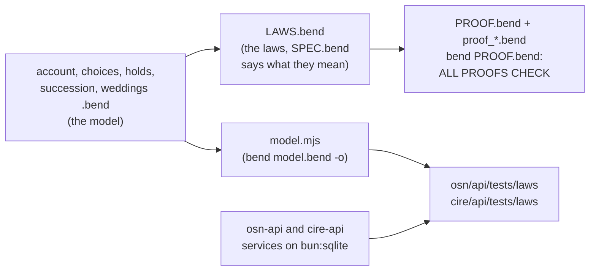

# Account deletion laws

The rules of [[account-deletion]] written as a small model in [Bend](https://bend-lang.org/) 2, a language whose type checker checks proofs, with eighteen laws proved about the model, and tests that run the same events through the model and through osn-api's and cire-api's code and fail when the two disagree. It all lives in [`tools/deletion-laws/`](../../tools/deletion-laws/).

> [!important] What a proof shows here
> A proof shows a law holds in **the model**, over every sequence of events, of any length. It says nothing about the TypeScript by itself. The agreement tests are what tie the model to the code, and they check only the cases they run. A law is as true of the code as the model is faithful to it.

## How it fits together



| File | Holds |
|---|---|
| `account.bend` | One account's deletion: request, cancel, fan-out pass, hard-delete pass |
| `choices.bend` | `DELETE /account`'s verdict on the open actions and the answers |
| `holds.bend` | One handle's hold through the soft delete, a cancel and the hard delete |
| `succession.bend` | Who an organisation passes to at its owner's hard delete |
| `weddings.bend` | One cire wedding's seats, its deletion preview, and an account's erasure |
| `model.bend` | Imports the five; what `model.mjs` is built from |
| `SPEC.bend`, `LAWS.bend` | What each law means, and the laws. A law changes only by the owner's decision |
| `kit.bend`, `proof_*.bend`, `PROOF.bend` | The proofs |
| `model.mjs`, `model.d.mts` | The compiled model, committed, and its types |
| `bend.env`, `bend.sh` | The pinned Bend release, and the script every run goes through |

Each event in the model is one whole service call. Times are unix seconds; a job's id is the account's count of requests, standing for the random `job_id` the code gives each job.

## The laws

| Law | Says | Kept in the code by | Agreement test |
|---|---|---|---|
| `never_before_window` | An account is never erased before its seven-day window ends | [`account-erasure.ts`](../../osn/api/src/services/account-erasure.ts) `requestErasure` (due = now + 7 days), the hard delete's read (`lte(hardDeleteAt, now)`) and claim (`claimPurge`) | `deletion-lifecycle.test.ts` "erases on the window's last second and not the second before" |
| `every_app_finished` | An account is erased only once every app confirmed its erasure or was skipped as one the tier does not run; a failing app is tried each pass and holds the erasure | `allAppsDone()` in the hard delete's read, its claim and its job delete; `markAppDone` writes a mark only while pending; `finishApp` leaves an unconfigured or failing app pending | "holds the erasure while an app fails, and erases once it answers" |
| `no_restore_after_an_app_is_reached` | Once any app has been sent the erasure, the account can never be restored | `cancelErasure` refuses once `purge_started_at` is set; `runFanOut` claims the job before it calls any app | "restores the second before the window ends, and not after a pass has claimed the job" |
| `withdrawn_never_reapplied` | After a cancel, no later state holds the cancelled job | A fresh `job_id` per request; the cancel deletes only the job it read; the sweeps read the job row that stands | every lifecycle trace checks a new model job is a `job_id` the code never used |
| `restore_only_inside_window` | Any restore is a cancel naming the pending job, unclaimed, before its window ends | `cancelErasure`'s early check and its delete's `WHERE` | the lifecycle traces |
| `stale_cancel_restores_nothing` | A cancel that read another job restores nothing | The cancel's delete names the `job_id` it read | Not driven: a stale read is a race inside one call. `osn/api/tests/services/account-erasure.test.ts` "a cancel that read a job since cancelled and asked for again in the same second leaves the new one" covers it |
| `scheduled_only_when_answered` | A deletion is scheduled only by a request that chose "Delete everything" or answered every open action | [`routes/account-erasure.ts`](../../osn/api/src/routes/account-erasure.ts) `DELETE /account` refuses before `requestErasure` | `deletion-request.test.ts`: every case checks a job exists exactly when the verdict is `Ok` |
| `accepted_means_answered` | The route accepts a request only with "Delete everything" or an answer for each action that needs one | `checkErasureChoices` | `deletion-request.test.ts` |
| `accepted_answers_are_offered` | An accepted request's answers each name a choice their action offers, and a named successor is a member from another account | `checkErasureChoices` | `deletion-request.test.ts` |
| `held_handle_has_no_owner` | A handle under a live hold has no owner: no account claims it while the deletion is pending or before the hold's release | [`lib/handle-hold.ts`](../../osn/api/src/lib/handle-hold.ts) `heldHandleRow` in every check that creates or offers a handle; the soft delete writes the hold with the redaction; a cancel deletes it | "refuses the handle to another account while held and for thirty days after the erasure", "gives a restored account its handle back and its hold up" |
| `hold_outlasts_erasure_by_thirty_days` | After the hard delete, a held **profile** handle stays unclaimed for thirty days | The hard delete sets `release_at` 30 days on | same |
| `heir_is_another_accounts_member` | An organisation passes only to a member from another account | [`organisation-succession.ts`](../../osn/api/src/services/organisation-succession.ts) `successorRow`; `successorOf` | `deletion-succession.test.ts` |
| `named_heir_honoured` | The successor the person named takes it while still a member from another account | `successorOf` | same |
| `delete_answer_deletes` | A delete answer deletes the organisation | The hard delete's `deletes` list | same |
| `passes_when_it_can` | With no delete answer, an organisation passes whenever a member from another account remains | The transfer's `successorOf … IS NOT NULL` | same |
| `no_live_wedding_without_owner` | No live cire wedding is ever left without an owner | [`cire/api/src/services/account-erasure.ts`](../../cire/api/src/services/account-erasure.ts) `eraseOwnedWedding` deletes it in the same batch when no other owner remains; [`hosts.ts`](../../cire/api/src/services/hosts.ts) `remove` and `setRole` refuse the last owner; [`wedding-lifecycle.ts`](../../cire/api/src/services/wedding-lifecycle.ts) `restore` needs an owner seat | `deletion-weddings.test.ts` |
| `erasure_never_promotes` | An erasure never makes anyone an owner: a wedding never passes to an editor | The erasure only deletes the account's seats | same |
| `sole_owner_blocks_deletion` | While the account holds every owner seat of a live wedding, the deletion is accepted only with an answer for it, or "Delete everything" | cire's preview lists such a wedding with one choice, `delete`, and no default; `checkErasureChoices` leaves it open until answered | same (the preview) and `deletion-request.test.ts` (the verdict) |

The model states two rules in a form of its own, and the agreement tests check they agree with the code on every state they reach: a cire host change is refused when it would leave no owner seat (the code counts owner seats), and a cancel names the job it read (the code reads the job itself).

The model makes one assumption the code does not state: one clock that never goes back. Each osn-api call reads `Date.now()` for itself.

## What the proofs and the tests do not show

- **Which checker said so.** `bend PROOF.bend` prints `ALL PROOFS CHECK` from Bend's own checker (`bend2/bend.ts` in Bend's repository), which has no proof of its own. `bend PROOF.bend --verdict` rechecks with a kernel that has a proof in Lean; it needs Lean v4.34.0 and is not run yet (englishstreetventures/osn#2555).
- **The compiler.** `model.mjs` comes from Bend's compiler, which Bend's README calls "99% AI-written and not yet fully audited". The agreement tests run the compiled module, so a compiler bug that changes a rule shows up there, not in the proofs.
- **Races inside one call.** Each event is atomic in the model. What happens between one call's read and its batch is left to the service tests: a profile made between the soft delete's read and its batch is redacted but not held, as `requestErasure` says.
- **D1.** The tests run on bun:sqlite, which runs a batch one statement at a time; D1's batch is atomic. `osn/api/tests/d1/` covers the D1 behaviour.
- **What is not modelled.** Email; ARC and step-up; the route's handle confirmation, live-session check and step-up; pepper rotation ([[account-deletion#Handle holds]]); the `deleted_` handle prefix; an organisation's own handle, which the hard delete frees at once when it deletes the organisation; the decline of an inherited organisation; Pulse's and Zap's own erasure rules; cire's three-weddings-a-call cap and the 100-action preview cap; the legacy `host` seat role; a wedding restore's seven-day window; the gift-payout holds on a deleted wedding's purge.
- **Cases not run.** The agreement tests run named boundary cases and fixed-seed traces (40 account traces, 60 requests, 40 organisations, 60 wedding traces). A disagreement on a case none of them reaches goes unseen.

## Running it

Install the pinned Bend once (it checks the release's SHA-256 against `bend.env`, and installs into `~/.bend`):

```bash
bash tools/deletion-laws/bend.sh install
bun run --cwd tools/deletion-laws prove   # bend PROOF.bend: ALL PROOFS CHECK
bun run --cwd tools/deletion-laws build   # rebuild model.mjs after a .bend change
bun run --cwd tools/deletion-laws check   # prove, and fail unless model.mjs is what model.bend builds
bun run --cwd osn/api test:repo           # the osn-api agreement tests
bun run --cwd cire/api test:repo          # the cire-api agreement test
```

Every run goes through `bend.sh`, which sets `BEND_NO_TELEMETRY=1`: without it, Bend asks bend-lang.com for the latest version once a day. It refuses any version but the one `bend.env` pins.

- **On commit**, lefthook's `bend-proofs` step runs when a `.bend` file is staged: it proves the laws and rebuilds `model.mjs`, and fails, asking for it to be staged, when the rebuild changed it. With no Bend, or another version, it prints one line and passes.
- **In CI**, the `bend-proofs` job installs the pinned release (SHA-256 checked, cached by version), and runs `bend.sh check`. The agreement tests run in Build & Test and in the cire-api job, as each package's `test:repo` task, which turbo reruns when `model.mjs` or its types change ([[testing-patterns#Tests that read files outside their package]]).

## Changing it

- **The code changes.** If an agreement test fails, the model no longer describes the code: change the model and re-prove, or the code was wrong. If a law then fails to prove, the change broke a deletion rule.
- **A rule changes.** Change the model, rebuild `model.mjs`, re-prove; a law changes only by the owner's decision.
- **Writing Bend.** `AGENTS.md` §Standing rules has the owner's four rules. Run `bend guide` first: Bend 2 is not Bend 1, and what you know of Bend 1 is wrong here.
