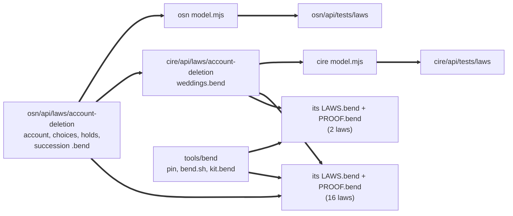

# Account deletion laws

The rules of [[account-deletion]] written as a small model in [Bend](https://bend-lang.org/) 2, a language whose type checker checks proofs, with eighteen laws proved about the model, and tests that run the same events through the model and through osn-api's and cire-api's code and fail when the two disagree. Each service keeps its laws beside its code: osn-api's in [`osn/api/laws/account-deletion/`](../../osn/api/laws/account-deletion/), cire-api's in [`cire/api/laws/account-deletion/`](../../cire/api/laws/account-deletion/); the Bend toolchain they share is in [`tools/bend/`](../../tools/bend/).

> [!important] What a proof shows here
> A proof shows a law holds in **the model**, over every sequence of events, of any length. It says nothing about the TypeScript by itself. The agreement tests are what tie the model to the code, and they check only the cases they run. A law is as true of the code as the model is faithful to it.

## How it fits together



Each topic folder is a Bend project root of its own:

| Where | File | Holds |
|---|---|---|
| `osn/api/laws/account-deletion/` | `account.bend` | One account's deletion: request, cancel, fan-out pass, hard-delete pass |
| | `choices.bend` | `DELETE /account`'s verdict on the open actions and the answers |
| | `holds.bend` | One handle's hold through the soft delete, a cancel and the hard delete |
| | `succession.bend` | Who an organisation passes to at its owner's hard delete |
| | `SPEC.bend`, `LAWS.bend` | What each law means, and 16 laws: the account's, the verdict's, the holds', succession's, and `sole_owner_blocks_deletion`, which spans both services and imports cire's `weddings.bend` |
| | `proof_*.bend`, `PROOF.bend` | The proofs; `proof_sole_owner.bend` proves the law that spans both services |
| | `model.bend`, `model.mjs`, `model.d.mts` | The four modules compiled for osn-api's agreement tests, committed, and their types |
| `cire/api/laws/account-deletion/` | `weddings.bend` | One cire wedding's seats, its deletion preview, and an account's erasure; it imports osn-api's `choices.bend` for the preview's action, the app contract cire answers |
| | `SPEC.bend`, `LAWS.bend` | What each law means, and 2 laws: a live wedding's owner, and an erasure that promotes no one |
| | `proof_weddings.bend`, `PROOF.bend` | The proofs |
| | `model.bend`, `model.mjs`, `model.d.mts` | `weddings.bend` compiled for cire-api's agreement test (with the `choices.bend` defs it uses, exported under their path), committed, and their types |
| `tools/bend/` | `bend.env`, `install-bend.sh`, `bend.sh`, `kit.bend` | The pinned Bend release, its installer, the script every run goes through, and the proof kit every set imports |

**A new law set** goes in `<workspace>/laws/<topic>/` beside the code it is about, with its own `LAWS.bend`, and a `PROOF.bend` that imports it; add `model.bend` (and commit the `model.mjs` it builds) when agreement tests need the model. A law that spans services lives with the service that runs the flow and imports the other's model by relative path (`import ../../../../cire/api/laws/…`). `bend.sh` finds a set by that path once it is in the index (`git add` it), so nothing lists the sets by hand, and the deploy map, the changeset rule and the `Bend proofs` CI job all read the same two-level path, `<top>/<package>/laws/<topic>/`. CI rechecks every set it finds with the BendTT kernel, so a new set must pass `--verdict` too: every def in it within what Bend can hand the kernel. Name its folders with letters, digits, `.`, `_` and `-` only; `bend.sh` refuses any other name. Nothing a build reads may name a set: oxlint refuses an import of one from any `src/`, and `scripts/tests/law-set-references.test.ts` refuses one anywhere else a product build reads, `.astro` files, globs and config outside `src/` included. A set ships in nothing.

Each event in the model is one whole service call. Times are unix seconds; a job's id is the account's count of requests, standing for the random `job_id` the code gives each job.

## The laws

| Law | Says | Kept in the code by | Agreement test |
|---|---|---|---|
| `never_before_window` | An account is never erased before its seven-day window ends | [`account-erasure.ts`](../../osn/api/src/services/account-erasure.ts) `requestErasure` (due = now + 7 days), the hard delete's read (`lte(hardDeleteAt, now)`) and claim (`claimPurge`) | `deletion-lifecycle.test.ts` "erases on the window's last second and not the second before" |
| `every_app_finished` | An account is erased only once every app confirmed its erasure or was skipped as one the tier does not run; a failing app is tried each pass and holds the erasure | `allAppsDone()` in the hard delete's read, its claim and its job delete; `markAppDone` writes a mark only while pending; `finishApp` leaves an unconfigured or failing app pending | "holds the erasure while an app fails, and erases once it answers" |
| `no_restore_after_an_app_is_reached` | Once any app has been sent the erasure, the account can never be restored | `cancelErasure` refuses once `purge_started_at` is set; `runFanOut` claims the job before it calls any app | "restores the second before the window ends, and not after a pass has claimed the job" |
| `withdrawn_never_reapplied` | After a cancel, no later state holds the cancelled job | A fresh `job_id` per request; the cancel deletes only the job it read; the sweeps read the job row that stands | every lifecycle trace checks a new model job is a `job_id` the code never used |
| `restore_only_inside_window` | Any restore is a cancel naming the pending job, unclaimed, before its window ends | `cancelErasure`'s early check and its delete's `WHERE` | the lifecycle traces |
| `stale_cancel_restores_nothing` | A cancel that read another job restores nothing | The cancel's delete names the `job_id` it read | Not driven: a stale read is a race inside one call. `osn/api/tests/services/account-erasure.test.ts` "a cancel that read a job since cancelled and asked for again in the same second leaves the new one" covers it |
| `scheduled_only_when_answered` | A deletion is scheduled only by a request that chose "Delete everything" or answered every open action | [`routes/account-erasure.ts`](../../osn/api/src/routes/account-erasure.ts) `DELETE /account` refuses before `requestErasure` | `deletion-request.test.ts`: every case checks a job exists exactly when the verdict is `Ok` |
| `accepted_means_answered` | The route accepts a request only with "Delete everything" or an answer for each action that needs one | `checkErasureChoices` | `deletion-request.test.ts` |
| `accepted_answers_are_offered` | An accepted request's answers each name a choice their action offers, and a named successor is a member from another account | `checkErasureChoices` | `deletion-request.test.ts` |
| `held_handle_has_no_owner` | A handle under a live hold has no owner: no account claims it while the deletion is pending or before the hold's release | [`lib/handle-hold.ts`](../../osn/api/src/lib/handle-hold.ts) `heldHandleRow` in every check that creates or offers a handle; the soft delete writes the hold with the redaction; a cancel deletes it | "refuses the handle to another account while held and for thirty days after the erasure", "gives a restored account its handle back and its hold up" |
| `hold_outlasts_erasure_by_thirty_days` | After the hard delete, a held **profile** handle stays unclaimed for thirty days | The hard delete sets `release_at` 30 days on | same |
| `heir_is_another_accounts_member` | An organisation passes only to a member from another account | [`organisation-succession.ts`](../../osn/api/src/services/organisation-succession.ts) `successorRow`; `successorOf` | `deletion-succession.test.ts` |
| `named_heir_honoured` | The successor the person named takes it while still a member from another account | `successorOf` | same |
| `delete_answer_deletes` | A delete answer deletes the organisation | The hard delete's `deletes` list | same |
| `passes_when_it_can` | With no delete answer, an organisation passes whenever a member from another account remains | The transfer's `successorOf … IS NOT NULL` | same |
| `no_live_wedding_without_owner` | No live cire wedding is ever left without an owner | [`cire/api/src/services/account-erasure.ts`](../../cire/api/src/services/account-erasure.ts) `eraseOwnedWedding` deletes it in the same batch when no other owner remains; [`hosts.ts`](../../cire/api/src/services/hosts.ts) `remove` and `setRole` refuse the last owner, and `authorize`, the organiser routes' gate, refuses any host change on a deleted wedding; [`wedding-lifecycle.ts`](../../cire/api/src/services/wedding-lifecycle.ts) `restore` needs an owner seat | `deletion-weddings.test.ts` |
| `erasure_never_promotes` | An erasure never makes anyone an owner: a wedding never passes to an editor | The erasure only deletes the account's seats | same |
| `sole_owner_blocks_deletion` | While the account holds every owner seat of a live wedding, the deletion is accepted only with an answer for it, or "Delete everything" | cire's preview lists such a wedding with one choice, `delete`, and no default; `checkErasureChoices` leaves it open until answered | same (the preview) and `deletion-request.test.ts` (the verdict) |

The model states two rules in a form of its own, and the agreement tests check they agree with the code on every state they reach: a cire host change is refused when it would leave no owner seat (the code counts owner seats), and a cancel names the job it read (the code reads the job itself).

The model makes one assumption the code does not state: one clock that never goes back. Each osn-api call reads `Date.now()` for itself.

## What the proofs and the tests do not show

- **Which checker said so.** `bend PROOF.bend` prints `ALL PROOFS CHECK` from Bend's own checker (`bend2/bend.ts` in Bend's repository), which has no proof of its own. CI's `Bend proofs` job then runs `bend PROOF.bend --verdict` in every set, which rechecks it with BendTT, a small kernel that has a proof in Lean, and passes only when Bend's checker and the kernel both accept every def outside Base. What the kernel proves holds for the translation Bend hands it, and that translation has no proof of its own.
- **The compiler.** `model.mjs` comes from Bend's compiler, which Bend's README calls "99% AI-written and not yet fully audited". The agreement tests run the compiled module, so a compiler bug that changes a rule shows up there, not in the proofs.
- **Races inside one call.** Each event is atomic in the model. What happens between one call's read and its batch is left to the service tests: a profile made between the soft delete's read and its batch is redacted but not held, as `requestErasure` says.
- **D1.** The tests run on bun:sqlite, which runs a batch one statement at a time; D1's batch is atomic. `osn/api/tests/d1/` covers the D1 behaviour.
- **What is not modelled.** Email; ARC and step-up; the route's handle confirmation, live-session check and step-up; pepper rotation ([[account-deletion#Handle holds]]); the `deleted_` handle prefix; an organisation's own handle, which the hard delete frees at once when it deletes the organisation; the decline of an inherited organisation; Pulse's and Zap's own erasure rules; cire's three-weddings-a-call cap and the 100-action preview cap; the legacy `host` seat role; a wedding restore's seven-day window; the gift-payout holds on a deleted wedding's purge.
- **Cases not run.** The agreement tests run named boundary cases and fixed-seed traces (40 account traces, 60 requests, 40 organisations, 60 wedding traces). A disagreement on a case none of them reaches goes unseen.

## Running it

Install the pinned Bend once (it checks the release's SHA-256 against `bend.env`, and installs into `~/.bend`; leave `~/.bend/bin` off the PATH, so nothing runs it bare):

```bash
bash tools/bend/bend.sh install
bun run --cwd tools/bend sets      # every law set
bun run --cwd tools/bend prove     # bend PROOF.bend in every set: ALL PROOFS CHECK each; then --verdict, with Lean 4.34.0 here
bun run --cwd tools/bend build     # rebuild every set's model.mjs after a .bend change
bun run --cwd tools/bend check     # prove every set, and fail unless each model.mjs is what its model.bend builds
bun run --cwd tools/bend verdict   # bend PROOF.bend --verdict in every set; fails with no Lean 4.34.0 or $BENDTT here
bash tools/bend/bend.sh prove osn/api/laws/account-deletion   # one set
bunx --bun vitest run --project laws   # in osn/api: the osn-api agreement tests
bun test --preload ./tests/test-helpers/metrics-harness.ts tests/laws/   # in cire/api: cire-api's agreement tests, this set's and the gift-payout set's
```

Run Bend only through `bend.sh` (`bash tools/bend/bend.sh guide` for the guide), never bare and never `bend update`. It sets `BEND_NO_TELEMETRY=1`, without which Bend asks bend-lang.com for its latest version once a day, and it runs a `bend` only when the binary's SHA-256 is the one `bend.env` pins for the platform. It reads `bend.env` and `lean.env` as data, `KEY=value` lines, and never runs them, as the CI job does. A proof passes only when `bend PROOF.bend` exits 0 and prints `ALL PROOFS CHECK`; a verdict only when `bend PROOF.bend --verdict` exits 0 and prints `ALL PROOFS CHECK` and nothing else, since a pass from Bend's checker alone adds a line telling you to use `--verdict`.

- **The verdict here.** `prove` and `check` run `--verdict` after each set's plain run when this machine has the kernel: `$BENDTT` naming a built one, or Lean 4.34.0 (the version `lean.env` pins and Bend asks for) where Bend looks for it, elan's toolchain for that version or `lean` on the PATH. The first such run builds the kernel into `~/.bend/bendtt/`, which takes minutes; a kernel built here is not checked against a pin. With no such Lean, or when the kernel does not build or run here, they say once that they skipped it and pass: CI is where it must run.
- **On commit**, lefthook's `bend-proofs` step runs when a `.bend` file is staged: it proves every set and rebuilds each `model.mjs`, and fails, asking for it to be staged, when a rebuild changed one. With no pinned Bend here, it prints one line and passes. It never runs the verdict.
- **`bend.sh` itself** is tested by `scripts/tests/bend-sh.cli.test.ts` (which sets it finds, none found, a set name it refuses, a set whose proof imports no laws, a stale `model.mjs`, a failed proof, a failure printed with exit 0, a `bend.env` or `lean.env` line that would run, another version or build, no Bend, the hook's outcomes; the verdict's: no kernel, another Lean, a rejection, a pass printed with anything else, a `$BENDTT` that is empty, missing or not the pinned build, the local skips; and the CI kernel's: restored, rebuilt, another hash, none), the pinned installs by `scripts/tests/install-bend.cli.test.ts` and `scripts/tests/install-lean.cli.test.ts`, and the job's step order by `scripts/tests/deploy-workflows.test.ts`.
- **In CI**, the `Bend proofs` job runs when a change touches a law set, `tools/bend/` or the workflow. It installs the pinned Bend (SHA-256 checked, cached by version), lists the sets and runs `bend.sh check`. Then it restores the BendTT kernel from the Actions cache, under a key made of the Bend, Lean and kernel pins; on a miss it downloads the Lean toolchain `lean.env` pins (about 580 MB, SHA-256 checked, never cached) and has Bend build the kernel. `bend.sh kernel` takes a restored or built kernel only with the SHA-256 `lean.env` pins as `BENDTT_SHA256_LINUX_X64`, the job saves a built one, and `bend.sh verdict` rechecks every set with it. The agreement tests run in each package's ordinary `test` (Build & Test and the cire-api job); they read only their own package's `model.mjs`, never a `.bend` file, so a proof-only change leaves them cached.
- **A bad cache entry.** A restored kernel that is not the pinned build fails the job, and is deleted from that run only; the entry stays under its key and fails each later run in its scope until it is deleted: `gh cache list --repo englishstreetventures/osn --key bendtt-`, then `gh cache delete <key> --repo englishstreetventures/osn`.
- **Deploys.** A change only inside law sets redeploys nothing, on dev or in a production release, and needs no changeset (`scripts/deploy-surfaces.ts` `ships`, which `scripts/release-plan.ts` also reads, and `scripts/changeset-required.sh`).

## Changing it

- **The code changes.** If an agreement test fails, the model and the code have parted: change the model and re-prove, or the code was wrong. If a law then fails to prove, the change broke a deletion rule.
- **A rule changes.** Change the model, rebuild every `model.mjs` (`bun run --cwd tools/bend build`: cire's compiles osn-api's `choices.bend` too), re-prove; a law changes only by the owner's decision.
- **The kernel refuses a set.** `SOME PROOFS FAIL` from `--verdict` after a plain pass means the kernel rejected a proof Bend's checker accepted, or a def is outside what Bend can hand the kernel (`BendTT: out of scope`). Either is a finding for the owner, never a reason to drop the verdict.
- **Moving Bend or Lean.** Change `bend.env` and `lean.env` together: Bend names the Lean it needs and refuses any other. The next CI run builds the kernel afresh and fails at `Provide the BendTT kernel`, printing the new kernel's SHA-256; pin it as `BENDTT_SHA256_LINUX_X64` in `lean.env` and push again.
- **Writing Bend.** `AGENTS.md` §Standing rules has the owner's four rules. Read the guide first (`bash tools/bend/bend.sh guide`): Bend 2 is not Bend 1, and what you know of Bend 1 is wrong here.
