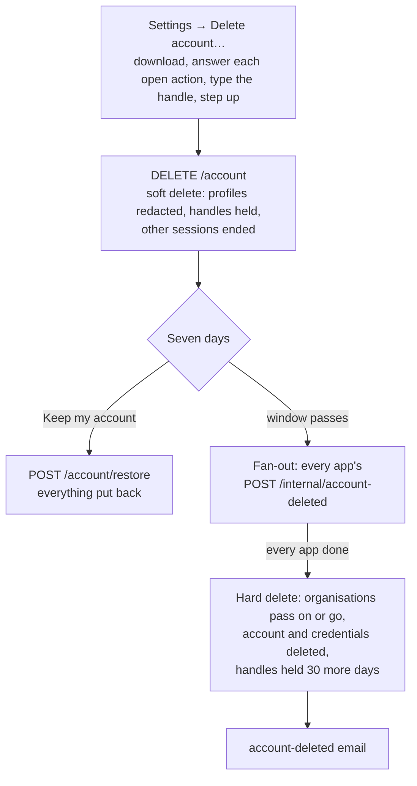

# Account deletion

How a person deletes their Musubi account, what happens in each app when they do, and how they leave one app while keeping the account. This page is the one description of the flow and of the contract every app implements; [[dsar]] holds the legal side (the rights, the runbook for a written request, cire's guest data) and [[retention]] the periods.

> [!important] Every app tells the person what is still open
> Before an account deletion is accepted, each app says what it still holds that needs the person's answer, and the person answers it or chooses "Delete everything". An app that cannot be asked blocks the deletion. Cire never lets a wedding pass to an editor or exist without an owner: while the person is the only owner of a live wedding, the deletion is refused until they add another owner, delete the wedding, or answer that it is deleted with them (owner, 2026-11-16).

## At a glance



| The person can | When | How |
|---|---|---|
| Download their data | Any time, and during the window | Settings → Account → "Download my data" (`GET /account/export`, an `account_export` step-up, one a day) or "Send me a link" by email; during the window, "Download my data" on the window screen, since the limited session cannot ask for the link ([[dsar#Art. 15 — Right of access]]) |
| Delete the account | Any time | Settings → Account → Danger zone → "Delete account…" ([[#The person's side]]) |
| Keep the account | Until the window ends, seven days on; the screen and the email offer it before the day it ends on | Sign in to Musubi by passkey or email, or start a sign-in from an app, then "Keep my account" ([[#The person's side]]) |
| Remove their data from one app and keep the account | Any time | Pulse's leave route; cire's "Remove my Cire data" ([[#Leaving one app]]) |

## The person's side

Musubi's Settings → Account ([[social]]) is where the person deletes the account:

- **Your data.** "Download my data" (an `account_export` step-up, then `GET /account/export`, saved as a file; one a day) and "Send me a link" (`POST /account/data-link`, [[#Emails]]).
- **"Delete account…" in Danger zone.** A flow: what is deleted and what stays, and the seven days; the download again; each open action from `GET /account/deletion-preview`, grouped by app, with its choices as the server describes them, its erase date and its link (a cire wedding's link opens its download page in Cire, which also offers to add another owner; Musubi builds no Cire address, and follows an app's link only when it is `https:`, or `http:` to this machine, which osn-api forwards from a local run alone); one "Delete everything" switch; the handle typed; an `account_delete` step-up; `DELETE /account`. An app that could not be checked blocks the flow and is named; each refusal (409 `open_actions`, `stale_choices`, `could_not_check`; 400 `invalid_choice`, `choices_with_delete_everything`, `handle_mismatch`; 403 `step_up_required`) returns the person to the step they can act on. On the 202 the page renews its token onto the pending audience at once.
- **The window.** While the deletion is pending, every sign-in to Musubi, and the device that asked, show one screen in place of the app: the day the window ends on ("We delete it on or shortly after <day>", in the reader's zone, with no clock time, then "Before that day, you can keep it"), "Keep my account" (an `account_restore` step-up, then `POST /account/restore`; the page renews onto the ordinary audience and the app comes back) and "Download my data". `@osn/client` keeps such a session rather than ending it on the first refused route ([[sessions#The pending-deletion session]]).

A person keeps the account by signing in to Musubi before the window ends — with a passkey, or with their email address (sign-in by handle finds nothing during the window) — and choosing "Keep my account".

### Signing in to an app during the window

A sign-in started from Pulse or cire lands on Musubi's `/authorize`, which shows the same screen under the app's card, and signs the person in to no app ([[oidc-provider#An account whose deletion is pending]], [[authorize-ui]]):

- Signed out, they sign in on the page first (passkey or email); signed in already, the screen shows at once.
- It names the app and says they are not signed in to it, then offers "Keep my account", "Download my data", "Back to <app>" and "Sign out" (after which the page offers sign-in, for another account).
- "Back to <app>" sends the app `access_denied` with the description a Cancel on the consent screen sends ("The user refused the request"), so the app learns nothing it would not learn from a Cancel. Closing the tab sends it nothing, as for any sign-in left unfinished.
- "Keep my account" (the same `account_restore` step-up and `POST /account/restore`) carries the same sign-in on: the page reads the request again and shows the consent screen, and Allow gives the app its code. The request lives 10 minutes from the app's redirect, a keep does not extend it, and one that has expired by then ends with "Your account is back, but this sign-in has expired" and a line to start again from the app.
- No code is issued and no consent is recorded while the deletion is pending. A silent request (`prompt=none`) gets the answer a browser with no session gets.

Tests: `osn/api/tests/routes/oidc.test.ts` ("GET /authorize for an account whose deletion is pending"), `musubi/social/tests/components/AuthorizePage.test.tsx` and `DeletionWindow.test.tsx`, `musubi/social/tests/components/AuthorizeDeletion.browser.test.tsx`; end to end, `tools/e2e/tests/flows/musubi-account-deletion.flow.ts` (from Pulse signed out, back to Pulse; from cire signed in, kept, into cire).

No "Remove my data" link sits in Musubi's Connected apps settings: Musubi keeps no address of an app's portal, and cire's portal origin reaches osn-api only inside one call's answer. A host removes their Cire data from cire's own portal, which sends them to Musubi's `/confirm/<request id>` page for the step-up and back ([[step-up#App step-up requests]]). Pulse has the leave route only.

## What happens, in order

`DELETE /account` ([`routes/account-erasure.ts`](../../osn/api/src/routes/account-erasure.ts), [`services/account-erasure.ts`](../../osn/api/src/services/account-erasure.ts)) needs the profile's handle typed (`confirm_handle`), a live session, every app able to answer a fresh preview, an answer for each open action that needs one, organisation or app, or `delete_everything: true` instead (below), and a step-up token for `account_delete`, read last, so a refused request spends no token. Three stages:

1. **Soft delete** (`requestErasure`), one read and one batch, answering 202 with `scheduled_for`. In order:
   - writes the `deletion_jobs` row, with a random `job_id`, its restore record (`restore`: each profile's handle, display name and avatar as they stood, and the ids of the open app enrolments), the person's answers to the open actions (`choices`), `delete_everything`, and every app's mark (`pulse_done_at`, `zap_done_at`, `cire_done_at`) NULL: the fan-out reaches every app, whatever the account's enrolments. The restore record comes from the rows this statement reads, so an enrolment that lands before it is closed with the rest;
   - redacts every profile: handle `deleted_<id>`, or `deleted_<id>_<8 hex>` when another profile already has `deleted_<id>`; display name and avatar cleared;
   - holds each profile's handle in `handle_holds`, as a keyed hash, with one insert whatever the profile count ([[#Handle holds]]);
   - deletes every session and rotation record of the account but those of the requesting device's family;
   - writes an `account_deletion_scheduled` security event;
   - closes every open app enrolment;
   - sets `accounts.deleted_at`, last: a job and a tombstone together mean the whole batch ran.

   A deletion counts as pending only when the job and the tombstone both stand. On D1 the batch is atomic. On bun:sqlite, which runs a batch one statement at a time, a batch that fails part way answers the failure, and so does every retry, since the job's key refuses a second job. Test: `osn/api/tests/services/account-erasure.test.ts` ("a soft delete that fails at its redaction answers the failure, and so does a retry").

   An app join (`/internal/app-enrollment/join`, `joinApp`) for an account whose deletion is pending writes no enrolment and answers `enrolled: false`: its insert reads `accounts.deleted_at` in the same statement. It changes nothing on the job, which reaches every app anyway. Tests: `osn/api/tests/services/account-erasure.test.ts` ("joinApp writes nothing for an account whose deletion is pending", "a join refused during the window leaves the job as it is").

   Passkeys, recovery codes and TOTP stay until the hard delete, so a person who can still sign in can cancel. The soft delete ends OSN sessions, and, in the background, the person's Pulse web sessions (`POST /internal/account-sessions/revoke` on pulse-api, scope `account:sessions-revoke`, best effort: a refusal is counted as `osn.account.deletion.app_sessions_ended` and logged, and Pulse's erasure at the end of the window deletes any that survived). Cire's organiser sessions are not OSN sessions: the route then asks cire-api to end them through the same revoke sign-out-everywhere uses (`POST <CIRE_API_URL>/internal/revoke-organiser-sessions`, one call per profile of the account that has signed in to cire, trigger `account_deletion` on `osn.auth.cire_session.revocations`, [[sessions#Sign out everywhere else reaches cire]]), best effort and only where both Workers hold `CIRE_INTERNAL_REVOKE_SECRET`; cire's erasure at the end of the window deletes any that survived. Nothing else changes in cire during the window, so a cancel loses nothing there. A new sign-in to any relying party issues no code: `/authorize` parks the request for Musubi's page, which shows the window screen, before it records a consent or mints a code ([[#Signing in to an app during the window]]).

   Two deletes at once answer one 202 scheduled and one 202 `already_pending`, never a 500. A repeat during the window answers `already_pending` with the date, before the handle check, since the handle is redacted by then; it needs no step-up. Tests: `osn/api/tests/routes/account-erasure.test.ts` ("two deletions at once…", "DELETE /account returns 202 with both scheduling fields, and is idempotent") and `osn/api/tests/d1/account-hard-delete.test.ts` ("two deletions of one account at once on D1"); credentials kept and the restore record written: `osn/api/tests/services/account-erasure.test.ts` ("soft-deletes the account, redacts identity, keeps credentials and the cancel session", "holds every profile's handle and records each in the restore record").

2. **The window**, seven days. Any sign-in of the account, from any device, mints a **pending-deletion session**: its access tokens carry the audience `osn-pending-deletion` ([[sessions#The pending-deletion session]]). The device that asked keeps its session, which mints the same audience from its next refresh. Such a token reaches only:
   - `GET /account/deletion-status`;
   - `GET /account/export`, with an `account_export` step-up. Its profiles section shows each handle, display name and avatar as the restore record holds them;
   - `POST /account/restore`, with an `account_restore` step-up ([[step-up#Purpose binding]]);
   - `DELETE /account`, for the `already_pending` answer only;
   - `GET /totp/status`, which the step-up sheet reads before it offers the authenticator;
   - the step-up routes, for those two purposes only.

   Every other route, and Pulse, Zap and cire, refuse it, since they pin `osn-access`. A passkey, a recovery code, or email or TOTP recovery each lead here. Recovery ends in a passkey enrolment, which a restricted recovery session of such an account may make, and the session's next refresh is pending-deletion ([[account-recovery-factors#Recovery of an account whose deletion is pending]]). So **mailbox access alone is enough to cancel an erasure**: email recovery, enrol a passkey, step up with it or with an emailed link, cancel. Every notice about the account goes to that mailbox. Sign-in by the handle the person had does not find the account during the window, since every handle is redacted; sign-in by email, or with a discoverable passkey, does. Tests: `osn/api/tests/routes/pending-deletion-session.test.ts`.

   **Cancel** (`POST /account/restore`, `cancelErasure`) needs any live session of the account and an `account_restore` step-up token, from the body's `step_up_token` or the `x-step-up-token` header. In one batch it deletes the job, clears `accounts.deleted_at`, records an `account_deletion_cancelled` event, and, from the restore record: puts back each profile's handle, display name and avatar; reopens the enrolments the deletion closed, where the account has no other open enrolment in that app; and releases the account's handle holds. A profile whose handle someone else holds by then, as a profile or an organisation, keeps its redacted handle; either redacted form is put back. A job written before the restore record existed cancels with none of the putting back. Tests: `osn/api/tests/services/account-erasure.test.ts` ("puts back each profile's handle, display name and avatar…", "a handle taken by a profile or an organisation since stays redacted…", "a job with no restore record cancels, and leaves the profiles redacted and the enrolments closed") and `osn/api/tests/routes/account-erasure.test.ts` ("POST /account/restore asks for an account_restore step-up").

3. **Hard delete** (`hardDeleteAccount`), once the window has passed and the fan-out has finished with every app. One batch, with no read before it:
   - each organisation a profile of the account owns passes on or goes ([[#Organisations the person owns]]);
   - deleted: connections, blocks, the account's memberships, OIDC consents and authorization codes, the profiles, sessions, rotation records, passkeys, recovery codes, TOTP, every `app_enrollments` row of the account, open or closed, the `deletion_jobs` row, and the `accounts` row;
   - OIDC clients the account registered are disabled and unlinked;
   - the handle holds lose their account id and are released 30 days on;
   - kept, as security records (Art. 6(1)(c)+(f), [[data-map]]): `security_events` (12 months) and `email_changes` (90 days), with the account id they name.

   Outside osn-api's database, before the hard delete, the fan-out reaches every app ([[#The app contract]]):
   - Pulse deletes the person's RSVPs, close friends, messages sent, Pulse profile, onboarding, series and web sessions; each upcoming event they host is cancelled and kept 14 days for its guests, or deleted at once, as answered; finished and cancelled events are deleted.
   - Zap removes their memberships, deletes a chat left with no one with its messages, replaces their sender id with a deletion sentinel on what stays and wipes the body of a plain-text message they wrote; an end-to-end message keeps its ciphertext, which Zap cannot read and the other members still hold.
   - cire removes their seats; deletes a wedding that leaves with no owner, in the same batch; deletes their organiser sessions, guest account links, Stripe OAuth states and budget rows; and clears every column that names them ([[dsar#Cire (wedding-invite) data]]). It answers, as one kept item, the weddings it deleted that cire's purge still holds ([[#What is kept after the deletion]]).

Nothing of the account outlives the hard delete in osn-api's database but its `security_events` and `email_changes` rows, kept for their windows, and its handle holds: keyed hashes with no account id, which the retention sweep deletes 30 days later ([[retention]]).

### The end of the window

Two sweeps run on osn-api's cron, `0 */6 * * *` (every six hours, UTC; [`musubi/infra/src/declaration.ts`](../../musubi/infra/src/declaration.ts)), and on the Bun dev server every six hours (`OSN_DELETION_SWEEPER_INTERVAL_MS`, [`osn/api/src/local.ts`](../../osn/api/src/local.ts)):

1. **The fan-out** (`runFanOutRetrySweep`) reads the jobs whose window has passed and that some app has not finished, claims each, and calls every pending app's `POST /internal/account-deleted` at once ([[#The app contract]]). Each app that answers is marked done and its answer stored.
2. **The hard delete** (`runHardDeleteSweep`) reads the jobs whose window has passed and whose every app is done, and erases each account in one batch (stage 3 above), then sends the emails ([[#Emails]]).

On the Bun dev server the two run in order in one pass ([`osn/api/src/services/sweeps.ts`](../../osn/api/src/services/sweeps.ts)), so an account whose apps all answer is erased on the first pass after its date. On a deployed tier the cron starts both at the same moment ([`osn/api/src/index.ts`](../../osn/api/src/index.ts), `scheduled`), and the hard delete reads the job before the fan-out has marked it done. So the first run after the date reaches the apps, and the account is erased on the next run: 6 to 12 hours after the window ends (englishstreetventures/osn#2386). So the window screen ([`DeletionWindow.tsx`](../../musubi/social/src/components/DeletionWindow.tsx)) and the scheduled email name a day, never a clock time: the account is deleted "on or shortly after" the day `hard_delete_at` falls on — the reader's own zone on the screen, UTC, named, in the email — and the keep is offered before that day. The account is never erased before that instant, so never before the day shown; a keep is refused from the instant on (`cancelErasure`), which can fall early in the day, so the offer ends as the day starts. Musubi's privacy notice ([`PrivacyPage.tsx`](../../musubi/social/src/pages/PrivacyPage.tsx)) says "usually within a day of the date we show you". An app that does not answer holds the hard delete until it does ([[#Fan-out reliability]]).

### Fan-out reliability

- **`deletion_jobs` table** — one row per soft-delete, with columns `account_id`, `soft_deleted_at`, `hard_delete_at` (= `soft_deleted_at + 7 d`), `pulse_done_at`, `zap_done_at`, `cire_done_at` (one mark per app: a positive time once the fan-out is done with it, NULL while pending), `reason`, `cancel_session_id`, `purge_started_at`, `restore` (what a cancel puts back), `choices` (the person's answers, organisation and app, JSON keyed by action id; NULL with `delete_everything`, which two triggers enforce on insert and update), `delete_everything`, `app_outcomes` (what each app reported, JSON keyed by app: `{ "status": "done", "kept": [...] }` or `{ "status": "skipped" }`), `fanout_failed_at`, `hard_delete_failed_at` ([[#Hard-delete sweep isolation]]) and `job_id` (a random id naming the job; NULL on a row written before the column). A row written before every account went to every app may hold `-1` ("not enrolled") in a mark: that reads as pending, so such a job is sent to that app too; so does the NULL `cire_done_at` of a row written before that column.
- **A hard delete never outruns an app's purge.** The hard delete's read, its claim, and its delete of the job inside the batch each need every mark to read done (positive) at the moment they run; otherwise the claim refuses, or the job stays, the `accounts` delete fails on the job's foreign key and D1 rolls the whole batch back. The fan-out claims a job before it calls any app, so a job with an app still pending usually reaches the hard delete claimed already, and then only the read and the batch's job delete hold it. Only the fan-out writes a mark, from pending to a time, and only while the mark reads pending: a mark another pass wrote first, and that app's outcome, stand, and the later pass counts nothing. `/internal/app-enrollment/join` and `/leave` write only for the calling service's own app (`pulse-api` for `pulse`, `zap-api` for `zap`, from the ARC token's signed issuer). Tests: `osn/api/tests/d1/account-hard-delete.test.ts` ("the hard delete waits for every app, on D1", a claimed job included), `osn/api/tests/services/deletion-fanout.test.ts` and `osn/api/tests/routes/internal-account.test.ts` ("internal app enrolment writes").
- **A cancel never restores an account a purge has begun on.** `POST /account/restore` cancels only inside the grace window. Before a sweep sends its first bridge call, or the hard delete runs, it stamps `purge_started_at`, and only while the job row still exists. The cancel deletes the job it read (the one with the `job_id` it read; for a row with none, the one with its `soft_deleted_at` and no `job_id`) only while `purge_started_at` is NULL and the window is open, in the same statement, then restores the account and writes its audit event only once no job stands. So a cancel and a purge that meet at the end of the window settle one way: the cancel lands first and the sweep finds no job to purge, or the sweep claims first and the cancel answers `{ cancelled: false }`, as one past the window does. The `account_deletion_cancelled` event's id is derived from the account and the job's `job_id`, so a job's cancellation is recorded once: of two cancels of the same job, the second answers `{ cancelled: false }` and writes nothing, and a cancel that read a job the user has since cancelled and asked for again, even in the same second, leaves the new job standing. Tests: `osn/api/tests/services/account-erasure.test.ts` (both orders, fan-out and hard delete; two cancels of one job; a cancel of a replaced job, also in the same second) and `osn/api/tests/d1/conditional-writes.test.ts` (both orders of the fan-out, and two cancels of one job, on D1).
- **Idempotent per app** — each app's `/internal/account-deleted` accepts the same `accountId` repeatedly: a repeat, or a second call that overlaps the first, writes nothing more and answers what the first call kept (Pulse reads it from the kept events; Zap from `zap_account_purges`, whose count the erasure's own batch writes; cire from the weddings as they stand, so a repeat after osn-api lost cire's done answer reports nothing kept). The sweeper retries an unfinished app every cycle until its mark is done.
- **Parallel fan-out, one stuck job never blocks the rest** — each pass reads its jobs once, with what every app is sent; a job's pending apps are called at once, each with a 10 s timeout; jobs four at a time. A job's first pass claims it and, in the same statement, marks each app the tier does not run as skipped. An app that does not answer, answers an error, or answers outside the contract leaves its mark pending and stamps the job's `fanout_failed_at`, and so does a job whose fan-out fails for any other reason, such as stored answers that do not parse; each pass reads never-failed jobs first, then the least recently failed, each group by `hard_delete_at`. A pass reaches at most `OSN_DELETION_FANOUT_MAX_JOBS` jobs (unset: 4, inside Workers Free's 50 D1 queries a cron run; production: 50), and the hard delete erases at most as many accounts ([[free-tier-limits]]). Tests: `osn/api/tests/services/deletion-fanout.test.ts`.
- **ARC rate limits** — no ARC route carries one. osn-api's calls are bounded by the per-run job cap and, for previews, by the per-IP limiter on `GET /account/deletion-preview` and `DELETE /account`.

### Hard-delete sweep isolation

Each pass reads at most `OSN_DELETION_FANOUT_MAX_JOBS` due jobs (unset: 4; production: 50), the fan-out's own cap: those that have never failed first (`hard_delete_failed_at` NULL), then the least recently failed, each group by `hard_delete_at`. One account's failure, a defect included, is caught: it is logged as `account.deletion hard delete failed` with the error's tag and no ids, counted as `osn.account.deletion.completed` with `result` `hard_failed`, and stamped on the job's `hard_delete_failed_at`, so the next pass reads it last. The pass goes on to the next account until three fail in a row; it then stops and logs `account.deletion hard delete sweep stopped` once, at warning, with no ids, since three in a row point at the database (an outage, or the Worker's per-invocation query cap) rather than at the accounts. A failed stamp is logged and changes nothing else. Test: `osn/api/tests/services/account-erasure.test.ts` ("account-erasure: hard-delete sweep isolation").

## Organisations the person owns

One profile owns each organisation (`organisations.owner_id`). `GET /account/deletion-preview` lists each organisation a profile of the account owns as an open action with the id `osn:organisation:<orgId>`, the member it would pass to (`successor`), the members a `successor` answer may name (`candidates`: every member from another account, in succession order, at most 50 an organisation, `listSuccessorCandidates`: one statement keyed on the account, run beside the organisations' own read, whose per-organisation `LIMIT` stops at the cap whatever the roster's size), the choices it allows and its default:

| The organisation has | Choices | Default |
|---|---|---|
| another admin, from another account | `transfer`, `successor`, `delete` | `transfer`: needs no answer |
| no other admin, but a member from another account | `transfer`, `successor`, `delete` | none: the person must answer |
| no member from another account | `delete` | none: the person must answer |

`DELETE /account` takes the answers as `choices: [{ action, choice, successor_profile_id? }]`, at most 200, and stores them on the job. It answers 409 `{ error: "open_actions", open_actions }` while an organisation with no default has no answer, and 400 `{ error: "invalid_choice", action }` for an action answered twice, a choice the organisation does not offer, or a successor who is not a member from another account. Both answers come before the step-up token is read. An answer for an action the account does not have is ignored.

At the hard delete, in its batch and before the profiles go, each owned organisation passes to:

1. the successor the person named, while that profile is still a member from another account;
2. else the longest-standing admin from another account;
3. else the longest-standing member from another account, who is made admin;
4. else, or where the person chose `delete`, no one: the organisation and its memberships are deleted.

Longest-standing means the earliest `organisation_members.created_at`, then the lowest id. The account's own other profiles are never chosen. The rules run on the rows as they stand at the hard delete, not as the preview showed them, so an organisation whose other admins all left during the window falls to rule 3 or 4 with no further question. cire's weddings follow the same rule: a wedding the person is the only owner of when the fan-out reaches cire is deleted, even one that had another owner when they asked ([[dsar#Cire (wedding-invite) data]]). The transfer sets the organisation's `owner_inherited_at` to the hard delete's time, and once the batch has removed the account the new owner is emailed, with a link to decline it ([[#Emails]]). A member who received an organisation this way may decline it for 30 days: it passes on by the same rules 2 to 4, leaving out the decliner's own account, to a member who may decline it in turn, or is deleted when there is none; the decliner leaves it in the same batch ([[identity-model]]). A successor whose own account is pending deletion is not skipped: it is emailed like any other, can decline once it keeps its account, and otherwise its own hard delete passes the organisation on. `osn.account.deletion.organisation` (`outcome`: `transferred` or `deleted`) counts each. Tests: `osn/api/tests/services/account-erasure.test.ts` ("account-erasure: owned organisations at hard delete"), `osn/api/tests/d1/account-hard-delete.test.ts` (the same rules on D1 with foreign keys enforced) and `osn/api/tests/routes/account-erasure.test.ts` ("the organisations an account owns").

## The app contract

Every app takes part in an account deletion through two ARC calls, signed with osn-api's published outbound key ([[arc-tokens#osn-api as issuer — published outbound keys]]). Every account goes to every app; nothing checks enrolment. The apps are `DELETION_APPS` in [`osn/api/src/services/deletion-apps.ts`](../../osn/api/src/services/deletion-apps.ts): Pulse, Zap and cire. A further app is one more entry there, its `*_done_at` column, its URL variable, and its host in the stacks.

| Call | Scope | Request | Answer |
|---|---|---|---|
| `POST /internal/account-deletion-preview` | `account:deletion-preview` | `{ profileIds, deletesAt }` (`deletesAt`: unix seconds the fan-out would reach the app) | `{ openActions: [{ id, kind, label, choices: [{ choice, description, erasedOn }], defaultChoice, link }] }`, at most 200; every `id` starts `<app>:` |
| `POST /internal/account-deleted` | `account:erase` | `{ accountId, profileIds, choices, deleteEverything }` (`choices`: this app's answers only, by action id) | `{ kept: [{ what, erasedOn, requestUrl }] }`, at most 100: what the app keeps, until when (unix seconds, or null for no date), and where to ask about it (https, or null) |

Only `account-deleted` carries the account id, which keys the app's record of the erasure; the preview and Pulse's session end at the soft delete (`POST /internal/account-sessions/revoke`, `{ profileIds }`, scope `account:sessions-revoke`) carry the profile ids alone ([[identity-model]]).

**Preview.** `GET /account/deletion-preview` asks every app at once (8 s each) beside the organisations, and answers `{ open_actions, could_not_check }`: each app action in the route's field names (`choices[].erased_on`, `default_choice`, `link`), and each app that did not answer in time, answered an error or a 404, or answered outside the contract (an id of another app, an action twice, a default not among its choices, a link that is not https). An action with no choices is shown for information only.

**Delete.** `DELETE /account` asks every app again. In order: `delete_everything` together with `choices` is 400 `choices_with_delete_everything`, before any app is asked; any app that cannot be checked is 409 `{ error: "could_not_check", open_actions, could_not_check }`; an answer twice, a choice an action does not offer, or a successor who is not a member is 400 `invalid_choice`; an answer to an app action the fresh preview does not list is 409 `stale_choices` with the fresh preview, so no answer is dropped silently; an action with choices and no default, unanswered, is 409 `open_actions`. An answer to an organisation id the account does not own, or to an id of no known app, is ignored. With `delete_everything` nothing is stored but the flag: each app takes, for each action it has, the choice that erases the person's data soonest, and each organisation passes to a successor where one exists (rules 2 to 4 above). Tests: `osn/api/tests/routes/account-erasure.test.ts` ("the apps' open actions").

**Where each app is.** osn-api reads `PULSE_API_URL`, `ZAP_API_URL` and `CIRE_API_URL` with no fallback, and `OSN_DELETION_ABSENT_APPS`, the apps a tier does not run. A URL must be `https:`; a local run also takes `http:` to a loopback host. Any other fails the boot (503), as a missing `INTERNAL_SERVICE_SECRET` does. An app is skipped (no preview actions; the fan-out marks it done, outcome `skipped`, and logs it) only on a local run without its URL, or where it is declared absent. On a deployed tier an app with neither fails closed: its preview is `could_not_check` and its mark stays pending. Dev and production give osn-api Zap's and cire's addresses and declare Pulse, which has no API Worker on any tier, absent (`musubi/infra/tests/deletion-apps.test.ts`). `CIRE_API_URL` is also where osn-api ends cire organiser sessions ([[sessions#Sign out everywhere else reaches cire]]), so a value that is not `https:` (or `http:` to a loopback host on a local run) refuses the boot.

**Fan-out.** No app is sent the person's email address: none keeps data a person may ask about by email. What each app answers is stored in `app_outcomes`, in the statement that marks the app done, for the email after the hard delete.

| App | Preview | Erasure | Kept |
|---|---|---|---|
| Pulse | One action per series with upcoming instances and one per other upcoming hosted event, soonest first; past 100, one `pulse:events:all`. Choices `cancel` (default: the event is cancelled, `host_left`, and kept 14 days for its guests, out of its series) and `delete` | An event's answer, else its series', else `pulse:events:all`'s, else `cancel`; under `deleteEverything`, `delete`. Each write checks the event when it runs: one a guest's visit marked finished since the read is deleted, one cancelled since keeps that cancellation | One item: the number of events kept and the date the last is deleted, read back from the events as written; `requestUrl` null |
| Zap | None | As in stage 3 above; `choices` and `deleteEverything` change nothing | One item when end-to-end messages stay in chats with other members; `erasedOn` and `requestUrl` null |
| cire | One action per live wedding a profile of the account alone owns, `cire:wedding:<id>` (past 100, one `cire:weddings:all`): one choice, `delete`, no default, a link to the wedding's download page in the host portal, which also offers to add another owner. A wedding with another owner is not an action | Per wedding the account has an owner seat in, one batch: its seats and RSVP notice rows go, and the wedding is soft-deleted in that batch when no owner is left, whatever was answered. Then, once per account, the rest ([[dsar#Cire (wedding-invite) data]]). At most three owned weddings a call; a call that leaves more answers 503 and the next pass goes on | One item when the purge holds a wedding it deleted, with no date and `requestUrl` null; otherwise nothing ([[#What is kept after the deletion]]) |

**What every app's preview must meet.** The person learns of everything an app holds that outlives them, or that other people depend on, before the deletion is accepted. An app lists it as an open action, with the choices it allows and what each does; an action with no default blocks the deletion until it is answered or the person chooses "Delete everything". An app that cannot be asked is shown as "could not check" and blocks the deletion ([`osn/api/src/routes/account-erasure.ts`](../../osn/api/src/routes/account-erasure.ts)). At the erasure, the app applies its rules to its rows as they stand and always finishes, whatever was answered; it reports in `kept` what it still holds and until when, which the `account-deleted` email repeats.

**Adding an app.** In osn-api: an entry in `DELETION_APPS` (its name, its ARC audience `<app>-api`, its `deletion_jobs` mark and its URL variable; [`osn/api/src/services/deletion-apps.ts`](../../osn/api/src/services/deletion-apps.ts)); the mark, a `<app>_done_at` column on `deletion_jobs` (`osn/db`), which reads pending on rows written before it; the URL variable in `deletionAppsConfig`; the app's name in `DeletionFanoutService` (`@shared/observability`) and in the names the emails and Musubi's flow show (`APP_NAMES` in `osn/api/src/services/account-erasure.ts`, `APP_DISPLAY_NAMES` in `osn/api/src/routes/account-erasure.ts`, `APP_NAME` in `musubi/social/src/lib/account-deletion.ts`). In the stacks: the app's API host in `DELETION_APP_HOSTS` and `deletionAppVars` ([`musubi/infra/src/declaration.ts`](../../musubi/infra/src/declaration.ts)), or the app named in `OSN_DELETION_ABSENT_APPS` on a tier that does not run it; `musubi/infra/tests/deletion-apps.test.ts` fails when an app gains an API host and the variables do not follow. In the app: the two routes, mounted before any browser-origin guard, each checking an ARC token osn-api signed for the app's audience and the call's scope against osn-api's published keys ([[arc-tokens#osn-api as issuer — published outbound keys]]); cire's verifier is [`cire/api/src/lib/osn-arc.ts`](../../cire/api/src/lib/osn-arc.ts). For the account export, a third route, `POST /internal/account-export`, scope `account:export` ([[dsar#Art. 15 — Right of access]]).

## What each app does

The table above, in short:

- **Musubi** (osn-api itself): the account's organisations, above.
- **Pulse** ([[pulse#Account deletion]]): hosted events still to come are the open actions; each is cancelled and kept 14 days for its guests, or deleted at once. Pulse has no deployed tier, so dev and production declare it absent and skip it.
- **Zap** ([[zap#Account deletion]]): no open actions. Memberships go; a chat left with no members goes with its messages; the person's sent messages that stay lose their sender id, and a plain-text one loses its body.
- **Cire** ([[cire-auth#osn-api's ARC calls (account deletion)]], [[dsar#Cire (wedding-invite) data]]): no wedding exists without an owner, and a wedding never passes to an editor. Each live wedding the person alone owns is an open action with one choice, `delete`, and no default, so the deletion waits until they add another owner, delete it, or answer `delete`. At the erasure their seats go, and a wedding left with no owner is soft-deleted in the same batch, whatever was answered: an erasure always finishes, and a wedding the person came to own alone during the window goes too. Their organiser sessions, guest account links and every column that names them are cleared. Cire answers, as one kept item, the weddings it deleted that its daily purge still holds ([[#What is kept after the deletion]]).

## Leaving one app

The account stays; only the app's data goes.

- **Pulse.** `DELETE /account` on pulse-api, with an OSN step-up token for `pulse_app_delete`, which pulse-api verifies at osn-api's `/internal/step-up/verify` ([`pulse/api/src/routes/account.ts`](../../pulse/api/src/routes/account.ts)). It soft-deletes the person's Pulse data, cancels their hosted events and keeps them 14 days for their guests, and hard-deletes the rest seven days on; `POST /account/restore` cancels it inside the seven days. Pulse then closes the account's Pulse enrolment through osn-api's `/internal/app-enrollment/leave`. Pulse has no screen for it.
- **Cire.** "Remove my Cire data" in the host portal's account menu ([`cire/host/src/components/RemoveCireData.tsx`](../../cire/host/src/components/RemoveCireData.tsx)). The screen lists the person's weddings, with each one's download and owners; each wedding they alone own needs a `delete` answer, as in an account deletion. Cire's portal holds no OSN token, so the person confirms on Musubi: the portal asks osn-api for a step-up request (`cire_app_delete`), sends the person to Musubi's `/confirm/<request id>`, where they step up, and Musubi sends them back with a code; `DELETE /api/organiser/account` then runs cire's erasure at once, with no window, for every profile of the account ([`cire/api/src/routes/organiser-account.ts`](../../cire/api/src/routes/organiser-account.ts), [[step-up#App step-up requests]], [[cire-auth#A host removes their Cire data]]). It leaves the person's vendor listing claims and guest account links; the other owners of each wedding they leave are emailed. They can sign in to cire again and start with no weddings.

Zap has no leave route.

### Leaving one app takes a passkey

Removing an app's data — `pulse_app_delete`, `zap_app_delete`, `cire_app_delete` — takes a passkey step-up and nothing else, and a passkey added by an emailed link, an authenticator code or recovery counts only once it is 72 hours old ([[step-up#When step-up is required]], [[step-up#Credential provenance]]). The owner chose it: "Require a passkey" (2026-11-19), then "Passkey, 72-hour hold, no skip" (2026-11-25). The step-up sheet offers the passkey alone for these purposes.

A person with no passkey they can use adds one first: signed in, from the Security part of Settings, confirming with an emailed link or an authenticator code; signed out, through "Lost your passkey?", whose restricted session adds one ([[passkey-primary#Recovery flow]]). Three days later the new passkey removes the app's data. Musubi's confirm page says so on every request, and after a held passkey's refusal names the day and time its hold ends. A request lasts 10 minutes, so the person starts again from the app. Deleting the whole account still admits an emailed link or an authenticator code ([[step-up#When step-up is required]]).

## Handle holds

A deleted account's handles cannot be taken while its deletion is pending, or for 30 days after the hard delete ([`lib/handle-hold.ts`](../../osn/api/src/lib/handle-hold.ts)). `handle_holds` stores an HMAC-SHA256 of each handle under the server pepper (`OSN_SESSION_IP_PEPPER`), never the handle itself. During the window the plain handle is only in the job's restore record, which the hard delete deletes with the job. Registration, sign-up finish, the handle check, profile creation and organisation creation refuse a held handle with the answer they give a taken one. Every check that creates or offers a handle, sign-up finish included, also refuses one that starts with `deleted_`, the form the soft delete gives a profile. Each row is pending (an account, no release) or released (a release, no account), and its handle is 64 characters: two CHECKs refuse any other row. Profile creation inserts from the account row only while no deletion is pending, so a profile made as the soft delete commits is refused ("Account not found") rather than left unredacted and unheld.

A cancel deletes the account's holds. The hard delete clears their account id and sets `release_at` 30 days ahead; from that second a hold refuses nothing, and the retention sweep deletes it. Rotating the pepper makes every hold stop matching its handle, so each held handle comes free early. With no pepper (local dev and tests) the key is random for the life of the process. Tests: `osn/api/tests/routes/account-erasure.test.ts` ("a handle held through the erasure routes"), `osn/api/tests/lib/handle-hold.test.ts`.

## Emails

osn-api sends five, each to an account holder's own address through `@shared/email` ([[email]]), each best effort: a send that fails is logged with its template alone (no address, no id) and changes nothing else. Text another party wrote (an app's label, a wedding's name) is escaped in the HTML part and never reaches a subject. An organisation is named by its handle alone, never by its name: any of its admins can rewrite the name, and a mail client turns a URL in it into a link. Each one's lawful basis and recipients are in [[data-map#Cross-cutting]]. Dates are written in UTC, and a day written alone says "(UTC)": the reader's zone is unknown, and a day's start differs by up to 26 hours across zones.

| Template | When | To | Says |
|---|---|---|---|
| `account-deletion-scheduled` | `DELETE /account` schedules a deletion (not `already_pending`) | The account | That it is deleted on or shortly after the UTC day the window ends on, with no clock time; how to keep it (sign in before that day, "Keep my account"); how to download the data; each open action's label (an organisation's is "You own @handle.") with what its stored answer does and the date anything kept is erased, as the request's own preview described it; with "Delete everything", that each app deletes what the person has there as soon as it can and each organisation passes to its successor or is deleted. Sent through `notifySecurityEventTo`, to the address the request read with the profile, as `account_deletion_scheduled` |
| `account-deletion-cancelled` | `POST /account/restore` cancels (`cancelled: true`) | The account | It will not be deleted; handles and profiles are back; apps that signed the person out ask again |
| `account-deleted` | The hard delete's batch has removed the account | The address it had | It is gone and cannot be brought back; the handles held, from the restore record, and the date they are released (30 days on); what each app kept, from `app_outcomes`, with its date and request link; where each owned organisation went, by handle |
| `organisation-ownership-received` | The hard delete passed an organisation on, or a decline passed it to the next member | The new owner | It names the organisation by its handle only (the reader may never have agreed to join it), why it passed, and how to decline it before its date: a link to `/organisations/<handle>?decline=1` |
| `account-data-link` | `POST /account/data-link` | The account | A link to `/settings#account`; the email holds no data, and the page asks the reader to sign in and step up |

The hard delete reads the address, `restore` and `app_outcomes` in the read that finds the due jobs, before its batch takes them, and each owned organisation's successor and that successor's address in the batch's first statement, by the transfer's own rule. It sends only once its batch's `accounts` delete has removed the row (`RETURNING`), so a second pass over the same account sends nothing. `account-deleted` and the ownership notices go side by side: the notices as one `sendBatch`, at most 100 an account a pass, or at most 10 one by one on a transport with no batch send, the rest logged by count. Each send gives up after 10 seconds; the account is gone by then, so that loses only the email. The Worker's cron provides the email transport to the hard delete (a transport that cannot be built is logged once and the erasure runs without mail), and the local sweeper runs on the app's runtime. `POST /account/data-link` takes a per-IP check first, then three a day per account (`accountDataLink`). Tests: `osn/api/tests/routes/account-deletion-notices.test.ts`, `osn/api/tests/services/hard-delete-notices.test.ts`, `osn/api/tests/d1/account-hard-delete.test.ts` ("the hard delete's notices, on D1"), `shared/email/tests/account-deletion.test.ts`.

## What is kept after the deletion

The periods live in [[retention]]; this table says where each thing is kept and why.

| What | Where | Why, and until when |
|---|---|---|
| `security_events` rows, with the account id | osn-api | Security records ([[retention]]: 12 months, then the six-hourly sweep deletes them) |
| `email_changes` rows, with the account id | osn-api | Security records ([[retention]]: 90 days) |
| Handle holds: keyed hashes, no account id | osn-api, `handle_holds` | So no one takes the handle at once ([[#Handle holds]]: 30 days after the hard delete) |
| Events the person hosted, cancelled | Pulse, where it runs | Kept for their guests, 14 days; the `account-deleted` email names the date |
| End-to-end messages the person sent, with no sender | Zap | They are the other members' copies; they last as long as their chat |
| A wedding the erasure deleted, with its guest data | cire | Hidden from every reader at once ([[cire-auth#Soft-deleted weddings]]); cire's daily purge (04:00 UTC, at most three weddings a run) then erases it, but holds it while an upgrade purchase or gift from the last 14 days is still pending, while any gift on it is disputed, however long that takes, and while a change to it is still writing ([`cire/api/src/services/maintenance-sweeps.ts`](../../cire/api/src/services/maintenance-sweeps.ts), `purgeHeld`). The erasure names, as each wedding's deleter, the profile whose owner seat went; the call that finishes counts the held ones and then clears the deleters, and answers one kept item, "A deleted wedding you owned, kept until a payment or gift for it settles, then erased in Cire's daily clean-up." (or "<n> deleted weddings …"), with no date and no link, which the `account-deleted` email lists. It names no wedding. Limits: a repeat call after osn-api lost cire's done answer reports nothing kept; a wedding someone else deleted and then left to the person alone is not counted, nor is one an earlier "Remove my Cire data" deleted. |

## Running it on a tier

What each tier needs before a deletion reaches every app:

| Worker | Needs | Notes |
|---|---|---|
| osn-api | `INTERNAL_SERVICE_SECRET`, which keys the MAC on its ARC key ids | On a deployed tier, without it osn-api does not boot: every route answers 503, sign-in included ([`osn/api/src/build-deps.ts`](../../osn/api/src/build-deps.ts), `deletionAppsConfig`). So does a name in `OSN_DELETION_ABSENT_APPS` that is no app, or an app URL that is not `https:`. The cron then logs `scheduled fan-out skipped: the deletion app settings are wrong` and reaches no app |
| osn-api | `ZAP_API_URL`, `CIRE_API_URL` and `OSN_DELETION_ABSENT_APPS: "pulse"`, from the musubi stack (`deletionAppVars`); `PULSE_API_URL` only where Pulse runs | An app with neither a URL nor an absent declaration fails closed: every preview answers `could_not_check` and every fan-out leaves its mark pending. A URL that is not `https:` refuses the boot |
| osn-api | `OSN_DELETION_FANOUT_MAX_JOBS`: jobs one fan-out pass reaches and accounts one hard-delete pass erases | Production sets `"50"`; dev leaves it unset, so 4. A value that is not a whole number from 1 to 200 is logged and the default used |
| osn-api | `CIRE_ORGANISER_ORIGIN`, cire's organiser portal, from the musubi stack | The one place Musubi sends a person back to after they confirm "Remove my Cire data" |
| osn-api | `OSN_SESSION_IP_PEPPER`, which keys the handle-hold hashes | Required on every deployed tier ([`osn/api/src/lib/handle-hold.ts`](../../osn/api/src/lib/handle-hold.ts)) |
| osn-api | An email transport ([[email]]) | Without one the hard delete still erases, sends no email, and logs `scheduled hard delete runs without mail: the email transport is wrong` |
| osn-api and cire-api | `CIRE_INTERNAL_REVOKE_SECRET`, one value on both | Optional; both production Workers hold it since 2026-11-19. Without it the soft delete leaves cire organiser sessions to end on their own, within 7 days ([[sessions#Sign out everywhere else reaches cire]]) |
| zap-api | `INTERNAL_SERVICE_SECRET`, the same value as osn-api's, with which it checks the MAC on osn-api's key ids ([`zap/api/src/routes/internal.ts`](../../zap/api/src/routes/internal.ts)) | A different value refuses osn-api's calls; with none, the MAC is not checked and a token stands on its signature alone |
| cire-api | `OSN_ISSUER_URL`, the issuer it already pins for organiser sign-in, where it fetches osn-api's keys | Holds no kid secret, so it never checks the kid's MAC ([`cire/api/src/lib/osn-arc.ts`](../../cire/api/src/lib/osn-arc.ts)) |
| cire-api | Its ARC registration on osn-api carrying the `step-up:verify` scope. On production the production operator workflow's `register-cire-arc` sets the scopes ([[production-deploy#6.2 Register cire's ARC public key with osn-api]]) | Without it "Remove my Cire data" answers 503 instead of sending the host to Musubi to confirm |

[[production-deploy]] says how each secret is set, and [[dev-environment]] which ones the `dev` Environment holds.

**Counting what Zap erased.** Zap writes one `zap_account_purges` row per account it erases, once, with the time in `processed_at` ([`zap/db/src/schema/accountPurges.ts`](../../zap/db/src/schema/accountPurges.ts)). To learn how many erasures reached production Zap in a window without reading a row, dispatch the production operator workflow's `count-deletion-fanouts` from `main` and approve its run: it prints the rows with `processed_at` inside the window, both ends included, and the total, and nothing else from the database ([`.github/workflows/production-operator.yml`](../../.github/workflows/production-operator.yml)).

```bash
gh workflow run production-operator.yml --repo englishstreetventures/osn --ref main -f action=count-deletion-fanouts -f window_start=2026-11-16T02:17:49Z -f window_end=2026-11-17T00:59:22Z
```

**A stuck fan-out.** An app that does not answer, answers an error (cire's `503 not_finished` included) or answers outside the contract leaves its `deletion_jobs` mark (`pulse_done_at`, `zap_done_at`, `cire_done_at`) NULL and stamps `fanout_failed_at`; the next run calls it again, and the hard delete waits. It shows in osn-api's Workers Logs as `account.deletion fan-out to an app failed` (warning, with the app), `account.deletion app has no URL on a deployed tier` (error) or `account.deletion fan-out of a job failed` (error), and, once an app's oldest unfinished job is more than a day past its date, as `account.deletion fan-out overdue` (warning, with the app and the age), every run. The same age is the metric `osn.account.deletion.fanout_oldest_age`, which reaches no exporter yet; the alert on it is englishstreetventures/osn#2303. A hard delete that fails logs `account.deletion hard delete failed` ([[#Hard-delete sweep isolation]]). No log names an account.

## Open work

- englishstreetventures/osn#2386 — erase the account on the run that reaches the apps, not the one after.
- englishstreetventures/osn#2303 — a dashboard panel and an alert on the age of each app's oldest unfinished job.
- englishstreetventures/osn#2299 — remove `deletion_jobs.cancel_session_id`, `sessions.replaced_at` and the handling of jobs written before the restore record.
