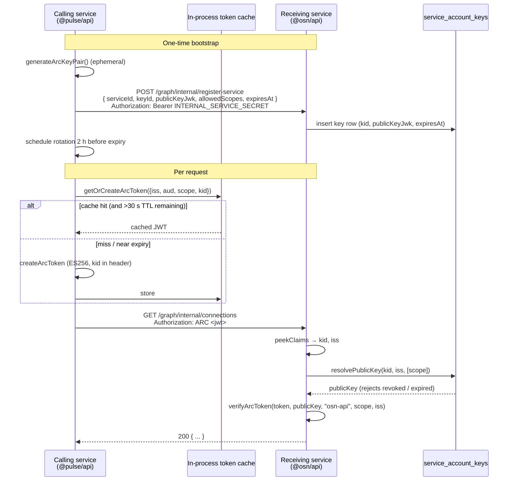

# ARC Tokens (S2S Auth)

ARC is OSN's service-to-service authentication token — an ASAP-style self-issued JWT for backend-to-backend calls (e.g. `@pulse/api` querying `@osn/api`'s social graph).

## Token issuance + verification flow



## Key Properties

- **ES256 (ECDSA P-256)** -- compact, fast, no shared secret
- **Self-issued:** each service signs its own token with its private key
- **Short-lived (5 min TTL);** cached in-memory, re-issued 30s before expiry
- **Scope-gated:** `scope` claim limits what the token can do. Scope format is `/^[a-z0-9_:-]+$/` — hyphens are valid and load-bearing (`step-up:verify`, `app-enrollment:write`, `graph:resolve-account`). Until 2026-07-05 the signer's `SCOPE_PATTERN` wrongly rejected `-`, which broke every Flow B leave-app token mint (S-H arc-scope-pattern, fixed 2026-07-05). The scope list is the server-side `PERMITTED_SCOPES` allowlist in `osn/api/src/routes/graph-internal.ts`: `graph:read` (general internal-graph reads), `graph:resolve-account` (profileId → accountId only — least privilege on the multi-account invariant, granted to pulse-api + cire-api), `account:erase`, `step-up:verify`, `app-enrollment:write`
- **Audience-scoped:** `aud` claim names the target service (e.g. `"osn-core"`)
- **`kid`-keyed:** JWT protected header carries `kid` (key ID UUID); receiver looks up the specific key row, not just the issuer
- **Public key discovery:** first-party services have rows in `service_accounts` (allowed scopes) + `service_account_keys` (key material per `kid`); third-party apps use the JWKS URL derived from `iss`
- **Automatic rotation:** `startKeyRotation()` rotates ephemeral keys before expiry — no manual key management

## Location

Lives in `shared/crypto` (`@shared/crypto`). Import from `@shared/crypto`.

The pure ES256 key/JWK helpers (`importKeyFromJwk`, `generateArcKeyPair`,
`exportKeyToJwk`, `thumbprintKid`, `ArcTokenError`) live in a **DB-free**
`src/jwk.ts`, exposed as the `@shared/crypto/jwk` subpath. The barrel
(`@shared/crypto`) re-exports them, so normal consumers import as before.
**Cloudflare Workers consumers must import from `@shared/crypto/jwk`, not the
barrel** — the barrel pulls `arc.ts → @osn/db → @shared/db-utils → bun:sqlite`
(the DB-backed `resolvePublicKey` path), which cannot bundle for workerd.
`@shared/osn-auth-client`'s JWKS-verification path does exactly this.

## Exports

```typescript
generateArcKeyPair()                                           // → CryptoKeyPair (ES256)
exportKeyToJwk(key)                                            // → JSON string (for DB storage)
importKeyFromJwk(jwk)                                          // → CryptoKey
createArcToken(privateKey, { iss, aud, scope, kid }, ttl?)              // → signed JWT string; kid in header
verifyArcToken(token, publicKey, expectedAud, scope?, expectedIssuer?)  // → ArcTokenPayload or throws
resolvePublicKey(kid, issuer, tokenScopes?)                            // → Effect<CryptoKey, ArcTokenError, Db>
getOrCreateArcToken(privateKey, { iss, aud, scope, kid }, ttl?)         // → cached JWT (cache key: kid:iss:aud:canonical(scope):ttl)
clearTokenCache() / clearPublicKeyCache()                      // → for testing / key rotation
evictPublicKeyCacheEntry(kid)                                  // → immediate per-key cache eviction (call on revoke)
evictExpiredTokens()                                           // → force-sweep expired tokens (no debounce)
```

## When to Use ARC Tokens

| Scenario | Use ARC? | Why |
|----------|----------|-----|
| `@pulse/api` -> `@osn/api` graph | **Yes** | HTTP call to `/graph/internal/*` must prove caller identity |
| Third-party app -> any OSN endpoint | **Yes** | Caller has no shared secret; presents its public key via JWKS |
| User-facing API call | No | Use the access token (`Authorization: Bearer`); ARC is machine-to-machine only |
| Background job -> `@osn/api` | **Yes** | Job acts as a service, not a user |

## Calling Service (Token Issuer) — Typical Pattern

```typescript
import { getOrCreateArcToken, generateArcKeyPair, exportKeyToJwk } from "@shared/crypto";

// Boot-time: either load pre-distributed private key or generate ephemeral pair
// See pulse/api/src/services/graphBridge.ts for the Promise-singleton pattern.
const pair = await generateArcKeyPair();
// Register public key with @osn/api using INTERNAL_SERVICE_SECRET...

// Per-request: get a cached or fresh token
const token = await getOrCreateArcToken(pair.privateKey, {
  iss: "pulse-api",      // this service's service_id
  aud: "osn-api",        // target service
  scope: "graph:read",   // minimal required scope
});

// Attach to outgoing HTTP request
fetch("http://localhost:4000/graph/internal/connections", {
  headers: { Authorization: `ARC ${token}` },
});
```

## Receiving Service (Token Verifier) -- Typical Pattern

```typescript
import { verifyArcToken, resolvePublicKey } from "@shared/crypto";
import { Effect } from "effect";

// In an Elysia route guard or middleware (canonical: osn/api/src/lib/arc-middleware.ts):
const arcMiddleware = (requiredScope: string) => async (ctx) => {
  const auth = ctx.headers.authorization;
  if (!auth?.startsWith("ARC ")) return ctx.set.status = 401;

  const token = auth.slice(4);
  // resolvePublicKey looks up the kid + issuer and validates allowed_scopes
  const publicKey = await Effect.runPromise(
    resolvePublicKey(kid, iss, [requiredScope]).pipe(Effect.provide(DbLive))
  );
  // Pass the resolved issuer as expectedIssuer (X1) so jose enforces the
  // signed `iss` matches the kid's registered service.
  const claims = await verifyArcToken(token, publicKey, "osn-api", requiredScope, iss);
  // claims.iss, claims.aud, claims.scope are now verified
};
```

## Key Storage Schema

Two DB tables cooperate:

| Table | Columns | Purpose |
|-------|---------|---------|
| `service_accounts` | `service_id PK`, `allowed_scopes`, timestamps | Maps issuer ID → allowed scope list |
| `service_account_keys` | `key_id PK`, `service_id FK`, `public_key_jwk`, `registered_at`, `expires_at`, `revoked_at` | Per-key material; multiple rows per service during rotation |

`resolvePublicKey(kid, issuer, scopes?)` joins both tables, rejects expired (`expires_at < now`) and revoked (`revoked_at IS NOT NULL`) keys. Key cache keyed by `kid`.

## Service Registration

Ephemeral key auto-rotation is the only supported strategy. Pre-distributed stable keys are not used.

### Startup self-registration with auto-rotation

`osn/api` exposes `POST /graph/internal/register-service`, protected by a shared `INTERNAL_SERVICE_SECRET` Bearer token. On startup, `startKeyRotation()` in `pulse/api`:

1. Generates an ephemeral P-256 key pair with a UUID `keyId`
2. Exports the public key (`exportKeyToJwk(pair.publicKey)`)
3. POSTs `{ serviceId, keyId, publicKeyJwk, allowedScopes, expiresAt }` to the endpoint
4. Schedules rotation `KEY_ROTATION_BUFFER_HOURS` (default 2h) before expiry
5. On rotation: registers the new key BEFORE swapping the signing singleton — zero downtime

Behaviour when `INTERNAL_SERVICE_SECRET` is unset:

- **Non-local env** (`OSN_ENV != "local"`): throws at startup, so a bad config fails fast instead of failing silently on the first S2S call.
- **Local dev** (`OSN_ENV` unset or `"local"`): the service skips registration, logs a warning, and still boots. Every S2S call to `osn/api` fails until you set the secret — useful for unrelated local work that doesn't need the social graph bridge.

Behaviour when `osn/api` is unreachable (`ConnectionRefused`, DNS failure, etc):

- **Non-local env**: throws at startup and the process exits. Deploy order is expected to bring `osn/api` up first; a race here signals a real config error.
- **Local dev**: the service logs a warning, `startKeyRotation()` returns `"pending-retry"`, and a background retry runs with exponential backoff (5 s, 10 s, 20 s… capped at 5 min) plus ±1 s symmetric jitter until registration succeeds. This lets `bun run dev:pulse` boot both services in parallel without a crash when `pulse-api` wins the startup race. The retry classifier uses an explicit allowlist of Bun/Node network-error codes (`ConnectionRefused`, `ECONNREFUSED`, `ECONNRESET`, `ENOTFOUND`, `ETIMEDOUT`, `EAI_AGAIN`, `EHOSTUNREACH`, `ENETUNREACH`, `UND_ERR_CONNECT_TIMEOUT`, `UND_ERR_SOCKET`) — HTTP 4xx/5xx responses and any other error still throw and exit. The retry reuses the same ephemeral key across attempts; this is safe because `/register-service` upserts both `service_accounts` (by `serviceId`) and `service_account_keys` (by `keyId`) via `ON CONFLICT DO UPDATE`, so repeated POSTs are idempotent.

Env vars: `INTERNAL_SERVICE_SECRET`, `KEY_TTL_HOURS` (default 24), `KEY_ROTATION_BUFFER_HOURS` (default 2).

```bash
# Both env files need:
INTERNAL_SERVICE_SECRET=<shared-random-string>
```

### A fixed key registered once (cire-api)

cire-api does not self-register. It signs with a fixed ES256 key held as two
Worker secrets, `CIRE_API_ARC_PRIVATE_KEY` (a raw JWK string) and
`CIRE_API_ARC_KEY_ID` (a UUID), and its public half is registered under
`serviceId` `cire-api` with the four scopes the `ARC_*_SCOPE` constants of
`cire/api/src/services/osn-bridge.ts` request: `graph:read`,
`graph:resolve-account`, `org:read` and `account:email-read`.

- **Production:** registered by hand with `POST /graph/internal/register-service`
  ([[production-deploy]] §6.2). Re-run it whenever the scope list changes: a
  registration holds exactly the scopes its last call listed.
- **Dev:** the musubi stack writes the `service_accounts` and
  `service_account_keys` rows straight into `osn-db-dev`, from a seed file it
  imports on the first dev deploy and again whenever the file changes
  ([[infrastructure-as-code#Seeds and the ARC registration]]). A step of the
  musubi stack job, `cire_seed`, derives the public JWK from the `dev`
  Environment's private key; the step that deploys holds only the public half.
  Like the route, a re-import never takes a key id another service holds: it
  leaves that row to its service. It never clears `revoked_at` or
  `expires_at`, so a revoked or expired dev key stays so. To
  replace one, set a new `CIRE_API_ARC_KEY_ID` with its new
  `CIRE_API_ARC_PRIVATE_KEY` in the `dev` Environment and dispatch **Deploy**.

### osn-api as issuer — published outbound keys

osn-api calls apps as an ARC **issuer**: the account deletion's preview
(`account:deletion-preview`), erasure (`account:erase`) and session end
(`account:sessions-revoke`, Pulse only), and the account export
(`account:export`) ([[dsar#The apps' open actions and the app contract]]).
Apps do not take a registration from osn-api. osn-api **publishes** its keys
and each app fetches the one a token names:

1. Each osn-api isolate mints an ES256 key pair the first time it calls an app,
   good for 24 hours and replaced two hours before its end
   (`osn/api/src/lib/outbound-arc.ts`).
2. Before it signs anything with it, it writes the public half to
   `arc_outbound_keys` (`publishOutboundKey`, which also deletes rows expired
   more than a day ago), once per key: calls that arrive while the write runs
   wait on that one write. `publishOutboundKey` answers the key it wrote, and
   the call signs with that key (`arcAuthHeader`), never with whichever key the
   isolate holds by then, so a key replaced in between still verifies.
   `arcAuthHeader` refuses any key `publishOutboundKey` did not answer. A failed
   write, or a key that failed to mint, is dropped, and the next call tries
   again.
3. `GET /.well-known/arc-jwks.json` serves the unexpired rows as a JWK Set, read
   fresh on every request (`cache-control: no-store`): a key written a moment
   ago must be in the next answer, or the app asking would refuse that `kid` for
   30 seconds. osn-db reads its primary (`readReplication: "disabled"`), so it is.
4. The app verifies with `verifyOsnArcToken` (`@shared/osn-auth-client/arc`,
   Worker-safe): the token must claim `iss: "osn-api"`, ask for a scope the app
   lets osn-api use, and, when the app's secret can key the MAC, carry a `kid`
   whose MAC verifies and whose expiry has not passed; only then is the key
   resolved, through the same bounded kid cache
   the app uses for access-token keys, at `<issuer>/.well-known/arc-jwks.json`
   below the issuer origin it already pins. Then jose checks the signature
   (ES256 only), `iss`, `aud`, `exp` and `iat`, and the token's scope must hold
   the route's.

**The key id.** `<uuid>.<expiry>.<MAC>`, the MAC the first 22 base64url
characters of HMAC-SHA256 under `INTERNAL_SERVICE_SECRET` over the uuid and the
expiry (`@shared/crypto/arc-kid`). An app holding the secret refuses a `kid`
whose MAC fails, or whose expiry has passed, before it fetches anything, so a
stream of tokens with made-up or scraped `kid`s costs it no request to osn-api.
On the ARC path the MAC gates fetching only; a token is authenticated by its
signature against the published key. But the same secret is the bearer of the
key-registration routes (`POST /graph/internal/register-service` on osn-api,
`POST /internal/register-service` on Zap) and of `GET /health/coordination`,
and every kid in the public key set is a message and its MAC under it, so
anyone can test a guess at the secret offline. A short or human-chosen secret
could be found that way, and with it a key registered under any service id
and scope. So a secret shorter than 32 characters never keys the MAC, on
either side: osn-api mints kids without a MAC and logs
`osn.arc outbound key id carries no MAC` once per key, and Pulse and Zap
treat it as unset and skip the check. A dev deploy refuses a shorter
`INTERNAL_SERVICE_SECRET` ([[infrastructure-as-code]]). A deployed osn-api
without the secret refuses to boot. Locally, osn-api and the app hold it both
or neither: an app holding it refuses osn-api's kids minted without it.

**What each app lets osn-api use.** Pulse: `account:erase`, `account:export`,
`account:deletion-preview`, `account:sessions-revoke`; it takes ARC from no
other service, so it holds no key registry. Zap: `account:erase`,
`account:export`, `account:deletion-preview`. Zap routes a token by the issuer
it claims before reading anything else: `osn-api` goes to the published keys
and never to its registry, which refuses a key registered for `osn-api` and
holds `chat:c2b` keys for cire-api only.

**Trust.** Whoever can write osn-db's `arc_outbound_keys`, or answer for
osn-api's origin, can mint tokens an app accepts as osn-api's. The same write
access already reaches every account (a session row), and the same origin
already vouches for every access token, so neither gains a power it lacks.

**Revoking a key.** Delete its `arc_outbound_keys` row. Apps stop accepting it
when their cached copy lapses, within five minutes. The isolate holding it
keeps signing with it, and its calls are refused, until a redeploy starts fresh
isolates with new keys. osn-api never signs with a key past its expiry, and a
token lives five minutes.

### Key revocation

`DELETE /graph/internal/service-keys/:keyId` (also protected by `INTERNAL_SERVICE_SECRET`) sets `revoked_at` in the DB and evicts this process's public key cache entry, so this process rejects the key on its next request; other processes follow when their cached entry expires (below). It answers 404 for a `kid` that matches no key, and `{ ok: true, alreadyRevoked: true }` for a key already revoked, whose `revoked_at` keeps its first value. `POST /graph/internal/register-service` refuses a revoked `kid` with 409 `kid_revoked`: a service brings a new key under a new `kid`.

`/register-service` validates requested `allowedScopes` against a server-side allowlist (`PERMITTED_SCOPES`). Any unknown scope returns 400 — a service cannot self-promote its scope set.

> ⚠ **Scope authorisation is service-granular, not key-granular.**
> `allowedScopes` lives on `service_accounts` (one row per serviceId) and every
> `/register-service` call **replaces** it wholesale, while keys live per-`kid` in
> `service_account_keys`. Consequences: (a) a service that registers multiple keys
> (pulse-api registers a graph-bridge key AND a leave-app key) **must send the
> identical scope union from every registration call site**, or the registrations
> clobber each other on boot races / rotations and randomly fail-close S2S calls;
> (b) per-key least privilege between a service's own keys does not exist — any of
> its keys can mint any scope in the service union. Keep
> `pulse/api/src/services/graphBridge.ts` `REGISTERED_SCOPES` and
> `pulse/api/src/lib/outbound-arc.ts` `ALLOWED_SCOPES` in lockstep.

### Cross-process revocation window (X4)

Revocation is immediate *in the process that performs it* (it calls `evictPublicKeyCacheEntry(kid)`). Other processes that have already cached the key keep serving it until their own `publicKeyCache` entry expires — at most one cache TTL.

- TTL defaults to **300 s** and is overridable via the `ARC_PUBLIC_KEY_CACHE_TTL_SECONDS` env var (kept finite; a lower value shrinks the window at the cost of more DB lookups).
- So the **worst-case cross-process revocation latency is ≤ the configured TTL (≤5 min by default)**. The DB row is updated synchronously, so a process with a cold/expired cache rejects the revoked key immediately — only warm caches on *other* nodes lag.
- A fan-out that evicts `(kid)` in every process and isolate on revoke (closing this window to ~0) is an open issue in `englishstreetventures/osn`.

## Issuer binding (X1)

`verifyArcToken` accepts an optional `expectedIssuer`. When supplied, jose enforces that the signed `iss` claim equals it. The OSN ARC middleware (`requireArc`) passes the issuer it resolved the key for (`peeked.iss`), so the signed `iss` is **cryptographically** bound to the `kid`→issuer DB mapping, not just checked via the DB lookup. A token whose signed `iss` differs from the service its `kid` is registered under is rejected at verification.

Zap's in-memory registry (`zap/api/src/lib/arc-middleware.ts`) also passes the registered issuer as `expectedIssuer`, with an explicit `payload.iss !== registered.issuer` check as well. osn-api's tokens to an app are pinned to `iss: "osn-api"` by `verifyOsnArcToken` ([[#osn-api as issuer — published outbound keys]]).

`expectedIssuer` is **optional** for backward compatibility — omitting it leaves `iss` unenforced (existing crypto-level behaviour).

## Token cache key (X3)

The in-process token cache key is `kid:iss:aud:canonical(scope):ttl`:

- **`ttl` is part of the key** — a token requested with a shorter TTL never reuses a longer-lived cached entry whose remaining life exceeds the caller's intent.
- **scope is canonicalised** with the same normalisation (`normaliseScopes` in `@shared/crypto/jwk`) the signer applies (trim + lowercase + drop empties), so formatting-only differences (`" Graph:Read "` vs `"graph:read"`) hit the same entry as the signed token.
- **scope is NOT sorted** — `"graph:read,graph:write"` and `"graph:write,graph:read"` stay distinct cache entries, matching the distinct `scope` claims `signArcToken` signs (it preserves order). Sorting would be a safe, trivial collapse but would also reorder the signed claim, so it's left as a deliberate non-change.

## Current S2S Strategy

`@pulse/api` calls `@osn/api`'s `/graph/internal/*` endpoints over HTTP, authenticated with ARC tokens. ARC token verification middleware (`requireArc` in `osn/api/src/lib/arc-middleware.ts`) protects all inbound calls. The [[s2s-patterns|graphBridge]] in `pulse/api` is the only file that makes these calls.

## Public key cache eviction

`publicKeyCache` is bounded. When it is full, the insert path scans a side map
of access ranks and drops the lowest — the least recently used entry. Reads go
through `touchPublicKey`, which writes the rank without a Map delete and
re-insert, so the hot cache-hit path stays O(1).

The rank is a counter, not a clock. It was `Date.now()` until 2026-08-21, and
milliseconds are too coarse: back-to-back accesses share one, the scan sees a
tie, keeps whichever key it iterated first, and evicts an entry that was just
used instead of the oldest. A counter cannot tie, and it is cheaper
than reading the clock. `_publicKeyAccessRankForTest` exists so a
test can assert that two accesses never compare equal, which is the property the
scan depends on — asserting an eviction outcome instead only catches the bug on
the runs where the timing happens to tie.

## Security Notes

- An unverified ARC `iss` claim reaches a metric label only through the `safeIssuer()` runtime guard in `arc-metrics.ts`.
- Revocation evicts `publicKeyCache` at once via `evictPublicKeyCacheEntry(kid)` — no 5-minute window in the revoking process.
- The `INTERNAL_SERVICE_SECRET` comparison uses `crypto.timingSafeEqual` — no timing oracle.
- `peekClaims` uses base64url decode (RFC 7515 §2) — `-` and `_` in UUID `kid`s are handled correctly.
- `/register-service` validates `allowedScopes` against `PERMITTED_SCOPES` allowlist — services cannot self-promote.
- A `resolvePublicKey` cache hit stores `allowedScopes` and validates scopes on every hit — no bypass when `tokenScopes` is omitted.
- ARC tokens are machine-to-machine only. Never use them for user-facing authentication — use access tokens for that.
- An `Authorization: ARC ...` header earns no trust for inbound trace context: no service adopts a caller's `traceparent`, and a Worker's handler span starts a trace of its own ([[tracing#Trace context across services]]).

## Metrics

ARC token metrics live in `shared/crypto/src/arc-metrics.ts`:
- `arc.token.issued` — counter by issuer/audience
- `arc.token.verification` — counter by result (ok, expired, bad_signature, unknown_issuer, revoked_key, scope_denied, audience_mismatch, malformed)
- All issuer/audience values pass through `safeIssuer()` to prevent cardinality explosion
- `verifyArcToken` self-reports its outcomes; receiver middlewares whose early-exit branches reject **before** `verifyArcToken` runs must record the counter themselves. Zap's registry path does: missing/malformed token → `malformed`, kid not in registry → `unknown_issuer`, kid revoked or registration expired → `revoked_key`, registry scope denial → `scope_denied`. `verifyOsnArcToken` records every outcome of an osn-api token itself (a kid that fails its MAC, or that osn-api does not publish, is `unknown_issuer`). No double-count — paths that reach `verifyArcToken` are only counted there.

## Source Files

- [shared/crypto/src/arc.ts](../../shared/crypto/src/arc.ts) — ARC token implementation (`kid`, `resolvePublicKey`, rotation cache)
- [shared/crypto/src/arc-metrics.ts](../../shared/crypto/src/arc-metrics.ts) — ARC metrics
- [osn/api/src/lib/arc-middleware.ts](../../osn/api/src/lib/arc-middleware.ts) — `requireArc` Elysia middleware (reads `kid` from header)
- [osn/api/src/routes/graph-internal.ts](../../osn/api/src/routes/graph-internal.ts) — internal graph routes + `/register-service` + `/service-keys/:keyId` (revoke)
- [osn/db/src/schema/index.ts](../../osn/db/src/schema/index.ts) — `service_accounts` + `service_account_keys` table definitions
- [pulse/api/src/services/graphBridge.ts](../../pulse/api/src/services/graphBridge.ts) — `startKeyRotation()`, ephemeral key auto-rotation
