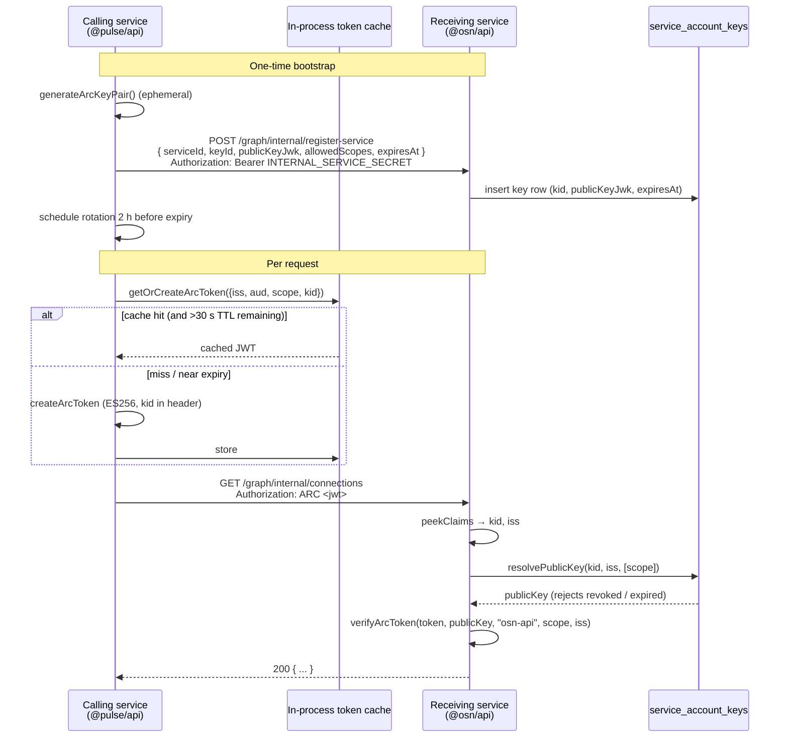

# ARC Tokens (S2S Auth)

ARC is OSN's service-to-service authentication token — an ASAP-style self-issued JWT for backend-to-backend calls (e.g. `@pulse/api` querying `@osn/api`'s social graph).

## Token issuance + verification flow



## Key Properties

- **ES256 (ECDSA P-256)** -- compact, fast, no shared secret
- **Self-issued:** each service signs its own token with its private key
- **Short-lived (5 min TTL);** cached in-memory, re-issued 30s before expiry
- **Scope-gated:** `scope` claim limits what the token can do. Scope format is `/^[a-z0-9_:-]+$/` — hyphens are valid and load-bearing (`step-up:verify`, `app-enrollment:write`, `graph:resolve-account`). Until 2026-07-05 the signer's `SCOPE_PATTERN` wrongly rejected `-`, which broke every Flow B leave-app token mint (S-H arc-scope-pattern, fixed 2026-07-05). The scope list is the server-side `PERMITTED_SCOPES` allowlist in `osn/api/src/routes/graph-internal.ts`: `graph:read` (general internal-graph reads), `graph:resolve-account` (profileId → accountId only — least privilege on the multi-account invariant, granted to pulse-api + cire-api), `account:erase`, `step-up:verify`, `app-enrollment:write`
- **Audience-scoped:** `aud` claim names the target service (e.g. `"osn-core"`)
- **`kid`-keyed:** JWT protected header carries `kid` (key ID UUID); receiver looks up the specific key row, not just the issuer
- **Public key discovery:** first-party services have rows in `service_accounts` (allowed scopes) + `service_account_keys` (key material per `kid`); third-party apps use the JWKS URL derived from `iss`
- **Automatic rotation:** `startKeyRotation()` rotates ephemeral keys before expiry — no manual key management

## Location

Lives in `shared/crypto` (`@shared/crypto`). Import from `@shared/crypto`.

The pure ES256 key/JWK helpers (`importKeyFromJwk`, `generateArcKeyPair`,
`exportKeyToJwk`, `thumbprintKid`, `ArcTokenError`) live in a **DB-free**
`src/jwk.ts`, exposed as the `@shared/crypto/jwk` subpath. The barrel
(`@shared/crypto`) re-exports them, so normal consumers import as before.
**Cloudflare Workers consumers must import from `@shared/crypto/jwk`, not the
barrel** — the barrel pulls `arc.ts → @osn/db → @shared/db-utils → bun:sqlite`
(the DB-backed `resolvePublicKey` path), which cannot bundle for workerd.
`@shared/osn-auth-client`'s JWKS-verification path does exactly this.

## Exports

```typescript
generateArcKeyPair()                                           // → CryptoKeyPair (ES256)
exportKeyToJwk(key)                                            // → JSON string (for DB storage)
importKeyFromJwk(jwk)                                          // → CryptoKey
createArcToken(privateKey, { iss, aud, scope, kid }, ttl?)              // → signed JWT string; kid in header
verifyArcToken(token, publicKey, expectedAud, scope?, expectedIssuer?)  // → ArcTokenPayload or throws
resolvePublicKey(kid, issuer, tokenScopes?)                            // → Effect<CryptoKey, ArcTokenError, Db>
getOrCreateArcToken(privateKey, { iss, aud, scope, kid }, ttl?)         // → cached JWT (cache key: kid:iss:aud:canonical(scope):ttl)
clearTokenCache() / clearPublicKeyCache()                      // → for testing / key rotation
evictPublicKeyCacheEntry(kid)                                  // → immediate per-key cache eviction (call on revoke)
PUBLIC_KEY_CACHE_TTL_SECONDS                                   // seconds a cached key and its scopes live (300 default)
evictExpiredTokens()                                           // → force-sweep expired tokens (no debounce)
```

## When to Use ARC Tokens

| Scenario | Use ARC? | Why |
|----------|----------|-----|
| `@pulse/api` -> `@osn/api` graph | **Yes** | HTTP call to `/graph/internal/*` must prove caller identity |
| Third-party app -> any OSN endpoint | **Yes** | Caller has no shared secret; presents its public key via JWKS |
| User-facing API call | No | Use the access token (`Authorization: Bearer`); ARC is machine-to-machine only |
| Background job -> `@osn/api` | **Yes** | Job acts as a service, not a user |

## Calling Service (Token Issuer) — Typical Pattern

```typescript
import { getOrCreateArcToken, generateArcKeyPair, exportKeyToJwk } from "@shared/crypto";

// Boot-time: either load pre-distributed private key or generate ephemeral pair
// See pulse/api/src/services/graphBridge.ts for the Promise-singleton pattern.
const pair = await generateArcKeyPair();
// Register public key with @osn/api using INTERNAL_SERVICE_SECRET...

// Per-request: get a cached or fresh token
const token = await getOrCreateArcToken(pair.privateKey, {
  iss: "pulse-api",      // this service's service_id
  aud: "osn-api",        // target service
  scope: "graph:read",   // minimal required scope
});

// Attach to outgoing HTTP request
fetch("http://localhost:4000/graph/internal/connections", {
  headers: { Authorization: `ARC ${token}` },
});
```

## Receiving Service (Token Verifier) -- Typical Pattern

```typescript
import { verifyArcToken, resolvePublicKey } from "@shared/crypto";
import { Effect } from "effect";

// In an Elysia route guard or middleware (canonical: osn/api/src/lib/arc-middleware.ts):
const arcMiddleware = (requiredScope: string) => async (ctx) => {
  const auth = ctx.headers.authorization;
  if (!auth?.startsWith("ARC ")) return ctx.set.status = 401;

  const token = auth.slice(4);
  // resolvePublicKey looks up the kid + issuer and validates allowed_scopes
  const publicKey = await Effect.runPromise(
    resolvePublicKey(kid, iss, [requiredScope]).pipe(Effect.provide(DbLive))
  );
  // Pass the resolved issuer as expectedIssuer so jose enforces the
  // signed `iss` matches the kid's registered service.
  const claims = await verifyArcToken(token, publicKey, "osn-api", requiredScope, iss);
  // claims.iss, claims.aud, claims.scope are now verified
};
```

## Key Storage Schema

Two DB tables cooperate:

| Table | Columns | Purpose |
|-------|---------|---------|
| `service_accounts` | `service_id PK`, `allowed_scopes`, timestamps | Maps issuer ID → allowed scope list |
| `service_account_keys` | `key_id PK`, `service_id FK`, `public_key_jwk`, `registered_at`, `expires_at`, `revoked_at` | Per-key material; multiple rows per service during rotation |

`resolvePublicKey(kid, issuer, scopes?)` joins both tables, rejects expired (`expires_at < now`) and revoked (`revoked_at IS NOT NULL`) keys. Key cache keyed by `kid`.

## Service Registration

Ephemeral key auto-rotation is the only supported strategy. Pre-distributed stable keys are not used.

### Startup self-registration with auto-rotation

`osn/api` exposes `POST /graph/internal/register-service`, protected by a shared `INTERNAL_SERVICE_SECRET` Bearer token. On startup, `startKeyRotation()` in `pulse/api`:

1. Generates an ephemeral P-256 key pair with a UUID `keyId`
2. Exports the public key (`exportKeyToJwk(pair.publicKey)`)
3. POSTs `{ serviceId, keyId, publicKeyJwk, allowedScopes, expiresAt }` to the endpoint
4. Schedules rotation `KEY_ROTATION_BUFFER_HOURS` (default 2h) before expiry
5. On rotation: registers the new key BEFORE swapping the signing singleton — zero downtime

Behaviour when `INTERNAL_SERVICE_SECRET` is unset:

- **Non-local env** (`OSN_ENV != "local"`): throws at startup, so a bad config fails fast instead of failing silently on the first S2S call.
- **Local dev** (`OSN_ENV` unset or `"local"`): the service skips registration, logs a warning, and still boots. Every S2S call to `osn/api` fails until you set the secret — useful for unrelated local work that doesn't need the social graph bridge.

Behaviour when `osn/api` is unreachable (`ConnectionRefused`, DNS failure, etc):

- **Non-local env**: throws at startup and the process exits. Deploy order is expected to bring `osn/api` up first; a race here signals a real config error.
- **Local dev**: the service logs a warning, `startKeyRotation()` returns `"pending-retry"`, and a background retry runs with exponential backoff (5 s, 10 s, 20 s… capped at 5 min) plus ±1 s symmetric jitter until registration succeeds. This lets `bun run dev:pulse` boot both services in parallel without a crash when `pulse-api` wins the startup race. The retry classifier uses an explicit allowlist of Bun/Node network-error codes (`ConnectionRefused`, `ECONNREFUSED`, `ECONNRESET`, `ENOTFOUND`, `ETIMEDOUT`, `EAI_AGAIN`, `EHOSTUNREACH`, `ENETUNREACH`, `UND_ERR_CONNECT_TIMEOUT`, `UND_ERR_SOCKET`) — HTTP 4xx/5xx responses and any other error still throw and exit. The retry reuses the same ephemeral key across attempts; this is safe because `/register-service` upserts both `service_accounts` (by `serviceId`) and `service_account_keys` (by `keyId`) via `ON CONFLICT DO UPDATE`, so repeated POSTs are idempotent.

Env vars: `INTERNAL_SERVICE_SECRET`, `KEY_TTL_HOURS` (default 24), `KEY_ROTATION_BUFFER_HOURS` (default 2).

```bash
# Both env files need:
INTERNAL_SERVICE_SECRET=<shared-random-string>
```

### A fixed key registered once (cire-api)

cire-api does not self-register. It signs with a fixed ES256 key held as two
Worker secrets, `CIRE_API_ARC_PRIVATE_KEY` (a raw JWK string) and
`CIRE_API_ARC_KEY_ID` (a UUID), and its public half is registered under
`serviceId` `cire-api` with the five scopes the `ARC_*_SCOPE` constants of
`cire/api/src/services/osn-bridge.ts` request: `graph:read`,
`graph:resolve-account`, `org:read`, `account:email-read` and
`step-up:verify`, the last for a host's removal of their Cire data
([[step-up#App step-up requests]]).

- **Production:** the key is registered by hand with
  `POST /graph/internal/register-service` ([[production-deploy]] §6.2). Whenever
  the scope list changes, the production operator workflow's `register-cire-arc`
  sets the service's scopes to the list production cire-api signs with, through
  `PUT /graph/internal/service-scopes/:serviceId` ([[#Renewing a service's scopes]]),
  and never needs cire-api's key. While production osn-api runs a commit without
  that route, the workflow instead sends the scopes with a throwaway key it
  registers already expired and then revokes; englishstreetventures/osn#2432
  removes that path.
- **Dev:** the musubi stack writes the `service_accounts` and
  `service_account_keys` rows straight into `osn-db-dev`, from a seed file it
  imports on the first dev deploy and again whenever the file changes
  ([[infrastructure-as-code#Seeds and the ARC registration]]). A step of the
  musubi stack job, `cire_seed`, derives the public JWK from the `dev`
  Environment's private key; the step that deploys holds only the public half.
  Like the route, a re-import never takes a key id another service holds: it
  leaves that row to its service. It never clears `revoked_at` or
  `expires_at`, so a revoked or expired dev key stays so. To
  replace one, set a new `CIRE_API_ARC_KEY_ID` with its new
  `CIRE_API_ARC_PRIVATE_KEY` in the `dev` Environment and dispatch **Deploy**.

### osn-api as issuer — published outbound keys

osn-api calls apps as an ARC **issuer**: the account deletion's preview
(`account:deletion-preview`), erasure (`account:erase`) and session end
(`account:sessions-revoke`, Pulse only), and the account export
(`account:export`) ([[account-deletion#The app contract]]).
Apps do not take a registration from osn-api. osn-api **publishes** its keys
and each app fetches the one a token names:

1. Each osn-api isolate mints an ES256 key pair, good for four hours and
   replaced two hours before its end (`osn/api/src/lib/outbound-arc.ts`).
2. It writes the public half to `arc_outbound_keys` after its first request,
   whatever the route, through `ctx.waitUntil`, so the answer never waits for
   it (`publishOutboundKeyInBackground`, called from the Worker's `fetch` in
   `osn/api/src/index.ts`). The first request once the key is due for
   replacement writes the new one the same way, and every cron run whose
   deletion app settings parse writes the key when one is due, whatever its
   sweeps find. Which route a request asks
   for never decides when a key is written. A background write that fails is
   logged (`osn.arc outbound key publish failed`) and pauses background writes
   for a minute; the Bun dev server (`local.ts`) has no `waitUntil` and makes
   no background write.
3. Every call to an app still publishes the key before it signs
   (`publishOutboundKey`, which also deletes rows expired more than a day ago),
   which writes nothing once the key is written: calls that arrive while a write
   runs wait on that one write. It then checks the key is still among the keys
   step 4 serves (a count of the live keys that expire with it or after it,
   reading at most 1,001 index rows, at most once every thirty seconds, shared by
   concurrent calls), and that its own row is still there. A key that has
   fallen out, or whose row was deleted, is replaced: one call mints a key,
   logs `osn.arc outbound key is not in the published set; minting a new one`,
   and every caller that found it so writes and signs with the new one. If even the new key would not be
   served, or the check cannot read the set, the call fails and signs nothing.
   `publishOutboundKey` answers the key it wrote,
   and the call signs with that key (`arcAuthHeader`), never with whichever key
   the isolate holds by then, so a key replaced in between still verifies.
   `arcAuthHeader` refuses any key `publishOutboundKey` did not answer. A key
   whose first write failed, or that failed to mint, is dropped, and the next
   call mints and writes another, so a key's expiry always dates its first
   write. A caller that signs within two hours of taking its key never signs
   with an expired one; the account export takes its key once and signs each
   app's section as the reader pulls it, so a reader slower than two hours can
   get the later sections refused.
4. `GET /.well-known/arc-jwks.json?kid=<kid>` answers the one key an app asks
   for, as a JWK Set of one key or none; without `kid` the same path serves the
   whole list. Neither may be cached (`cache-control: no-store`;
   `osn/api/src/routes/arc-jwks.ts`).
   - **By kid.** osn-api first reads the ask (`readArcKeyAsk`,
     `@shared/crypto/arc-kid`): a uuid as `crypto.randomUUID` writes it, an
     expiry ahead of now by at most a key's life and five minutes, and at most
     two MAC parts of 22 base64url characters. Anything else is answered with
     no key and no read. A kid one of whose MACs verifies under a secret
     osn-api holds is answered from the isolate's memory
     (`osn/api/src/lib/outbound-key-memory.ts`): a key found is held a minute
     from when its read started, a key not found 30 seconds; at most 1,024
     keys, about 1.4 KB each on V8, past which a key is answered from a read
     and not held, and at most 128 absences in a map of their own, so ids a
     holder of a kid secret MACs can never push a key out. Asks that arrive
     while a read runs share it for five seconds, then start their own, so a
     read whose request was cancelled holds nothing up. A key written a
     moment ago is read on its first ask, so it is found at once: no token
     names a kid before its row is written. The read is one seek down the
     primary key's index for the row whose kid starts with the ask's
     `<uuid>.<expiry>`, so it never depends on a MAC part. A kid osn-api
     cannot verify (a made-up one, or one minted under a secret value this
     isolate does not hold, during a rotation) is answered from memory when
     its key is held; otherwise it is read under a budget of its own, 30 a
     minute per app zone or address, which the native binding counts in each
     Cloudflare location, and a key that read finds is held, an absence never.
     A kid osn-api verifies has no budget in the app lane, and no ask calls
     the coordination store, so while osn-api's isolates hold the secret value
     a key was minted under, nothing a sender makes an app ask for can refuse
     its asks for osn-api's real keys. During a rotation, a key minted under
     the old value takes that budget on its first ask in each isolate each
     minute, which a sender can spend through an app holding no secret: while
     those keys are in use, a sender can have such asks refused for the rest
     of a minute. A direct caller's asks also spend
     its address's minute budget. Each answer is counted (`osn.arc.jwks.key_lookups`, by
     `lane` and `result`: `memory`, `read`, `probe` or `refused`), and a full
     memory is logged once a minute (`osn.arc key memory is full; answering
     without holding`).
   - **The whole list.** The unexpired rows, read fresh on every request: a key
     written a moment ago must be in the next answer, or an app asking for it
     would refuse that `kid` for 30 seconds. osn-db reads its primary
     (`readReplication: "disabled"`), so it is. It serves at most the newest
     1,000 keys by expiry (`PUBLISHED_OUTBOUND_KEYS_BOUND`), so a key just
     written is always among them. The set holds the keys written in the last
     four hours: one for each isolate that started in that time, two for one
     older than two hours. From 500 live keys the read logs
     `osn.arc published outbound keys are nearing the read bound`, and past
     1,000 `... passed the read bound; the oldest are left out`, each at most
     once a minute per isolate. A key left out is refused by every app on the
     code before key-by-id that has not cached it, until its isolate's next
     call replaces it (step 3); calls signed in the thirty seconds a passing
     check stands can still be refused. No published figure caps how many
     isolates load can start: Cloudflare runs 348 cities
     ([network](https://www.cloudflare.com/network/)), publishes no server
     count per city, and runs a Worker on more than one server in a data
     centre when the first is overloaded
     ([sharding](https://blog.cloudflare.com/eliminating-cold-starts-2-shard-and-conquer/)).
     On either warning, find why the set grew before raising the bound. Each
     caller's address (an IPv6 one by its /64) may read the list 30 times a
     minute, and every address shares one budget of 60 an hour; a configured
     app's fetch, which Cloudflare sends from the address every Worker's
     cross-zone subrequest shares, is budgeted under the app's zone (its
     `CF-Worker` header) instead, 30 a minute and 60 an hour. The apps read
     the list only while a release runs their code from before key-by-id, and
     a person may read it by hand. A refused app fetches again 30 seconds
     later, so it recovers when its window ends, at most an hour; meanwhile
     some of osn-api's calls to it can be refused. Each refusal is counted
     (`osn.arc.jwks.refused`, by `lane` and `reason`) and the first in each
     minute per lane is logged (`osn.arc key list refused a caller over its
     budget`) ([[rate-limiting]]).
5. The app verifies with `verifyOsnArcToken` (`@shared/osn-auth-client/arc`,
   Worker-safe): the token must claim `iss: "osn-api"`, ask for a scope the app
   lets osn-api use, and, when the app holds a secret that can key a MAC, carry
   a `kid` with a MAC that verifies under it and an expiry that has not passed.
   Only then does it ask osn-api for the key,
   `<issuer>/.well-known/arc-jwks.json?kid=<ask>` below the issuer origin it
   already pins, and keep it four minutes, through the same bounded kid cache
   the app uses for access-token keys (`@shared/osn-auth-client/jwks-cache`).
   A checked kid is looked up, cached and fetched once by the
   `<uuid>.<expiry>` its verified MAC covers, never by a part the app did not
   verify (below). An osn-api on the code before key-by-id ignores `kid` and
   answers the whole list, from which the app takes the same key, so either
   side may deploy first. Then jose checks the signature (ES256 only), `iss`,
   `aud`, `exp` and `iat`, and the token's scope must hold the route's.

**The key id.** `<uuid>.<expiry>` and one or two MACs, each the first 22
base64url characters of HMAC-SHA256 over the uuid and the expiry
(`@shared/crypto/arc-kid`). Each MAC is keyed by a key derived from its secret
with HKDF-SHA-256 (fixed salt `osn-arc-kid-salt`), never by the secret itself:

| MAC | Secret | HKDF `info` | Held by |
|---|---|---|---|
| First | `OSN_ARC_KID_SECRET`, held for this MAC alone | `osn-arc-kid-mac-v2` | osn-api, zap-api, pulse-api, cire-api, once set on each |
| Second | `INTERNAL_SERVICE_SECRET` | `osn-arc-kid-mac-v1` | osn-api, zap-api, pulse-api |

osn-api puts a MAC in the kid for each secret it holds: `<uuid>.<expiry>.<v1>`
with the service secret alone, `<uuid>.<expiry>.<v2>.<v1>` with both. An app
holding either secret refuses, before it fetches anything, a kid whose expiry
has passed or that carries no MAC verifying under a secret it holds, so a
stream of tokens with made-up `kid`s costs it no request to osn-api. On the
ARC path the MAC gates fetching only; a token is authenticated by its
signature against the published key. osn-api and every app derive the keys in
that one module, so both sides change together.

A 4-part kid carries a MAC the app may hold no key for. An app that checked a
kid therefore looks the key up, caches it or its absence, and shares one fetch,
by the `<uuid>.<expiry>` its verified MAC covers, and takes from the answer the
3- or 4-part kid with that uuid and expiry (`checkArcKid`'s lookup, passed to
`resolvePublicKeyForKid` in `@shared/osn-auth-client/jwks-cache`). It asks
osn-api for the `<uuid>.<expiry>` and the kid's parts shaped as MACs, the
verified one always among them (`checkArcKid`'s `ask`): osn-api can check each
MAC it holds, and junk in a part the app could not verify never reaches it,
so no copy of a real kid can make osn-api refuse the ask for it. No fetch
count and no cache entry depends on a part of a kid the app did not verify.
An app holding no secret checks nothing, asks for the kid as it came, and
looks it up exactly as sent; osn-api checks the MACs, and a kid no URL can
carry is refused before any fetch.

**Rolling out the kid secret.** The owner sets `OSN_ARC_KID_SECRET` by hand,
Worker by Worker ([[production-deploy#5.11 The ARC key-id secret 🔑]]), and
until every Worker holds it, one holding the service secret alone behaves as
before. Whether osn-api's kids are admitted:

| osn-api holds | cire-api: neither | Zap, Pulse: service secret | cire-api: kid secret | Zap, Pulse: both |
|---|---|---|---|---|
| Service secret only | admitted, unchecked | admitted | **refused** | admitted |
| Both | admitted, unchecked | admitted | admitted | admitted |

Every cell that admits asks osn-api by kid. osn-api checks every MAC it
holds, so an isolate holding the service secret alone still finds a key minted
under both, from memory. A key it cannot verify at all, minted under a value
it does not hold during a rotation, is found through its budgeted read: in
normal running nothing spends that budget, and a sender who spends it through
an app holding no secret can delay such keys for the rest of its minute.

Zap and Pulse admit osn-api's kids whichever of them gets the secret first.
cire-api never holds the service secret, so it admits only a kid carrying the
kid secret's MAC: it gets the secret after osn-api, once every kid in the key
set has four parts. Code older than this rule refuses a 4-part kid, so every
Worker on the tier runs it before osn-api gets the secret. The service
secret's MAC goes once every Worker holds the kid secret
(englishstreetventures/osn#2540).

The service secret is also the bearer of the key-registration routes
(`POST /graph/internal/register-service` on osn-api,
`POST /internal/register-service` on Zap) and of `GET /health/coordination`.
Every kid in the public key set lets anyone test a guess at a secret that
keys one of its MACs offline: derive the key, compute the MAC, compare. HKDF
is fast and adds no entropy, so it does not slow that search. Only each
secret's own randomness stops it: generate each (`openssl rand -base64 32`),
never choose it, and generate the kid secret on its own, never as a copy of
the service secret: every Worker ignores a kid secret equal to the service
secret, osn-api logs `osn.arc OSN_ARC_KID_SECRET equals INTERNAL_SERVICE_SECRET;
key ids carry no MAC under it`, and a dev deploy refuses the pair. A secret shorter than 32 characters never keys a MAC, on
either side: osn-api mints the kid without it and logs `osn.arc outbound key
id carries no MAC under a secret too short to key one` once per key, naming
the secret; Pulse and Zap treat it as unset; cire-api treats it as unset and
logs `osn-api's ARC key ids are not checked: OSN_ARC_KID_SECRET is shorter
than 32 characters` once per app build. A dev deploy refuses either secret
shorter than 32 characters ([[infrastructure-as-code]]). The floor refuses a
value too short to be random; it cannot tell a long generated value from a
long guessable one. A deployed osn-api without `INTERNAL_SERVICE_SECRET`
refuses to boot. Locally, osn-api and the app hold each secret both or
neither: an app holding one refuses osn-api's kids minted without it.

**What each app lets osn-api use.** Pulse: `account:erase`, `account:export`,
`account:deletion-preview`, `account:sessions-revoke`; it takes ARC from no
other service, so it holds no key registry. Zap: `account:erase`,
`account:export`, `account:deletion-preview`. Zap routes a token by the issuer
it claims before reading anything else: `osn-api` goes to the published keys
and never to its registry, which refuses a key registered for `osn-api` and
holds `chat:c2b` keys for cire-api only. cire-api: `account:deletion-preview`,
`account:erase` and `account:export`, audience `cire-api`, verified in
`cire/api/src/lib/osn-arc.ts`; each of its three routes asks for its own
scope, so a token for one opens neither other.

**cire-api holds the kid secret, never the service secret.** The service
secret is the registration bearer above, and cire-api is not given it, so a
compromised cire-api cannot register keys or revoke Zap's. cire-api checks
kids with `OSN_ARC_KID_SECRET` alone (`cire/api/src/lib/osn-arc.ts`), and
checks none while it does not hold it.

**Trust.** Whoever can write osn-db's `arc_outbound_keys`, or answer for
osn-api's origin, can mint tokens an app accepts as osn-api's. The same write
access already reaches every account (a session row), and the same origin
already vouches for every access token, so neither gains a power it lacks.

**Revoking a key.** Delete its `arc_outbound_keys` row. Each osn-api isolate
stops answering it within a minute, and apps stop accepting it when their copy
lapses, within five minutes in all: osn-api holds it a minute from its read's
start and an app four from its fetch's start. An app on the code before
key-by-id reads the whole list, which osn-api reads fresh, and keeps its copy
five minutes. The isolate holding it
replaces it at its next call to an app once its last passing check is thirty
seconds old (step 3). Until then it still signs with the revoked key, and so
does an account export already streaming with it; apps accept those calls
until their cached copy lapses. osn-api signs with a key past its expiry only
when a caller holds it longer than two hours (the account export, step 3), and
a token lives five minutes.

### Key revocation

`DELETE /graph/internal/service-keys/:keyId` (also protected by `INTERNAL_SERVICE_SECRET`) sets `revoked_at` in the DB and evicts this process's public key cache entry, so this process rejects the key on its next request; other processes follow when their cached entry expires (below). It answers 404 for a `kid` that matches no key, and `{ ok: true, alreadyRevoked: true }` for a key already revoked, whose `revoked_at` keeps its first value. `POST /graph/internal/register-service` refuses a revoked `kid` with 409 `kid_revoked`: a service brings a new key under a new `kid`.

`/register-service` validates requested `allowedScopes` against a server-side allowlist (`PERMITTED_SCOPES`). Any unknown scope returns 400 — a service cannot self-promote its scope set.

### Renewing a service's scopes

`PUT /graph/internal/service-scopes/:serviceId`, behind the same `INTERNAL_SERVICE_SECRET` bearer and the same 501 and 401 answers (one helper, `refuseWithoutServiceSecret`, gates all three registry routes), sets the scopes of a service with no key in the request. The body is `{ "scopes": [...] }`: at least one name, none twice, each exactly as `PERMITTED_SCOPES` spells it (400 otherwise; a malformed body is 422). One `UPDATE` sets `allowed_scopes` only while the service has a row and a live key (not revoked, and no expiry or one still ahead, the test `resolvePublicKey` applies); otherwise it answers 404 `unknown_service` or 409 `no_live_key` and writes nothing. It writes no key and creates no service, so it grants nothing the bearer cannot already grant through `/register-service`. A 200 answers `{ ok: true, scopes, staleForUpToSeconds }`: the public-key cache is untouched, and an isolate holding a key's entry keeps its old scopes for up to that many seconds (`PUBLIC_KEY_CACHE_TTL_SECONDS`). A 500 does not show whether the write landed; the renewal sets the whole list, so the caller sends it again.

It is for a service with a fixed key whose scopes nothing else sets, as cire-api's. A service that registers itself sends its scopes with every registration — zap-api on each Worker isolate start, pulse-api on the Bun path — so its next registration replaces a renewal.

> ⚠ **Scope authorisation is service-granular, not key-granular.**
> `allowedScopes` lives on `service_accounts` (one row per serviceId) and every
> `/register-service` call **replaces** it wholesale, while keys live per-`kid` in
> `service_account_keys`. Consequences: (a) a service that registers multiple keys
> (pulse-api registers a graph-bridge key AND a leave-app key) **must send the
> identical scope union from every registration call site**, or the registrations
> clobber each other on boot races / rotations and randomly fail-close S2S calls;
> (b) per-key least privilege between a service's own keys does not exist — any of
> its keys can mint any scope in the service union. Keep
> `pulse/api/src/services/graphBridge.ts` `REGISTERED_SCOPES` and
> `pulse/api/src/lib/outbound-arc.ts` `ALLOWED_SCOPES` in lockstep.

### Cross-process revocation window

Revocation is immediate *in the process that performs it* (it calls `evictPublicKeyCacheEntry(kid)`). Other processes that have already cached the key keep serving it until their own `publicKeyCache` entry expires — at most one cache TTL.

- TTL defaults to **300 s** and is overridable via the `ARC_PUBLIC_KEY_CACHE_TTL_SECONDS` env var (kept finite; a lower value shrinks the window at the cost of more DB lookups).
- So the **worst-case cross-process revocation latency is ≤ the configured TTL (≤5 min by default)**. The DB row is updated synchronously, so a process with a cold/expired cache rejects the revoked key immediately — only warm caches on *other* nodes lag.
- A fan-out that evicts `(kid)` in every process and isolate on revoke (closing this window to ~0) is englishstreetventures/osn#693.

## Issuer binding

`verifyArcToken` accepts an optional `expectedIssuer`. When supplied, jose enforces that the signed `iss` claim equals it. The OSN ARC middleware (`requireArc`) passes the issuer it resolved the key for (`peeked.iss`), so the signed `iss` is **cryptographically** bound to the `kid`→issuer DB mapping, not just checked via the DB lookup. A token whose signed `iss` differs from the service its `kid` is registered under is rejected at verification.

Zap's in-memory registry (`zap/api/src/lib/arc-middleware.ts`) also passes the registered issuer as `expectedIssuer`, with an explicit `payload.iss !== registered.issuer` check as well. osn-api's tokens to an app are pinned to `iss: "osn-api"` by `verifyOsnArcToken` ([[#osn-api as issuer — published outbound keys]]).

`expectedIssuer` is **optional** for backward compatibility — omitting it leaves `iss` unenforced (existing crypto-level behaviour).

## Token cache key

The in-process token cache key is `kid:iss:aud:canonical(scope):ttl`:

- **`ttl` is part of the key** — a token requested with a shorter TTL never reuses a longer-lived cached entry whose remaining life exceeds the caller's intent.
- **scope is canonicalised** with the same normalisation (`normaliseScopes` in `@shared/crypto/jwk`) the signer applies (trim + lowercase + drop empties), so formatting-only differences (`" Graph:Read "` vs `"graph:read"`) hit the same entry as the signed token.
- **scope is NOT sorted** — `"graph:read,graph:write"` and `"graph:write,graph:read"` stay distinct cache entries, matching the distinct `scope` claims `signArcToken` signs (it preserves order). Sorting would be a safe, trivial collapse but would also reorder the signed claim, so it's left as a deliberate non-change.

## Current S2S Strategy

`@pulse/api` calls `@osn/api`'s `/graph/internal/*` endpoints over HTTP, authenticated with ARC tokens. ARC token verification middleware (`requireArc` in `osn/api/src/lib/arc-middleware.ts`) protects all inbound calls. The [[s2s-patterns|graphBridge]] in `pulse/api` is the only file that makes these calls.

## Public key cache eviction

`publicKeyCache` is bounded. When it is full, the insert path scans a side map
of access ranks and drops the lowest — the least recently used entry. Reads go
through `touchPublicKey`, which writes the rank without a Map delete and
re-insert, so the hot cache-hit path stays O(1).

The rank is a counter, not a clock. It was `Date.now()` until 2026-08-21, and
milliseconds are too coarse: back-to-back accesses share one, the scan sees a
tie, keeps whichever key it iterated first, and evicts an entry that was just
used instead of the oldest. A counter cannot tie, and it is cheaper
than reading the clock. `_publicKeyAccessRankForTest` exists so a
test can assert that two accesses never compare equal, which is the property the
scan depends on — asserting an eviction outcome instead only catches the bug on
the runs where the timing happens to tie.

## Security Notes

- An unverified ARC `iss` claim reaches a metric label only through the `safeIssuer()` runtime guard in `arc-metrics.ts`.
- Revocation evicts `publicKeyCache` at once via `evictPublicKeyCacheEntry(kid)` — no 5-minute window in the revoking process.
- The `INTERNAL_SERVICE_SECRET` comparison uses `crypto.timingSafeEqual` — no timing oracle.
- `peekClaims` uses base64url decode (RFC 7515 §2) — `-` and `_` in UUID `kid`s are handled correctly.
- `/register-service` and the scope renewal check every scope against the `PERMITTED_SCOPES` allowlist — services cannot self-promote.
- A `resolvePublicKey` cache hit stores `allowedScopes` and validates scopes on every hit — no bypass when `tokenScopes` is omitted.
- ARC tokens are machine-to-machine only. Never use them for user-facing authentication — use access tokens for that.
- An `Authorization: ARC ...` header earns no trust for inbound trace context: no service adopts a caller's `traceparent`, and a Worker's handler span starts a trace of its own ([[tracing#Trace context across services]]).

## Metrics

ARC token metrics live in `shared/crypto/src/arc-metrics.ts`:
- `arc.token.issued` — counter by issuer/audience
- `arc.token.verification` — counter by result (ok, expired, bad_signature, unknown_issuer, revoked_key, scope_denied, audience_mismatch, malformed)
- All issuer/audience values pass through `safeIssuer()` to prevent cardinality explosion
- `verifyArcToken` self-reports its outcomes; receiver middlewares whose early-exit branches reject **before** `verifyArcToken` runs must record the counter themselves. Zap's registry path does: a missing or malformed token counts as `malformed`, a kid not in the registry as `unknown_issuer`, a revoked kid or an expired registration as `revoked_key`, and a registry scope denial as `scope_denied`. `verifyOsnArcToken` records every outcome of an osn-api token itself (a kid that fails its MAC, or that osn-api does not publish, is `unknown_issuer`). No double-count — paths that reach `verifyArcToken` are only counted there.

## Source Files

- [shared/crypto/src/arc.ts](../../shared/crypto/src/arc.ts) — ARC token implementation (`kid`, `resolvePublicKey`, rotation cache)
- [shared/crypto/src/arc-metrics.ts](../../shared/crypto/src/arc-metrics.ts) — ARC metrics
- [osn/api/src/lib/arc-middleware.ts](../../osn/api/src/lib/arc-middleware.ts) — `requireArc` Elysia middleware (reads `kid` from header)
- [osn/api/src/routes/graph-internal.ts](../../osn/api/src/routes/graph-internal.ts) — internal graph routes + `/register-service` + `/service-keys/:keyId` (revoke) + `/service-scopes/:serviceId` (scope renewal)
- [osn/db/src/schema/index.ts](../../osn/db/src/schema/index.ts) — `service_accounts` + `service_account_keys` table definitions
- [pulse/api/src/services/graphBridge.ts](../../pulse/api/src/services/graphBridge.ts) — `startKeyRotation()`, ephemeral key auto-rotation
