# Auth Flow Failure Runbook

## Symptoms

- 401 / 400 responses from `/login/passkey/*`, `/login/recovery/*`, `/register/*`, `/token`, or `/passkey/register/*`
- Users cannot register or sign in
- Step-up actions (the routes in §5) answering `403 step_up_required`, 401 or 400
- 429 spike on the `osn.auth.rate_limited` metric
- "Sign out everywhere else" appearing to fail silently
- Organiser (or any `@osn/client` consumer) reports **logged out on page reload** after a recent sign-in — see §4

## Auth surface (cheat sheet)

Primary login is **passkey-only**. OTP and magic link are step-up / verification factors only — they no longer mint a primary session. See [[passkey-primary]].

| Flow | Endpoints |
|---|---|
| Register | `POST /register/{begin,complete}` → mandatory `POST /passkey/register/{begin,complete}` |
| Login (passkey) | `POST /login/passkey/{begin,complete}` (identifier-bound or discoverable) |
| Login (recovery) | `POST /login/recovery/complete` (a recovery code); `POST /login/recovery/email/begin`, `…/:requestId/{status,resend}` (an emailed link, confirmed through `POST /email-link/:requestId/confirm`) and `POST /login/recovery/totp/complete`, which mint a restricted session whose one permitted action is enrolling a passkey |
| Refresh | `POST /token` (HttpOnly cookie only — body fallback removed) |
| Step-up | `POST /step-up/{passkey,otp}/{begin,complete}`, `POST /step-up/totp/complete` |
| Authenticator app | `POST /totp/enroll/{begin,complete}`, `DELETE /totp`, `GET /totp/status` |
| Recovery codes | `POST /recovery/generate`, `GET /recovery/status`; `POST /recovery/disown`, the "this wasn't me" link in the recovery notice email |

## Diagnosis flow

```mermaid
flowchart TD
  start([Auth failing]) --> rl{HTTP 429?}
  rl -- yes --> ratelimited[See &#91;&#91;rate-limit-incident&#93;&#93;]
  rl -- no --> origin{Origin header rejected?<br/>origin guard}
  origin -- yes --> originfix[Allowlist the calling origin<br/>or check the cookie path.<br/>A service call to an internal route<br/>must send Authorization ARC or Bearer]
  origin -- no --> flow{Which flow?}
  flow -- "/login/passkey" --> passkey[Step 1: Passkey checks]
  flow -- "/login/recovery" --> recovery[Step 2: Recovery checks]
  flow -- "/register" --> register[Step 3: Registration checks]
  flow -- "/token" --> refresh[Step 4: Refresh checks]
  flow -- "/step-up" --> stepup[Step 5: Step-up checks]
```



## 1. Passkey login

| Symptom | Likely cause | Action |
|---|---|---|
| `400 invalid_request` on `/login/passkey/complete` | Challenge expired or never persisted | Call `/begin` again. Check that the request does not hit the unknown-identifier branch (enumeration safety returns synthetic options) |
| Repeated 401 on first ceremony after enrollment | Counter mismatch / signing key replaced | Inspect `passkeys` table, confirm the `credentialId` registered matches the one being asserted |
| `400 invalid_request` for known-good identifier | Account has 0 passkeys (legacy / corrupt) | Recover the account with recovery-code login. Then enroll a passkey again |

Discoverable login (no `identifier`) returns identical-shape options for unknown and known accounts, so nobody can probe the namespace — see the "Enumeration safety" section in [[passkey-primary]].

## 2. Recovery-code login

| Symptom | Likely cause | Action |
|---|---|---|
| `400 invalid_request` for valid-looking code | Code already consumed, or wrong identifier | Codes are single-use. Check `recovery_codes.used_at`. The failure surface is uniform by design |
| `429` after a few attempts | 5/hour/IP cap (recoveryComplete) | Wait the window or unblock at the proxy |
| Login succeeds but other devices stay signed in | Expected | Recovery login revokes all sessions in the same transaction (`security_invalidation{trigger=recovery_code_consume}`) — only the new session survives |

### Email recovery

| Symptom | Likely cause | Action |
|---|---|---|
| "Check your email", and no recovery link arrives | The address has no account (begin answers every address alike); the send failed; or a limit held the link back: 3 links a day for the account from this client address, 3 Resends a day for the account, 20 links a day for the account in all (`osn.auth.email_link.sends{flow="recovery", result="capped"}`), or the account's email recovery is locked (five wrong numbers in 15 minutes, `osn.auth.recovery.lockout{result="locked"}`) | Check the address is the one on the account. For a send failure, as for sign-up below. A cap or the lockout passes with its window; the recovery code and the authenticator app are the other ways in |
| The link's page says "This link no longer works" after a number was typed | A wrong number (it ends the request), the request expired (10 minutes), or the account's email recovery is locked | Ask for a new link from the tab that began, and type the number that tab shows |
| The link was confirmed but the tab that began never moves on | The tab was closed (its wait goes with its `sessionStorage`), the account's email changed since the link was sent, or the account was recovered in the last 72 hours (the cooldown answers the poll `expired`) | Reload the same tab to resume; otherwise begin again. See [[account-recovery-factors]] §D for the cooldown |

## 3. Registration

| Symptom | Likely cause | Action |
|---|---|---|
| The sign-up status poll answers 201 but the UI refuses to dismiss | `/passkey/register/complete` did not run | This is by design — the account-level invariant is "≥1 passkey at all times". Send the user back into the registration flow |
| `/passkey/register/begin` returns `400 invalid_request` | The account already holds 10 passkeys (`MAX_PASSKEYS_PER_ACCOUNT`), which is checked first and refused the same way. Otherwise it has ≥1 passkey, and the request carried no step-up token, or one that is stale, spent or minted for another purpose | At the cap, delete a passkey (`DELETE /passkeys/:id`, which takes a passkey step-up) before adding one; a restricted recovery session is exempt from the cap. Otherwise mint a fresh token with purpose `passkey_register` (passkey, emailed code or authenticator app) and send it as `step_up_token` or `X-Step-Up-Token`. Only the very first passkey, or a restricted recovery session, enrols without one |
| `/register/begin` answers 200 for a taken email or handle, and no link arrives | By design: `begin` answers the same whether or not the email or handle is free, and sends nothing for a taken one. Every send checks both again, so a request whose address or handle an account took after `begin` gets nothing either (`osn.auth.email_link.sends{result="taken"}`). The dialog asks `GET /handle/:handle` before it offers to send | Pick a free handle; an email that already has an account signs in instead |
| "Check your email", and no link arrives | The send failed: Resend refused it (unverified sender domain, testing-only account, used-up quota), was unreachable, or took over 10 s; or, for a Resend, the address's mailbox key ([[email-links#Sign-up]]) has had six resent sign-up links this hour (`osn.auth.email_link.sends{result="capped"}`); or sign-up links to that address drew three wrong picks today; or the send could not read the accounts table to check the address was still free (`osn.auth.email_link.sends{result="failed"}` with the log line `sign-up link not sent: the account probe failed`). `begin` answers the same either way, before the send runs. The request stays live | Search osn-api's Worker logs for `email.dispatch_failed` (`email.dispatch_interrupted` for a timeout): `status`, `resendError` and `resendDetail` say why ([[email#Observability]]); the probe's line means D1 did not answer the read, so look for D1 errors in the same minutes. Fix the cause, then press "Resend link" once its 30-second wait ends: it sends another link for the same request, three in all |
| Chrome signed in to Gmail still gets "Check your email" and a link, not the passkey step | The Email Verification API path did not run or refused the token. `POST /register/email-verification-nonce` answers 404 while `OSN_EMAIL_VERIFICATION_API` is off, and then the form has no token field; without a served origin-trial token Chrome fills nothing; a token that fails a check takes the link path with no error (`osn.auth.email_verification.tokens{outcome}`: `issuer` for a lookup refused or failed, `binding` for the origin, nonce or holder key, `unavailable` for a timeout or a store that did not answer) | By design every refusal falls back to the link, which works. To turn the path on, follow [[email-verification-api#Before the flag goes on in any tier]] |
| "Check your email" after a second try with the same address, and no link arrives | A sign-up for the address is still live, from another tab or another person; a second begin sends nothing while it lives (10 minutes) | "Use a different email" in the tab that began, then the same address again: `previous` retires that tab's own request. Otherwise, once the first sign-up has ended, "Resend link" in the second tab parks its sign-up and sends its link — unless the first made the account, when nothing goes and the address signs in instead |
| The link's page says "This link no longer works" | The request expired (10 minutes), was finished, ended by a wrong pick or by "I didn't ask for this" (the page that sent it shows "Cancelled"), or wiped by five wrong secrets; or the page was reloaded, which drops the secret it took off the address bar | Open the link from the email again while the request lives; otherwise ask for a new link from the tab that began. See [[email-links]] |
| The sign-up never finishes after the link was confirmed | The tab that began was closed, so the wait went with its `sessionStorage`; or a duplicate of that tab claimed the request first | A reload of the same tab resumes the wait and finishes on its next poll. A closed tab's request expires after 10 minutes, and the address can begin again; a request a duplicate tab claimed finished in that tab |

## 4. Refresh / `/token`

| Symptom | Likely cause | Action |
|---|---|---|
| 401 with `missing_refresh_token` | Cookie not sent | Confirm the client uses `credentials: "include"`. The cookie name is `__Host-osn_session` (non-local) or `osn_session` (local). We removed the body fallback on purpose |
| 401 with `family_revoked` | Reuse detection (C2) tripped | An old/leaked refresh token replayed; the entire family is revoked. The user must sign in again |
| `400 invalid_grant` on a token <30 days old | The session row is gone: a concurrent grant rotated it, reuse detection revoked its family, or a rotation batch failed after the old row was deleted | `osn.auth.session.rotation_race` (benign concurrency), `osn.auth.session.reuse_detected` / `family_revoked` (a replay revoked the family), D1 errors in Workers Logs (a failed batch fails the grant and keeps the session marker). See [[sessions]] |
| Access token rejected with `aud_mismatch` | Token issued by a different audience | Verify the caller is using the JWKS at `/.well-known/jwks.json` and asserting `aud: "osn-access"` |
| **Client logged out on every reload** (>5 min after sign-in) | The client treats the stale cached access token as the source of truth and never reads the refresh cookie | Client-side bug, not server. `@osn/client` `loadSession` must rehydrate from the cookie when the cached access token is expired but `hasSession === true` (see [[identity-model]] "Session load on mount"). Confirm `POST /token` fires on reload with `credentials: "include"`. Fixed in `feat/organiser-session-refresh`. |
| Reload logout only under load / on first request to a cold isolate | Single `/token` with no retry; a transient `5xx`/`429`/network blip read as logged-out | `fetchTokenGrant` now retries transient failures with bounded backoff and only treats a **4xx `invalid_grant`** as terminal. Check `/token` 5xx/429 rates if it recurs. |

## 5. Step-up

| Symptom | Likely cause | Action |
|---|---|---|
| `403 email_change_held` on `POST /account/security-events/:id/ack` | The event is an `email_changed` row less than 7 days old; no factor clears it until `holdEndsAt` (unix seconds) | Wait until `holdEndsAt`; `ack-all` dismisses every other row meanwhile |
| `403 step_up_required` on `DELETE /account`, `GET /account/export`, `POST /recovery/generate`, `PATCH` or `DELETE /passkeys/:id`, `POST /account/security-events/:id/ack` or `/ack-all`, `POST /totp/enroll/begin`, `DELETE /totp` | Token missing or wrong amr | Mint a token with `POST /step-up/passkey/{begin,complete}`, the emailed link (`POST /step-up/email/begin`, then the status poll) or `POST /step-up/totp/complete`. Check the route's `allowedAmr` config |
| `400` on `POST /account/email/:requestId/complete` | `step_up_token` is a required body field there, so a missing one fails body validation; a request not yet confirmed, spent, replaced by a newer begin or another account's, and a stale token, are also `400 invalid_request` | Poll status until `confirmed`, mint a fresh `email_change` token, and complete; a refused request needs a new begin |
| Step-up link poll stays `pending` after the link was opened | The reader typed a wrong number (the request ended, and the poll reads `expired`), or the account's step-up lockout holds (`step_up_link_lockout`: no link was mailed, and a right number is refused) | Begin again; after five wrong numbers wait out the 15-minute window. See [[email-links#Step-up]] |
| `409 session_stale` on `POST /recovery/generate`, or on a step-up `/complete` that calls `liveSessionGate` | The caller holds no live session: the one its access token came from was logged out, revoked or has expired, and the request carried no cookie naming a live, unrestricted session of the account. A browser tab can also meet it when its request leaves with the old cookie while another tab is renewing | The route's 409 in Workers Logs (`osn.auth.session.stale_refused{endpoint}` counts them, but metric export on workerd is deferred, englishstreetventures/osn#501). Nothing was spent: no step-up token, authenticator-app step or code set. Check the request sent the cookie (`credentials: "include"`); the client shows "For your security, sign in again to finish this." ([[sessions]], `liveSessionGate`) |
| Token rejected with `replay` | `jti` already consumed (`StepUpJtiStore`) | Mint a fresh token — they're single-use |
| Token rejected with `aud_mismatch` | Cross-used as access token (or vice versa) | Step-up JWTs carry `aud: "osn-step-up"` |
| Step-up token refused as "could not be verified" | The coordination store could not check the token's single use, so the guard failed closed | `coordination store call failed` with `store: step_up_jti` in Workers Logs; restore the store ([[coordination-store]]). Watch `osn.auth.step_up.verified{result}` |

## Useful queries

### Decode a JWT payload

```bash
echo "<token-payload-section>" | base64 -d | jq .
```

### Inspect a user's passkeys

```sql
SELECT id, label, last_used_at, backup_eligible, backup_state
FROM passkeys WHERE account_id = '<acc_…>';
```

### Inspect security events surfaced to the user

```sql
SELECT id, kind, created_at, acknowledged_at
FROM security_events WHERE account_id = '<acc_…>' ORDER BY created_at DESC LIMIT 50;
```

## Related

- [[passkey-primary]] — primary login contract (the only primary factor)
- [[recovery-codes]] — recovery-code generation, consumption, and audit
- [[step-up]] — sudo token model and allowed AMR config
- [[sessions]] — server-side sessions, rotation, reuse detection
- [[rate-limiting]] — current limits and 429 diagnosis
- [[arc-tokens]] — S2S auth (not user auth — included for contrast)
