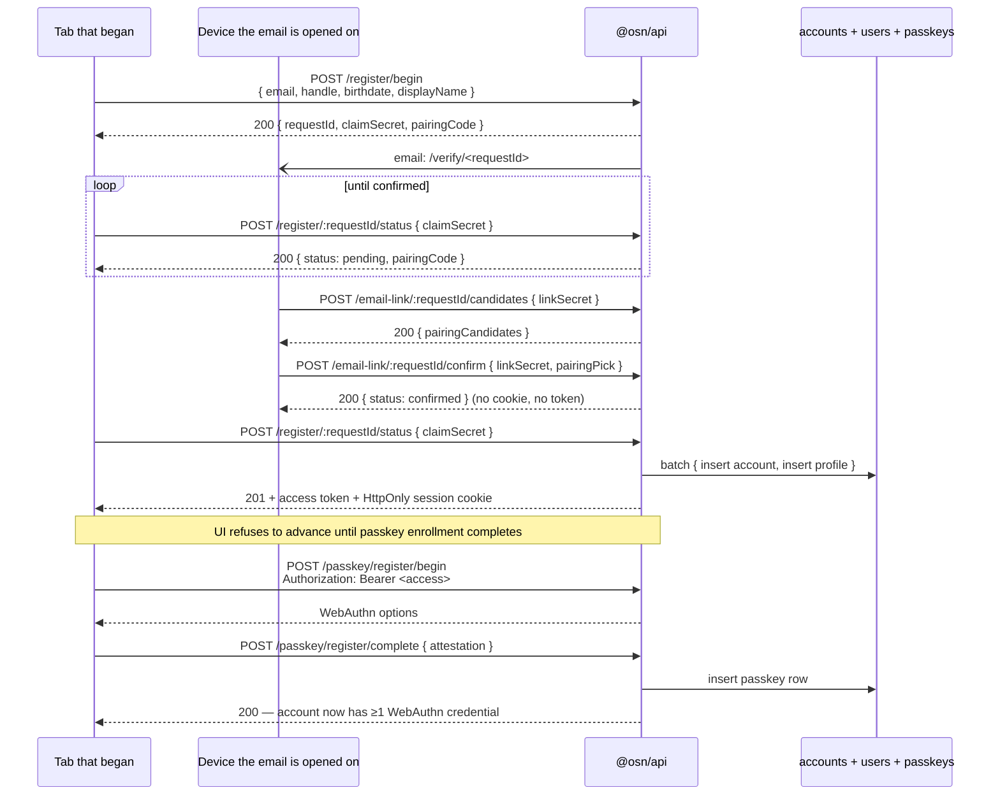

# Identity Model

## Terminology

| Term | Meaning | Code entity |
|------|---------|-------------|
| **User** | The actual human person. Not a data structure — never a type name, column, or variable. | — |
| **Account** | Login identity — email, passkeys, auth tokens. A user owns one account. | `accounts` table, `acc_` prefix |
| **Profile** | Public-facing identity — handle, display name, avatar. An account can have multiple profiles. | `users` table (legacy name), `Profile` type, `usr_` prefix |
| **Organisation** | Group identity composed of profiles. | `organisations` table, `org_` prefix |

A user owns an account, which owns one or more profiles. The relationship is: **User (person) → Account (login) → Profiles (public identities)**.

OSN uses a two-tier identity model inspired by Meta's Accounts Center. A single **account** (the login entity) can own multiple **profiles** (the public-facing handles). **Organisations** are separate entities composed of individual profiles.

## Architecture

```mermaid
flowchart TD
  user(["User<br/>(real human)"])
  account["accounts<br/>acc_xxxx · email · passkeyUserId<br/><i>login identity — never exposed</i>"]
  profileA["users (profile)<br/>usr_aaaa · handle: @alice<br/><i>public identity</i>"]
  profileB["users (profile)<br/>usr_bbbb · handle: @alice_work<br/><i>public identity</i>"]
  graph["social graph<br/>connections · blocks"]
  pulse["pulse/*<br/>events · RSVPs"]
  zap["zap/*<br/>chats · messages"]

  user -.owns.-> account
  account -- "1:N (private link)" --> profileA
  account -- "1:N (private link)" --> profileB
  profileA --> graph
  profileA --> pulse
  profileA --> zap
  profileB --> graph
  profileB --> pulse
  profileB --> zap
```

Key invariant: every cross-domain reference (RSVP, chat membership, connection edge) keys on `profileId`. `accountId` never leaves the auth boundary — see Privacy Rules below.

## Accounts

The `accounts` table is the **authentication principal** — the entity that logs in, owns passkeys, and receives step-up / email-change OTPs.

| Column | Type | Notes |
|--------|------|-------|
| `id` | `text PK` | `acc_` prefix + 12 hex chars |
| `email` | `text UNIQUE` | Login credential — the only place email lives. Written lower case; the database refuses a capital: see below |
| `passkeyUserId` | `text NOT NULL UNIQUE` | Random UUID used as WebAuthn `user.id` — opaque, non-correlating |
| `maxProfiles` | `integer` | Default 5; enforced by `createProfile` |
| `createdAt` | `timestamp` | |
| `updatedAt` | `timestamp` | |

**Key invariants:**
- `accountId` is **never exposed** in any API response, token claim, or log entry. It is the multi-account correlation identifier — leaking it reveals which profiles belong to the same person. It is on the log redaction deny-list.
- `passkeyUserId` is a random UUID generated at account creation, used as the WebAuthn `user.id` in passkey registration. It stops anyone correlating two profiles on the same account through matching WebAuthn credential `user.id` fields.
- Email is **only on accounts**, not duplicated on profiles.
- Passkeys reference `accounts.id` (not profile IDs), because authentication is account-level.

**The email at the database.** Every writer stores the address lower-cased: registration, email change and `registerProfile` call `toLowerCase()`, and the seeds use lower-case literals. Two triggers, `accounts_email_lower_case` (insert) and `accounts_email_lower_case_update` (update of `email`), refuse an email holding a capital A to Z with the message `account email is not lower case`, whoever writes it. SQLite's `lower()` folds only A to Z, so a capital outside them passes; no writer stores one. Migration [`20261110132140_account_email_lower_case.sql`](../../osn/db/drizzle/20261110132140_account_email_lower_case.sql) creates the triggers and changes no stored row, so it cannot fail on what a database holds. [`osn/db/src/triggers.ts`](../../osn/db/src/triggers.ts) copies them into every test database and into the local file `db:push` builds ([[testing-patterns#Schema-derived test databases]]).

**Finding an account by what the user typed.** Passkey sign-in (begin and complete), recovery-code sign-in, and email and authenticator-code recovery all take one identifier, an email address or a handle. `normaliseIdentifier` (`osn/api/src/services/auth/helpers.ts`) trims it, strips any leading `@` and lower-cases it, so `Alice@X.com`, `@Alice` and ` alice ` name the same account, as they do in the people search. Every store key a ceremony derives (the login challenge, the probe key) starts from that one string, so a ceremony begun in one case and finished in another meets its own entries. `resolveIdentifier` (`profiles.ts`) treats one longer than 255 characters, longer than any stored email or handle, as naming nobody and looks nothing up. Otherwise it looks up a handle by that string, and an email in one statement that matches the address as typed (trimmed, `@` stripped, case kept) or lower-cased, preferring the row stored as typed, and of that account its default profile. The typed match is for a row stored with capitals before the triggers: it signs in by its address exactly as stored, and stays apart from an account whose address differs only in case. The owner, never an agent, can count such rows with `SELECT count(*) FROM accounts WHERE email <> lower(email)`, which reads counts only and sees capitals A to Z only.

## Profiles (DB table: `users`)

The `users` table is the **public-facing identity**. This is what other profiles see — a handle, display name, and avatar. Every reference across Pulse, Zap, and the social graph points to `users.id` (the `profileId`). Code-level functions and API parameters use `profile` terminology (e.g. `findProfileByHandle`, `registerProfile`, `blockProfile`); the DB table retains the name `users` for migration stability.

| Column | Type | Notes |
|--------|------|-------|
| `id` | `text PK` | `usr_` prefix + 12 hex chars |
| `accountId` | `text FK → accounts.id` | The owning login entity (never exposed) |
| `handle` | `text UNIQUE` | `@handle` — immutable social identity |
| `displayName` | `text` | Nullable display name |
| `avatarUrl` | `text` | Nullable avatar URL |
| `isDefault` | `boolean` | Exactly one per account; auto-selected on login |
| `createdAt` | `timestamp` | |
| `updatedAt` | `timestamp` | |

**Key invariants:**
- `profileId` (previously `userId`) is the canonical identifier throughout all services. Pulse events, Zap chats, RSVPs, connections, blocks — everything keys on `profileId`. All service functions, route parameters, and error messages use "profile" terminology (not "user").
- Each profile has a **fully independent social graph**. If profile A blocks someone, profile B (same account) is NOT affected.
- Two profiles from the same account **can interact** — they can connect, message, RSVP to the same event. Preventing this would reveal the account link.
- Handle namespace is **shared with organisations** — no user handle can collide with an org handle.

## Organisations

Organisations are independent entities that are **composed of profiles, not accounts**. An org member is a handle/profile. The system cannot distinguish whether two members in the same org share an account.

| Column | Type | Notes |
|--------|------|-------|
| `id` | `text PK` | `org_` prefix |
| `handle` | `text UNIQUE` | Shared namespace with user handles |
| `name` | `text` | Display name |
| `ownerId` | `text FK → users.id` | A profile, not an account |

### Organisation Members

| Column | Type | Notes |
|--------|------|-------|
| `id` | `text PK` | `orgm_` prefix |
| `organisationId` | `text FK → organisations.id` | |
| `profileId` | `text FK → users.id` | The member's profile |
| `role` | `admin \| member` | The database refuses any other value: see below |

**The role at the database.** Two triggers, `organisation_members_role_known` (insert) and `organisation_members_role_known_update` (update of `role`), refuse any role but `admin` or `member` with the message `organisation member role is not admin or member`, whoever writes it. Migration [`20261107024712_organisation_member_role_check.sql`](../../osn/db/drizzle/20261107024712_organisation_member_role_check.sql) creates them. Drizzle cannot declare a trigger, so [`osn/db/src/triggers.ts`](../../osn/db/src/triggers.ts) copies them into every test database (`applySchema`) and into the local file `db:push` builds; see [[testing-patterns#Schema-derived test databases]].

The migration ends by stopping if a stored row already holds another role; it rewrites nothing, since mapping or deleting such a row changes who can act for an organisation. If it stops, a later migration cannot fix it: Alchemy applies files in name order and stops at the first that fails, so every release that ships the musubi stack stops at "Apply osn-db-prod's migrations with Alchemy" before the Worker deploys (the running Worker keeps serving), and on dev every musubi stack deploy fails. Recover in this order:

1. The owner counts the rows on the database that stopped, under their own Cloudflare login; an agent never runs it. It reads counts only, never rows. On production: `cd osn/api && bunx wrangler d1 execute osn-db-prod --remote --env production --command "SELECT count(*) FROM organisation_members WHERE role NOT IN ('admin', 'member')"`.
2. The owner decides whether each such row becomes `member` or `admin`, or is deleted. It is a permission decision.
3. The owner writes that change on the same database with `wrangler d1 execute`, and the next release applies the file unchanged. Each row changed or deleted is an admin action on user data: record it per [[access-control#Internal admin actions on user data]] (row count, the decision, who made it and when).

Never rewrite the file to recover. By then `osn-db-dev` has almost always applied it, since a merge deploys dev at once, and Alchemy refuses an applied file whose bytes changed ([[infrastructure-as-code#Migrations]]).

**Key invariants:**
- Multiple profiles from the same account **can be in the same org** — one might be admin, another a member. This is by design.
- Org ownership is per-profile. Deleting a profile that owns an org requires ownership transfer first.
- The `listMembers` service return **never includes `accountId`** — defence in depth against correlation leakage.
- Admins add and remove plain members; only the owner grants admin, removes an admin or changes a role, and the owner itself cannot be removed. Each membership write (`addMember`, `removeMember`, `updateMemberRole`, `updateOrganisation` in `osn/api/src/services/organisation.ts`) checks in one statement and writes in another, so the write carries what the checks read: the caller's admin row (a non-owner's add, removal or update), the member's row and, for a non-owner's removal, its plain-member role. A caller demoted, or a member promoted or removed, in between changes nothing, and the write is refused with the message the checks would give now. The owner needs no such guard: `ownerId` never changes.

## Token Model

| Token | Bound to | Format | TTL | Purpose |
|-------|----------|--------|-----|---------|
| Access | Profile | ES256 JWT (`sub` = profileId) | **5 min** | Authorise API calls as a specific profile |
| Session (refresh) | Account | Opaque `ses_` + 40 hex chars (160-bit entropy) | 30 days (sliding) | Re-issue access tokens; enables profile switching without re-authentication |
| Enrollment | Account | ES256 JWT (`sub` = accountId) | 5 min | Passkey registration after signup |
| Recovery code | Account | 16 hex chars `xxxx-xxxx-xxxx-xxxx` (64-bit entropy) | No expiry, single-use | Lost-device account recovery (Copenhagen Book M2) — see [[recovery-codes]] |

### JWT audiences

`aud` is what separates the token kinds, and every verifier pins exactly one. A token is not "an OSN token" — it is a token for one audience, and presenting it anywhere else fails closed.

| `aud` | Minted by | Accepted by |
|---|---|---|
| `osn-access` | login, `/token` refresh, `/profiles/switch` | every authenticated route here, plus `pulse/api`, `zap/api` and `cire/api` through `@shared/osn-auth-client` |
| `osn-recovery` | a restricted recovery session | `resolvePasskeyEnrollPrincipal` **only** — i.e. `/passkey/register/begin` and `/complete`, and nothing else anywhere |
| `osn-step-up` | `/step-up/*/complete` | the step-up verifiers, purpose-bound — see [[step-up]] |
| a relying party's `client_id` | the OIDC token endpoint (`typ: at+jwt`) | that relying party. Never a first-party route |

`osn-recovery` is the audience of the **restricted recovery session**: it can enrol a passkey and do nothing else. The restriction lives in the audience rather than in a column precisely because three of the verifiers above are services with no access to OSN's database, and all of them already pin `osn-access` — so they reject it with no change to any of them. The mechanism, its 15-minute absolute expiry and how rotation carries it are in [[sessions#The restricted recovery session]].

Every one of these values is on the reserved OIDC client-id deny-list (`RESERVED_OIDC_CLIENT_IDS`), so no relying party can register under a name whose tokens would collide with an internal verifier's pin.

Access tokens live only in the page's memory: `@osn/client` writes no token to storage ([[#Client Storage Model]]), so a script that can read `localStorage` finds none to carry off. A 5-minute TTL caps what a token taken from a running page is worth — the companion is the client's `authFetch`, which renews the token through the HttpOnly refresh cookie before it expires and on a 401 ([[sessions#Renewal in the browser]]). Third-party OAuth clients receive `expires_in: 300` in the `/token` response.

**Issuer pinning.** Access and step-up JWTs are signed with `iss = AuthConfig.issuerUrl` and every verify pins `issuer` with a **30s `clockTolerance`** (`signJwt` / `verifyJwt` in `osn/api/src/services/auth/helpers.ts`). A token minted by a different OSN deployment is rejected. The downstream `@shared/osn-auth-client` verifier carries the same contract — rollout is **verifier-first**: the tolerant verifier must deploy before the signer enforces `iss`, or every legacy iss-less token would be rejected the instant the signer rolls out.

### Server-side sessions (Copenhagen Book C1)

Session tokens (formerly "refresh tokens") are **opaque** — not JWTs. The server stores only the **SHA-256 hash** of each token in the `sessions` table. A database leak does not expose valid tokens because the tokens have 160 bits of entropy.

**Sliding-window expiry:** when less than half the TTL remains (< 15 days), the session's `expiresAt` is extended by the full TTL from now. This matches the Copenhagen Book's recommended pattern.

**Revocation:** `invalidateSession(token)` ends the token's device: every session of its family, so a refresh of the same token in another tab cannot leave one behind ([[sessions#Endpoints]]). `POST /logout` exposes it, and every route that sets a new session cookie ends the device of the cookie the request carried the same way, once the new session exists (`endReplacedSession`; [[sessions#Endpoints]]). A passkey added or deleted ends the account's other devices instead: `invalidateOtherAccountSessions(accountId, keepSessionHash)` deletes every session outside the caller's family ([[sessions]]).

**Sessions table:**

| Column | Type | Notes |
|--------|------|-------|
| `id` | `text PK` | SHA-256(raw token), hex-encoded |
| `account_id` | `text FK → accounts.id` | The owning account |
| `expires_at` | `integer` | Unix seconds |
| `created_at` | `integer` | Unix seconds |
| `restricted_until` | `integer` nullable | Non-null only on a restricted recovery session, where it equals `expires_at`. Drives **rotation**, not request-time authorisation — see [[sessions#The restricted recovery session]] |
| `restricted_amr` | `text` nullable | The RFC 8176 factor that minted a restricted recovery session (`otp` / `totp` / `webauthn`). What the passkey-enrolment bypass is checked against, so the step-up it skips is priced at the ceremony actually performed. NULL on every ordinary session |

Two profile management endpoints:
- `POST /profiles/switch` — Bearer access token, target `profile_id` in the body; receive a new access token for that profile, bound to the caller's session. That session must be live, named by the session cookie or the token's `osn_sid`, or the answer is `409 session_stale` ([[sessions#Access-token session binding (`osn_sid`)]]). Per-account rate limited (20 switches/hr).
- `GET /profiles/list` — Bearer access token; receive all profiles for the account. The session token itself travels only in the HttpOnly cookie, never in an `Authorization` header, so it is not confused with an access token.

## Client Storage Model

`@osn/client` holds the session in two places (`osn/client/src/service.ts`, `osn/client/src/tokens.ts`):

| Where | Shape | Holds |
|-------|-------|-------|
| The service's memory | `AccountSession` | Active profile ID, per-profile access tokens, scopes, ID token |
| `localStorage` key `@osn/client:account_session` | `StoredAccount` JSON | `hasSession`, the active profile ID and the sign-in's id — nothing else |

```typescript
interface StoredAccount {
  hasSession: boolean;      // this device holds a session cookie, as far as the client knows
  activeProfileId: string;  // the profile the page was on; a reload's grant names it
  signInId: string;         // random, one per sign-in on this device; never sent anywhere
}
```

**Design decisions:**
- No credential is written to storage. Page script reads `localStorage` as easily as the page does, so a token there is a token any injected script can take elsewhere. A reload gets its token from the HttpOnly session cookie instead ([[#Session load on mount — durable refresh across reloads]]).
- Every write goes through `saveAccountSession`, which keeps the full session in memory and writes only the `StoredAccount` cut.
- Every read is validated against Effect Schema (`decodeStoredAccount`), which takes those fields and nothing else; malformed data is removed rather than consumed. A stored value with more fields — an older client's tokens — is rewritten without them on the first read (an older value with no `signInId` gets one), and no token is ever read from storage.
- Tabs share the stored account but nothing in memory: each holds its own tokens and renews for itself, and acts as the profile its own screen shows. A sign-in (`setSession`) or a cold-start bootstrap begins a new `signInId`; a reload, a renewal and a profile switch keep it. A tab ends its session, with no request and leaving storage alone, when the stored account is gone or carries another `signInId` — another tab signed out, and perhaps someone signed in since. The runtime checks on every `storage` event for the key (`checkStoredAccount`) and `authFetch` before every request ([[sessions#Renewal in the browser]]).
- Expired tokens of profiles other than the active one are pruned from memory on every save.
- iOS passes `createEphemeralStorage()`, so not even the stored account reaches disk there.

## Session load on mount — durable refresh across reloads

`@osn/client` exposes `loadSession()` (the entry point the SolidJS `AuthProvider` calls on mount via the `session` resource, on the page's one `createOsnAuthRuntime`). Access tokens live only in memory, so a reloaded page holds none. The HttpOnly `__Host-osn_session` refresh cookie (30-day sliding window) is what keeps the user signed in; `loadSession` redeems it.

`loadSession` resolves three cases, in order (`osn/client/src/service.ts`):

| Stored account? | Access token in memory | Action |
|---|---|---|
| none | — | **Cold-start bootstrap** — only when the `osn_has_session` marker is set: replay the cookie against `POST /token` and rebuild the account from the response (post-login full-page navigation). |
| present | still valid | Return it directly — no `/token` roundtrip. Only a page that already holds a session gets here. |
| present, `hasSession === true` | none, or expired | **Rehydrate from the cookie** via the same `/token` grant, naming the stored active profile, so a reload keeps the profile it was on. Every reload takes this path. A refused grant also removes the stored account, so the next load spends no grant on a dead cookie; a transient failure keeps it. |

`toSession` yields `null` without a valid token, so a `loadSession` that trusted the stored account alone would report every reloaded user as signed out while the cookie is alive; the third case is what stops that.

A session set or ended while the bootstrap grant is out wins: a sign-in adopted, a log out, or another tab storing another sign-in or none. The load then resolves to the session the page holds, or `null`, and the grant's answer is neither saved nor, if refused, allowed to forget the stored account ([[sessions#Renewal in the browser]]).

**Single-flight + retry/backoff.** Both cold-start and rehydrate go through one shared, single-flighted cookie grant (`fetchTokenGrant`), so concurrent mounts fire **exactly one** `/token` — replaying a rotated cookie a second time would trip C2 reuse detection and revoke the family. The grant classifies failures:

- **Terminal** (`/token` 4xx but 429, e.g. `invalid_grant`): the cookie is genuinely gone/expired/rotated: fail fast, **no retry**; `loadSession` resolves to `null` (genuinely logged out, never throws). The exception is a `400 invalid_grant` the issuer marks as leaving the cookie's status unknown (a lost rotation race, a storage error): it is retried once after 250 ms — see [[sessions#Renewal in the browser]].
- **Transient** (`5xx`): the cookie is probably still alive; the server just couldn't answer (cold Worker isolate, momentary blip), so the grant gets **bounded exponential backoff** (3 attempts, ~0 + 200ms + 400ms) before giving up: a single hiccup must not evict a live session.
- **Network** (`fetch` rejects; a CORS refusal looks the same): 2 attempts, ~0 + 200ms. A refused origin never becomes an allowed one on the next attempt.
- **Rate limited** (`429`): 1 attempt, since a retry inside the same window would meet the same refusal. The failure carries `Retry-After`, which sets how long renewal pauses ([[sessions#Renewal in the browser]]).

**Which profile a grant mints for.** `POST /token` takes an optional `profile_id`. The issuer mints the access token for it when the cookie session's account owns that profile, bound to the rotated session as any grant is; otherwise — no field, a profile that is gone, or another account's — for the account's default profile, so the grant says nothing about which profiles exist. A restricted recovery session ignores the field. Renewal in the browser and the rehydrate on reload name the active profile; the cold-start bootstrap and `refreshHeldSession` name none.

This keeps the short access-token TTL (XSS blast-radius cap) intact while making the *session* durable: the user stays signed in across reloads for as long as the refresh cookie lives — **provided the app and the issuer share a registrable domain**. `__Host-osn_session` is `SameSite=Lax`, so a browser sends it on a credentialed `POST /token` only when the calling page is same-site with the issuer.

> **This is what the 2026-07-27 identity move broke, deliberately.** The issuer is now `id.musubi.social` (see [[musubi-identity-migration]]). `@musubi/social` on the `musubi.social` apex is same-site with it, so the cookie flows and the rehydrate path above works. The cire origins — `app.cireweddings.com`, `vendor.`, `invite.` — are a **different registrable domain** from `musubi.social`, so their `/token` grants are cross-site and the cookie is never sent: cold-start bootstrap and rehydrate both resolve to `null`, and the passkey ceremony that would rebuild the session is itself illegal under the new RP ID. Cire regains sessions by moving to the OIDC redirect flow, where the cookie is only ever replayed from the identity domain itself — see [[oidc-provider]].

## Registration Flow



The link, the pairing number and the refusals are in [[email-links]]. With the Email Verification API flag on, a browser that has the API can prove the address at `begin` instead: the request is confirmed there, no email goes, and the tab's first status poll makes the account — [[email-verification-api]]. Passkey enrolment is **mandatory**; `deletePasskey` refuses to drop below 1 credential. This gives the account-level invariant "every live account has ≥1 WebAuthn credential at all times".

Passkey (or security key) is the only primary login factor. OTP and magic-
link primary-login surfaces were removed; OTP survives as the step-up and
email-change verification factor. A lost device has three ways back: a
recovery code, which mints an ordinary session, and an emailed link or an
authenticator code, each of which mints a restricted session that can only
enrol a passkey — see [[recovery-codes]] and [[account-recovery-factors]].

## Cross-Service Impact

| Service | References | Notes |
|---------|-----------|-------|
| Pulse events | `createdByProfileId` | Profile that created the event |
| Pulse RSVPs | `profileId` | Profile that RSVP'd |
| Zap chats | `createdByProfileId`, member `profileId` | Profiles in the chat |
| Social graph | `requesterId`, `addresseeId` (both profile IDs) | Independent per profile |
| ARC S2S | No profile context | Service-to-service only |
| Login response | `{ session, profile: PublicProfile }` | Wire format + SDK types renamed to match identity model |

## Privacy Rules

1. **`accountId` never appears in**: API responses, JWT claims (except refresh tokens, which only the account holder sees), log entries (enforced via redaction deny-list), metric attributes, span attributes, or any data sent to other services.
2. **`passkeyUserId` (not `accountId`)** is used as the WebAuthn `user.id` to prevent passkey-based profile correlation.
3. **Rate limiting is per-profile** for API calls, **per-IP for auth** — per-account rate limits would correlate profiles. Exception: profile-switch rate limiting is per-account (acceptable because the endpoint inherently requires the account-scoped refresh token).
4. **Block independence** — blocking on one profile does NOT affect other profiles on the same account.
5. **Self-interaction allowed** — two profiles from the same account can follow, message, and interact. Preventing this would reveal the link.
6. **Log redaction** — `accountId` and `account_id` are in the observability deny-list (`shared/observability/src/logger/redact.ts`) as defence in depth.

## Passkey Management

Settings-surface operations over an account's existing credentials. All routes bearer-authenticated; `DELETE` additionally gated by a fresh step-up token (passkey or OTP amr).

| Endpoint | Purpose | Step-up required? |
|----------|---------|-------------------|
| `GET /passkeys` | List credentials with label / created / last-used / backup-eligible flags | No |
| `PATCH /passkeys/:id` | Rename (label-only, 1–64 chars trimmed) | No |
| `DELETE /passkeys/:id` | Remove + invalidate other sessions + write `security_events{kind: "passkey_delete"}` | **Yes** |

### Schema columns (added 2026-04-22, migration `0007_passkey_management.sql`)

| Column | Type | Notes |
|--------|------|-------|
| `label` | `text` | User-editable friendly name. NULL → UI falls back to synced/device heuristic |
| `last_used_at` | `integer` | Unix seconds. Coalesced to 60s on assertion / step-up |
| `aaguid` | `text` | Authenticator model UUID from WebAuthn attestation |
| `backup_eligible` / `backup_state` | `integer` 0/1 | WebAuthn sync-capable / synced flags |
| `updated_at` | `integer` | Unix seconds for any metadata change (rename, counter bump) |

### Enrolment hardening

- `residentKey: "preferred"` — an authenticator that can hold a discoverable credential makes one, so it signs in through conditional UI; a FIDO2 security key without a resident-key slot registers as non-discoverable and signs in through the identifier form ([[passkey-primary#Accepting security keys]]).
- `userVerification: "required"` — biometric or PIN, never silent sign-in.
- `maxPasskeys = 10` per account, enforced at `begin` and re-checked race-safely at `complete`.

### Discoverable-credential login

`POST /login/passkey/begin` with no body (or `{}`) returns `{ options, challengeId }`; `challengeId` is `options.challenge`. Browser calls `navigator.credentials.get({ mediation: "conditional", … })`; the signed assertion is posted back via `/login/passkey/complete` with `{ challengeId, assertion }`. The server resolves the caller from the credential's `accountId` + `userHandle`. Exactly one of `identifier` / `challengeId` must be present — the route returns 400 otherwise.

The challenge proves itself — 16 random bytes, an expiry and an HMAC over both — so `begin` stores nothing. `complete` refuses a challenge that is not the one the browser signed, that the server did not mint or that has expired, and claims its nonce once the signature verifies, so it signs in once ([[coordination-store#Refusals cost the same, and single use is atomic]]).

### Last-passkey guard

`deletePasskey` refuses to delete an account's last passkey, whatever recovery codes the account holds (`osn/api/src/services/auth/passkey-management.ts`). To replace a passkey, the user adds the new one first, then deletes the old one.

## Multi-Account Roadmap

| Phase | Status | Scope |
|-------|--------|-------|
| P1: Schema + terminology | ✅ Done | `accounts` table, `userId` → `profileId`, seed data, email dedup, service/route/test rename from "user" → "profile" terminology |
| P2: Auth refactor | ✅ Done | Two-tier tokens (refresh=account, access=profile), `POST /profiles/switch`, `POST /profiles/list`, `verifyRefreshToken`, `findDefaultProfile`, scope claim validation, per-account rate limiting |
| P3: Profile CRUD | ✅ Done | `createProfile` (maxProfiles enforcement), `deleteProfile` (cascade delete graph+org data), `setDefaultProfile`, three REST routes, `withProfileCrud` observability wrapper |
| P4: Client SDK | ✅ Done | Multi-session `AccountSession` storage in `@osn/client`, `listProfiles` / `switchProfile` / `createProfile` / `deleteProfile` / `getActiveProfile` methods, SolidJS `AuthContext` integration (`profiles` resource, `activeProfileId` signal), legacy session migration, Effect Schema validation on storage reads + API responses, Base64URL JWT parsing, expired token pruning |
| P5: UI | ✅ Done | Profile switcher component, create form, onboarding |
| P6: Privacy audit | ✅ Done | `passkeyUserId` column (WebAuthn correlation fix), `accountId` log redaction, privacy invariant tests, route/token/span/metric audit (all clean) |
