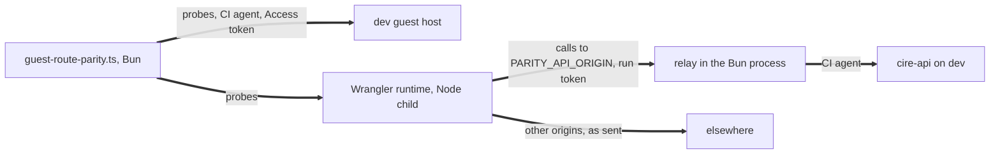

# Infrastructure as code (Alchemy)

## What it is

Alchemy deploys the Cloudflare resources the monorepo runs — Workers, D1 databases, R2 buckets, custom domains and cron schedules — from one stack per product. `@shared/infra` ([`shared/infra/`](../../shared/infra/package.json)) holds the building blocks those stacks use, and pins `alchemy` and its Cloudflare provider, `@alchemy.run/cloudflare`, at exactly `2.0.0-beta.85`.

The Cloudflare resources, the state backend and the Worker bundler come from `@alchemy.run/cloudflare`; stacks import it as `@alchemy.run/cloudflare` and its subpaths, and Alchemy's core as `alchemy/...`. The CLI finds the state backend through the `alchemy.contributes` field of `@alchemy.run/cloudflare`'s manifest, which it reaches from the dependencies the working directory's `package.json` files list, or from an `@alchemy.run` directory in a `node_modules` above it. Bun's isolated install links a package only into the workspaces that list it, so every package that runs Alchemy lists `@alchemy.run/cloudflare` itself; one that does not fails with `Unknown state backend 'cloudflare'`.

**Both tiers deploy through it.** Four stacks build the dev tier in its own Cloudflare account from `.github/workflows/deploy.yml` ([[#The dev deploy]], [[dev-environment]]). On production the musubi, cire and zap stacks deploy every production Worker from `.github/workflows/production-release.yml`: the sites, one switch per site ([[#Production sites]]), and the API Workers with their databases and buckets, each adopted in place under its live name ([[#Production API Workers and storage]]). Alchemy is every database's one migrator, on both tiers ([[#Migrations]]). Wrangler reads each Worker's `[env.production]` block for `secret put` and `types`; it deploys and migrates nothing deployed. The rollout's design is [`docs/superpowers/specs/2026-10-16-alchemy-rollout-design.md`](../../docs/superpowers/specs/2026-10-16-alchemy-rollout-design.md), under epic englishstreetventures/osn#1490.

Alchemy runs on Effect. Root `package.json` `overrides` hold `@effect/platform-node-shared` and `@effect/sql-d1` at `4.1.2`, so the tree keeps one copy of `effect`; `shared/infra/tests/package.test.ts` fails on a second copy of `effect`, `alchemy` or `@alchemy.run/cloudflare`, on any `@effect/*` package at a version other than the `effect` `@shared/infra` pins, or on any other Alchemy version.

## Accounts

Dev and production are separate Cloudflare accounts.

- **Production** stays in the current account. Alchemy adopts its API Workers, databases and buckets in place, under their existing names, so no guest domain moves.
- **Dev** is built fresh in its own account (englishstreetventures/osn#1538), on a zone of its own named by `DEV_DOMAIN` ([[#Dev hosts]]).

[`TIER_ACCOUNTS`](../../shared/infra/src/accounts.ts) names, for each tier, the GitHub Environment and the two Environment secrets that give its jobs their account. A job maps them to `CLOUDFLARE_ACCOUNT_ID` and `CLOUDFLARE_API_TOKEN`, the two variables Alchemy reads. No file holds an account id.

| Tier | Environment | Account id secret | API token secret |
|---|---|---|---|
| `dev` | `dev` | `CLOUDFLARE_DEV_ACCOUNT_ID` | `CLOUDFLARE_DEV_ACCOUNT_API_TOKEN` |
| `production` | `production` | `CLOUDFLARE_ACCOUNT_ID` | `CLOUDFLARE_API_TOKEN` |

Dev's names are its own because a production name read in the `dev` Environment can resolve to a production value: `CLOUDFLARE_ACCOUNT_ID` falls back to the repository secret of that name, which names the production account. `accounts.ts` lists `CLOUDFLARE_ACCOUNT_ID` and `CLOUDFLARE_API_TOKEN_DEV`, the production account's id and a Wrangler token name on that account, as `RETIRED_DEV_CREDENTIALS`: the `dev` Environment, which has no reviewer, must never hold either, and no job in it reads either ([[dev-environment#The production account holds no dev tier]]). It lists the dev account's read-only token, `CLOUDFLARE_DEV_ACCOUNT_API_TOKEN_READONLY`, as `DEV_READONLY_CREDENTIALS`: the free-tier ceiling alert's dev job reads it, so `requiredCredentials("dev")` holds it beside the account pair. It lists `CLOUDFLARE_PAGES_DNS_TOKEN`, the Pages and DNS token that once moved a site's domain off its Pages project, as `RETIRED_CREDENTIALS`: no workflow may read it and neither Environment may hold it. It lists the repository-level `CLOUDFLARE_ACCOUNT_ID` and `CLOUDFLARE_API_TOKEN_READONLY` (read-only, production account) as `REPOSITORY_CREDENTIALS`.

Two checks enforce these names:

- `shared/infra/tests/accounts.test.ts` reads every `.github/workflows/*.yml`. It fails when a workflow reads a Cloudflare credential `accounts.ts` does not classify (`knownCredentials()`, which leaves out `CLOUDFLARE_API_TOKEN_DEV`), and when any workflow but `alchemy-state.yml`, `deploy.yml` and `free-tier-ceiling-alert.yml` reaches the dev account.
- `secrets:check-github` (below) fails when an Environment holds the other tier's credential or a retired dev one, unless its own account uses the name, or a retired one in either tier (`forbiddenCredentials()`): `dev` must not hold `CLOUDFLARE_ACCOUNT_ID`, `CLOUDFLARE_API_TOKEN`, `CLOUDFLARE_API_TOKEN_DEV` or `CLOUDFLARE_PAGES_DNS_TOKEN`; `production` must not hold `CLOUDFLARE_API_TOKEN_DEV`, `CLOUDFLARE_DEV_ACCOUNT_API_TOKEN`, `CLOUDFLARE_DEV_ACCOUNT_API_TOKEN_READONLY`, `CLOUDFLARE_DEV_ACCOUNT_ID` or `CLOUDFLARE_PAGES_DNS_TOKEN`. It reads names alone, so a token under another name passes it; it lists Environment secrets only, never repository-level ones; and nothing in CI runs it.

The credentials a run carries choose the account, and no stack checks which account that is. `assertDeployTarget()` checks only that `OSN_DEPLOY_TIER` names the stage's tier and that both credentials are set ([[#How a stack run starts]]); `token:check`, below, is the one check that ties a token to its tier, and only a run that calls it first gets it. So the Environment a job runs in, or the credentials a person exports, must match the stage.

A token can reach more than one account: one created with "All accounts" by a member of both reaches production from the `dev` Environment, which has no reviewer. A token also holds zone grants apart from its accounts, so a grant on another account's zone need not show in its account list. So before Alchemy runs, `bun run --cwd shared/infra token:check -- --tier <dev|production>` ([`scripts/check-token-reach.ts`](../../shared/infra/scripts/check-token-reach.ts)) lists the accounts `CLOUDFLARE_API_TOKEN` reaches (`GET /accounts`) and stops the run unless it is exactly the one `CLOUDFLARE_ACCOUNT_ID` names. With `--tier dev` it needs `DEV_DOMAIN` too, reads every page of the zones the token can act on (`GET /zones`), and refuses a zone of another account, a production zone or a name under one, and a token that cannot act on the `DEV_DOMAIN` zone; the last also refuses an account id that names production. It exits 1 on any of those, 2 when an argument or variable is missing or a listing fails, and prints no account id. Every CI job that runs Alchemy runs it first: the two tier steps of `alchemy-state.yml` (`--tier dev` with `DEV_DOMAIN`, and `--tier production`), each stack job of `deploy.yml` before its first step that holds the dev token (W12 in `shared/infra/tests/workflow-secrets.test.ts`), and `production-release.yml`'s `alchemy-plan` and stack jobs (`--tier production`) before any step that holds the production token. No stack and no package script runs it, so a run by hand runs it first ([[#How a stack run starts]]).

## The building blocks

Every builder takes each setting where Alchemy's default differs from today's Wrangler config as a required input, so a stack cannot inherit a default by leaving a field out. Each `*Props()` function is pure and tested; the wrapper of the same name without `Props` declares the Alchemy resource with its removal policy.

| Export | What it does | Alchemy default or behaviour it overrides |
|---|---|---|
| `apiWorker()`, `apiWorkerProps()` | A Worker with code. Every setting is required: the Worker's inventory key (`worker`), entry, whether Alchemy bundles it (`bundle`), the static assets it serves beside its code (`assets`, or `null`), compatibility date and flags, custom domain, crons, the stable `workers.dev` URL, version preview URLs, vars, bindings, secrets and observability, Workers Issues included. A bundled Worker passes rolldown `WORKER_BUNDLE_EXTERNAL`: Alchemy's own `lightningcss` and `fsevents`, plus `BUN_ONLY_MODULES` (`drizzle-orm/bun-sqlite`), so no bundle names `bun:sqlite`. A prebuilt Worker (`bundle: false`) passes no build options and uploads with `PREBUILT_MODULE_RULES`: Alchemy's default module rules (scripts, WebAssembly, text and data modules) plus `**/*.map`, the source maps `writePrebuiltStage()` writes beside its modules. A `null` domain detaches every custom domain. Production refuses preview URLs, and holds observability to the rules in [[#Production observability]]. No var or binding may take a name the secret inventory lists for the Worker, except a var the stage's own tier lists in `plainVars`. On dev `secrets` holds every name the inventory requires; on production it holds none, and `apiWorker()` declares the Worker to be adopted (`AdoptPolicy.adopt(true)`, [[#Production API Workers and storage]]). `logs: false` sends Workers Logs off, as a Wrangler config with no `observability.enabled` does. Invocation logs are off unless the input turns them on. Zone routes stay unmanaged. Its refusals are in [[#Errors]]. | Without the provider patch an upload keeps only the secrets it names and deletes the rest ([[#Dependency review]]), and a later deploy deletes a secret an earlier one uploaded and it drops; `workers.dev` and version preview URLs on; invocation logs on when `observability` is omitted; Workers Issues turned off on the next full deploy when `observability.issues` is omitted; five `ALCHEMY_*` plain-text bindings bound first, so a secret of the same name is silently dropped; an `external` list replaces Alchemy's own rather than adding to it |
| `siteWorker()`, `siteWorkerProps()` | A static-assets Worker for a built site. Alchemy applies the directory's `_headers`, and its `_redirects` unless `redirectsFile` is `false`, which sends an empty list that overrides the file. A site with an `entry` runs that module for the paths its `runWorkerFirst` rules name; one with `entry: null` uploads no script. HTML and not-found handling, the stable `workers.dev` URL, version preview URLs and Workers Issues are required; production refuses preview URLs. Query strings redacted, native traces and invocation logs off, on every stage. | `workers.dev` and version preview URLs on; invocation logs on; Workers Issues turned off on the next full deploy when `observability.issues` is omitted |
| `retainedD1()`, `retainedD1Props()` | A D1 database kept on destroy: name, read replication, jurisdiction, and its migrations, as `{ dir, table: "__alchemy_migrations" }`, on every stage ([[#Migrations]]). `importFiles`, SQL files imported after the migrations, re-imported only when a file's hash changes, refused on production. A location hint only on a stage that creates the database. | Removal policy `destroy`; a declared `primaryLocationHint` that differs from live replaces the database; a ledger table a prior deploy stamped into state beats the default, and a stamped `d1_migrations` is rebuilt in place |
| `retainedBucket()`, `retainedBucketProps()` | An R2 bucket kept on destroy: storage class, jurisdiction, public access, lifecycle rules, CORS and custom domains all required; `forceDestroy: false`; object locks left unmanaged. The same location-hint rule as D1. | Removal policy `destroy`; omitted lifecycle rules, CORS or custom domains are cleared; a changed location hint replaces the bucket |
| `planPrebuiltStage()`, `writePrebuiltStage()` | Stage a prebuilt Worker's output for upload ([[#Bundling and the module registry]]). The plan reads only: every file Alchemy's default module rules select, except under the top-level `.wrangler/` that `wrangler dev` writes, and for each module whose trailing comment names a source map, that map as Wrangler's `upload_source_maps` sends it (`file` set to the module's path, `sourceRoot` and `sources` stripped of leading `./` and `../`). It throws `PrebuiltWorkerError` when the entry is not among the modules, and `PrebuiltSourceMapError` for a map comment naming a missing file or a `data:` URL, as Wrangler refuses both, a file outside the prebuilt directory, or a map that does not parse. The write empties its target and writes the modules byte for byte and the maps; it refuses a target that overlaps the source. | A prebuilt upload leaves out `*.map` files; with them, it would send each raw map, whose `file` and `sources` differ from what Wrangler sends |
| `flattenMigrations()`, `migrationFiles()`, `MigrationSources` | Copies the top-level `*.sql` files of a migrations directory, names and bytes unchanged, into a target it empties first; on production, a refusing placeholder under each archived name (`archive`, cire) and the freeze file (`freeze`) beside them ([[#Migrations]]). `migrationFiles()` lists what the target will hold, in Alchemy's order, without writing it; the live read counts a ledger against it. Throws `MigrationsSourceError` when a source holds no `.sql` file or is missing, or the target overlaps a source. | Alchemy also applies `.sql` files in subdirectories, which Wrangler never applies, and refuses drizzle-kit's old `meta/_journal.json` |
| `requireSecrets()` | Reads every secret the inventory names for a Worker's tier from `env` and returns them `Redacted`, and refuses before anything uploads: a required value unset or blank, a value with leading or trailing whitespace, or a value that breaks a rule its tier sets ([[#Secrets]]). On production, whose secrets stay on the Workers, it reads nothing and returns none. | A stack that passed a subset of the inventory on dev would leave a Worker without a secret its code needs |
| `requireSeedValue()` | Reads one value a stack builds its own seed from, which no Worker receives; throws `SeedValueError`, naming the variable and never its value, when it is unset, blank or padded. | — |
| `assertSiteBuiltFor()`, `PrebuiltSite` | Refuses a prebuilt site directory that is missing, or whose text files, taken together, lack an origin the site's build bakes in for the stage ([[#Sites]]). | Alchemy uploads whatever the directory holds |
| `stackOptions()` | The providers and state store every stack passes to `Alchemy.Stack`: `Cloudflare.providers()` and `Cloudflare.state()` ([[#State store]]). | — |
| `removalFor()`, `assertRetained()`, `assertStackRetained()` | Storage is always retained; a Worker on `dev` or `production` is retained, because deleting it deletes its secrets; an investigation stage's Workers are destroyed with it. Every stack ends with `assertStackRetained({ stage, storage, workers })`, which asserts its storage always and its Workers where `removalFor()` retains them, so a lost `retain()` fails the plan rather than a destroy. A Durable Object namespace is not a resource it sees: Alchemy asks Cloudflare to delete a class the Worker hosts, with its storage, on the first deploy in which no binding names it ([[cire#Turning realtime push off]]). | Workers, D1 databases and R2 buckets default to removal policy `destroy` |
| `parseStage()`, `tierOf()`, `isLongLivedStage()`, `physicalName()` | The stage rules ([[#Stages]]). | Alchemy's generated `${app}-${stage}-${id}` names: a long-lived resource always passes its name |
| `parseDevDomain()`, `readDevDomain()`, `stageHosts()`, `origin()`, `devHostOutputs()` | The dev host layout ([[#Dev hosts]]). | — |
| `assertDeployTarget()`, `refuseDotEnvFiles()`, `refuseProductionTier()` | The checks a stack makes before it declares anything ([[#How a stack run starts]]). `refuseProductionTier()` is for what a stack does not declare on production: each full declaration, and the pulse and zap stacks. | Credentials from a stored profile when either variable is unset; `.env` files loaded into `process.env` |
| `hostsFor()` | A stage's hosts: today's production hosts (`PRODUCTION_HOSTS`, from `production-sites.ts`) on production, and `stageHosts()` of `DEV_DOMAIN` on any other stage. A production run reads no `DEV_DOMAIN`. | — |
| `PRODUCTION_SITE_MODES`, `siteDomain()`, `PRODUCTION_ADOPTIONS`, `API_SURFACES`, `API_HOST_KEYS`, `PREBUILT_WORKER_BUILDS` | The production sites switch ([[#Production sites]]); the production API Workers, databases and buckets the stacks adopt, each surface's API Worker and its production host, and the guest Worker's build, which the release's `sites` job makes ([[#Production API Workers and storage]]). `production-sites.ts` imports nothing, so scripts that install nothing load it. | — |
| `assertProductionScope()` | The check a production stack body ends with: every resource it declares is one its `PRODUCTION_RESOURCE_KINDS` lists. | — |
| `parsePlan()`, `guardPlan()`, `runPlanGuardCli()`, `productionSiteKinds()` | The plan guard ([[#The plan guard]]). | — |
| `readProductionLive()`, `judgeLive()`, `readLedger()`, `countLedger()`, `judgeLedger()`, `lostSecrets()`, `runReadLiveCli()`, `adoptedWorkerOf()` | The live read of a stack's adopted resources and of each database's migration ledger (counts only), what the guard makes of it, and the secret check after a deploy ([[#Production API Workers and storage]]). | Alchemy changes an adopted resource to match its declaration, and no plan line shows a cron, a Durable Object class, a storage setting it replaces, or what a migration ledger holds |
| `STACK_KEYS`, `STACK_WORKERS`, `STACK_STEP_SECRETS` | The four stacks in deploy order, the inventory Workers each deploys, and the secrets a stack job reads besides its Workers' own, each with the step that reads it: `deploy`, which runs Alchemy, or `cire_seed`, the musubi job's step that derives osn-api's seed values ([[#Seeds and the ARC registration]]). Only the musubi stack has any, and `cire_seed` reads all three. `shared/infra/tests/workflow-secrets.test.ts` holds each stack job in `deploy.yml` to them. | — |
| `TIER_ACCOUNTS`, `accountSecrets()`, `requiredCredentials()`, `forbiddenCredentials()`, `knownCredentials()` | Credential names per tier ([[#Accounts]]). | — |
| `SECRET_INVENTORY`, `tierSecrets()`, `SHARED_SECRET_VALUES`, `WORKFLOW_SECRETS`, `ENVIRONMENT_WORKER_SECRETS`, `DEPLOY_ENVIRONMENT` | The secret inventory ([[#Secrets]]). `DEPLOY_ENVIRONMENT` lists the names a deploy job sets itself (`CI`, `DO_NOT_TRACK` and every credential), which no Worker secret may share. | — |

`shared/infra/tests/declare.test.ts` registers each wrapper on a bare stack, with no provider or credentials, and checks the removal policy Alchemy records for it on `dev`, `production` and an investigation stage.

### Errors

Each refusal is a `Data.TaggedError`. Every one names secret names, never values.

| Error | Thrown by | When |
|---|---|---|
| `UndeclaredSecretsError` | `apiWorkerProps()` | On dev, `secrets` leaves out a name the inventory requires of that Worker, or passes a name the inventory does not declare there; on production, whose secrets stay on the Workers, it passes any secret at all |
| `BindingNameClashError` | `apiWorkerProps()` | One name appears in two of vars, bindings and secrets, or starts with `ALCHEMY_` |
| `SecretAsPlainBindingError` | `apiWorkerProps()` | A var or binding takes a name the inventory lists for that Worker on either tier (required, optional or forbidden), unless it is a var the stage's own tier lists in `plainVars`. A var reaches the Worker as plain text that `wrangler secret list` never shows |
| `ProductionPreviewUrlsError` | `apiWorkerProps()`, `siteWorkerProps()` | `previewUrls` is true on production. Each version's preview URL is a public `workers.dev` host outside any Access gate |
| `ProductionObservabilityError` | `apiWorkerProps()` | On production, query strings are not redacted, native traces are on for a Worker other than the guest site's, or invocation logs are on for cire-api or cire-invites ([[#Production observability]]) |
| `AdoptedLocationHintError` | `retainedD1Props()`, `retainedBucketProps()` | A location hint is declared on production, where the storage is adopted |
| `ProductionNotAdoptedError` | `apiWorkerProps()`, `retainedD1Props()`, `retainedBucketProps()` | A production API Worker, database or bucket whose name is not in `PRODUCTION_ADOPTIONS`, checked after every other production rule; each builder takes the list as a second argument, which tests pass. A new production Worker, database or bucket is therefore a change to that list |
| `ProductionScopeError` | `assertProductionScope()` | A production stack declares a logical id outside its `PRODUCTION_RESOURCE_KINDS` |
| `MissingSecretsError` | `requireSecrets()` | A required secret is unset, empty or only whitespace (`missing`), any value has leading or trailing whitespace (`malformed`), or a value breaks a rule its tier sets (`breaksRule`): on dev, `STRIPE_SECRET_KEY` must start `sk_test_` or `rk_test_`, and `DEV_LOGIN_SECRET` and `CIRE_INTERNAL_REVOKE_SECRET` must each be at least 32 characters. Production reads no value, so it sets no rule |
| `NoWorkerOnTierError` | `tierSecrets()` | The Worker has no deployed script on that tier |
| `UnretainedResourceError` | `assertRetained()`, `assertStackRetained()` | A resource a long-lived stage keeps would be deleted on destroy or replacement |
| `ProductionSeedError` | `retainedD1Props()` | `importFiles` on production, whose data no seed may touch |
| `MigrationsSourceError` | `flattenMigrations()`, `migrationFiles()` | A source (the migrations or the archive) is missing or holds no `.sql` file, or the target overlaps a source |
| `PrebuiltWorkerError` | `planPrebuiltStage()`, `writePrebuiltStage()` | The prebuilt directory is missing, its entry is not among its modules, one of Alchemy's default module rules is not of the form `**/*.<ext>`, or the target overlaps the source |
| `PrebuiltSourceMapError` | `planPrebuiltStage()` | A module's trailing source-map comment names a file that does not exist or lies outside the prebuilt directory, inlines the map as a `data:` URL, or names a map that does not parse or lists no sources. It names the module |
| `SeedValueError` | `requireSeedValue()` | A seed value is unset, blank or padded |
| `SiteBuildError` | `assertSiteBuiltFor()` | A prebuilt site's directory is missing, or lacks an origin its build bakes in for the stage. It names the site, the directory and each missing origin |
| `StageNotDeclaredError` | `refuseProductionTier()`, `stageHosts()`, each full stack declaration, and the pulse stack | The stage is the production tier, which the cire, musubi and zap stacks declare through their production functions alone and the pulse stack not at all |
| `DeployTargetError` | `assertDeployTarget()`, `refuseDotEnvFiles()` | `OSN_DEPLOY_TIER` does not name the stage's tier, a Cloudflare credential is unset or blank, or the stack directory holds a `.env` file Bun would load ([[#How a stack run starts]]) |
| `MissingDevDomainError` | `readDevDomain()` | `DEV_DOMAIN` is unset or empty |
| `InvalidDevDomainError` | `parseDevDomain()`, `stageHosts()` | `DEV_DOMAIN` is not a bare lower-case domain, is or is under a production zone or `workers.dev`/`pages.dev`, or a derived host passes 253 characters ([[#Dev hosts]]) |
| `InvalidStageError` | `parseStage()` and everything that calls it | The stage breaks the rules in [[#Stages]] |

Storage on production is adopted, and an adopted resource is changed to match its declaration, so a production declaration states each setting exactly as it is live. A stage that creates storage — `dev` or an investigation stage — passes a location hint to place it where production's is, and declares production's settings: every D1 database in `oc` with its production database's read replication, and the R2 buckets `Standard`, `enam`, private, with no CORS or custom domain and production's one lifecycle rule ([[database-environments]]).

## Stages

`parseStage()` ([`shared/infra/src/stage.ts`](../../shared/infra/src/stage.ts)) accepts lowercase letters and digits in groups joined by single hyphens, starting with a letter, 1 to 20 characters. It refuses three names besides:

| Stage | Why it is refused |
|---|---|
| `prod` | The production D1 databases are `osn-db-prod` and `zap-db-prod`, so a stage `prod` derives a live production name |
| `staging` | `osn-db-staging` exists, and `osn/api/wrangler.toml` declares `[env.staging]` |
| `local` | It is the `OSN_ENV` posture of `wrangler dev` (`osn/api/wrangler.toml` `[vars]`) |

`dev` and `production` are the long-lived stages, and `physicalName()` gives each resource today's name on them: production by adoption, dev by creating the dev account's resources under the `-dev` names (`osn-api-dev`, `cire-db-dev`, …). Any other stage is an investigation stage and derives `<base>-<stage>` (`cire-db-pr-7`); `physicalName()` refuses a derived name equal to a dev or production name, or longer than 63 characters, Cloudflare's limit for Worker script and R2 bucket names.

Only the stage spelled exactly `production` is the production tier (`tierOf()`). Every other stage, investigation stages included, runs on the dev tier, in the dev account, with the `dev` Environment's secrets.

## The stacks

Each product has one stack, `<product>/infra/alchemy.run.ts`, in a workspace named `@<product>/infra`. Its declaration is a pure module, `src/declaration.ts`, which the tests evaluate offline; `alchemy.run.ts` reads the environment, writes the generated files and turns the declaration into resources.

| Directory | Stack name | Declares (dev names) |
|---|---|---|
| `musubi/infra` (`@musubi/infra`) | `musubi` | Our identity instance: osn-api (`osn-api-dev`) with its D1 database (`osn-db-dev`) and seed, musubi social (`osn-social-dev`), musubi landing (`musubi-landing-dev`) |
| `cire/infra` (`@cire/infra`, version-less like every `@cire/*`) | `cire` | cire-api (`cire-api-dev`) with its D1 database (`cire-db-dev`), seeds and R2 buckets (`cire-assets-dev`, `cire-sheets-dev`), cire-invites (`cire-invites-dev`), cire host, cire vendor, cire landing (`cire-host-dev`, `cire-vendor-dev`, `cire-landing-dev`) |
| `zap/infra` (`@zap/infra`) | `zap` | zap-api (`zap-api-dev`) and its D1 database (`zap-db-dev`) |
| `pulse/infra` (`@pulse/infra`) | `pulse` | Pulse landing (`pulse-landing-dev`), a Worker serving `/api/geo` beside its assets |

The stack name equals the directory name. It keys Alchemy's state rows and becomes the `ALCHEMY_STACK_NAME` binding on every Worker, so it never changes after a stack's first deploy; the logical ids in `alchemy.run.ts` (`OsnApi`, `CireDb`, …) key the rows too. `osn/` stays headless: the hosted instance's configuration is Musubi's ([[osn-and-musubi]]), and a stack template for independent OSN instances, `osn/infra`, is englishstreetventures/osn#1539. `pulse/api` has no deploy job and no stack.

**On production each stack but pulse declares through its production functions; pulse refuses it.** Each full declaration (`cireDeclaration()`, `musubiDeclaration()`, `zapDeclaration()`, …) throws `StageNotDeclaredError`, naming phase P3 of englishstreetventures/osn#1490, for any stage `tierOf()` calls production. The stack bodies branch on the production tier instead: cire to `cireProductionSites()` and `cireProductionApis()`, musubi to `musubiProductionSites()` and `musubiProductionApis()`, zap to `zapProductionApis()` ([[#Production sites]], [[#Production API Workers and storage]]); the pulse stack calls `refuseProductionTier()` after `assertDeployTarget()`. Investigation stages are accepted: their names come from `physicalName()` and their hosts from `stageHosts()`.

**What the tests hold.** Each label below begins a test's name, so a search finds it. Each stack's tests check that each Worker, database and bucket takes its `-dev` name and each Worker its host under `DEV_DOMAIN` (K1), its bindings, vars and secret names against Wrangler's `[env.production]` with every difference listed and given a reason (K2), compatibility date, flags and crons (K3), invocation logs off on cire-api and cire-invites (K4), every storage resource retained (K5), production's storage settings (K6), no literal host in stack source (K7), the full declaration refusing a production stage (K8), every `env.NAME` each API Worker's source reads declared or listed as deliberately unset on dev (K9), and an offline rolldown bundle of each API Worker that names no `bun:sqlite` and whose files, source maps included, gzip to 3 MiB or less, the Workers Free limit (K10; the measured sizes are in [[free-tier-limits]]). cire's and musubi's K10 also check that the API Worker's main module exports every Durable Object class the Worker binds — `TopicHub` for cire-api, `CoordinationStore` for osn-api ([[coordination-store]]): Cloudflare refuses the upload otherwise, and no stack runs a dry run that would say so first. musubi's also checks that the stack bundles osn-api from the module `osn/api/wrangler.toml` names.

Every stack is also evaluated offline through Alchemy with an in-memory state and a `fetch` that throws (`tests/stack.test.ts`). The evaluation holds:

- no Worker serving a `workers.dev` host or version preview URLs, each a public host outside Access (K11). englishstreetventures/osn#1578 turns preview URLs on for per-pull-request previews;
- every refusal made before the stack writes a file or calls Cloudflare: `OSN_DEPLOY_TIER` unset or naming production, a blank credential, a production zone as `DEV_DOMAIN`, a `.env` file in the working directory, every required secret blank, and on production a wrong target (cire, musubi, zap) or the stage itself (pulse) (K12);
- each dev surface's smoke target naming the Worker the stack deploys for it (K13);
- each cire site uploading its build: the guest site's Astro server output staged with its source maps and unbundled, its client output as assets, and the others their output alone (K14); a guest-site module naming a missing source map refuses the run before it writes a file (ST-j);
- a prebuilt site accepted when its output holds the origins its dev build bakes in, and refused when built for other hosts or none (SB9);
- on production (cire, musubi and zap): the API Workers, databases and buckets and the non-off sites under today's names, retained, each API Worker to be adopted, equal to `PRODUCTION_RESOURCE_KINDS` (KP1), each Worker on its production host (KP2), a held site still declared, with its build and no custom domain (H6), the hosts the plan guard reads equal to the ones the stack declares at production's own holds (H7), no secret, seed value or `DEV_DOMAIN` read, no secret uploaded, and no file written but the database's flattened migrations and the cire stack's staged guest output (KP3), the database declared with Alchemy's migrations from its chain, cire's archived names as refusing placeholders and the freeze (cire and musubi KA2, zap KP2), a build for other hosts refused (KP5), each surface's production smoke target naming its Worker (KP6), and the adopted resources the live read and the guard compare equal to the ones the stack declares, the migration files the live read counts equal to the flattened directory, and `migrate:production` deploying the database alone (KA4). Every evaluation holds no host unless the test passes holds, so an entry the owner adds to `PRODUCTION_HOST_HOLDS` fails no test.

Each stack's `tests/parity.test.ts` holds its production API Workers to the `[env.production]` block of the Worker's Wrangler config: the vars, with no secret uploaded (PA1); the bindings, storage by name (PA2); the custom domain, crons, compatibility and observability, plus `legacy_module_registry` on a bundled Worker (PA3); and for the guest Worker, its route and flags in `cire/invites/wrangler.jsonc` (PA4) and its observability (PO1). Those blocks stay because Wrangler reads them for `secret put` and `types`; a change to a var or binding goes in both. Their D1 blocks name no `migrations_dir`, so `wrangler d1 migrations apply|list --env production` stops at "No migrations present" before it reads a database ([[#Migrations]]).

The helpers every stack's tests share live in `shared/infra/tests/support/`: `literal-hosts.ts` (the K7 scanner), `evaluate-stack.ts` (the offline evaluation) and `refused-targets.ts` (the K12 table).

### How a stack run starts

`alchemy.run.ts` reads and checks every input before it writes a file or declares a resource, so a refused run writes nothing:

Each stack body takes its working directory as an input, `workingDir`; `alchemy.run.ts` passes `process.cwd()`.

1. `refuseDotEnvFiles(workingDir)` refuses a stack directory holding any of the eight `.env` files Bun loads (`.env`, `.env.local`, and the `.development`, `.production` and `.test` pairs). Alchemy's CLI hands off to Bun, which would load one into `process.env` and so into the stack.
2. `assertDeployTarget(stage, env)` requires `OSN_DEPLOY_TIER` equal to the stage's tier and both `CLOUDFLARE_ACCOUNT_ID` and `CLOUDFLARE_API_TOKEN` non-blank. Alchemy takes the account from the environment only when both are set; otherwise it loads a stored profile, whose account may be production's. The deploy step sets `OSN_DEPLOY_TIER: dev` beside the dev credentials, and a production step `OSN_DEPLOY_TIER: production` beside the production ones. It does not check which account the credentials reach ([[#Accounts]]). On production the cire, musubi and zap stacks go to their production branch here ([[#Production sites]]), and pulse refuses.
3. `hostsFor(stage, env)` derives every host from `readDevDomain(env)` through `stageHosts()` ([[#Dev hosts]]).
4. `assertSiteBuiltFor()` checks each prebuilt site directory, resolved from `workingDir`, against the stage's hosts ([[#Sites]]). The musubi, cire and pulse stacks have prebuilt sites; zap has none. The cire stack also plans the guest site's staging (`planPrebuiltStage()`), which reads and checks without writing.
5. `requireSecrets()` reads every Worker secret, none on production, and the musubi stack's `requireSeedValue()` the three seed values its job's `cire_seed` step derives on dev ([[#Seeds and the ARC registration]]).
6. Only then: `flattenMigrations()`, the generated seed files, the cire stack's staged guest server output (`writePrebuiltStage()`), the resources, and `assertStackRetained()`.

Generated files go under `<product>/infra/.generated/` (git-ignored, `*/infra/.generated/`).

**Running a stack by hand.** Export the dev credentials as `CLOUDFLARE_ACCOUNT_ID` and `CLOUDFLARE_API_TOKEN`, and `DEV_DOMAIN`, then:

1. `bun run --cwd shared/infra token:check -- --tier dev`. Go on only when it exits 0: nothing in the stack checks which account the token reaches.
2. Build the stack's sites with that stage's hosts: `bun run --cwd shared/infra dev-hosts -- --stage <stage>` prints them, and each build takes the values its stack job in `deploy.yml` passes, `OSN_DEPLOY_TIER=dev` among them for cire's guest site and two portals. A site built for other hosts, or not built, fails the site check before anything is written.
3. For the musubi stack, set `CIRE_API_ARC_KEY_ID`, `CIRE_API_ARC_PUBLIC_JWK` and `CIRE_OIDC_CLIENT_SECRET_SHA256`: `GITHUB_OUTPUT=<file> bun --no-install musubi/infra/scripts/derive-cire-seed.ts`, with the three cire secrets set, writes them to `<file>` as `key_id`, `public_jwk` and `client_secret_sha256`.
4. From the stack's directory, with `OSN_DEPLOY_TIER=dev` and the stack's secrets set: `bun run plan:dev` or `bun run deploy:dev`. Each sets `CI=true` and `DO_NOT_TRACK=1`, so it takes Cloudflare credentials from the environment alone, prints plain logs in place of the interactive view, and caches no state store token: every run uploads a temporary edge-preview Worker to read it ([[#State store]]).

An investigation stage runs the same steps with its own stage, `DO_NOT_TRACK=1 bun alchemy deploy --stage <name>`, its sites built for that stage's hosts.

### Dev hosts

One GitHub `dev` Environment **variable**, `DEV_DOMAIN`, names a zone in the dev account: the bare domain, no scheme. `stageHosts(domain, stage)` ([`shared/infra/src/hosts.ts`](../../shared/infra/src/hosts.ts)) derives every host from it, under `DEV_DOMAIN` for stage `dev` and under `<stage>.<DEV_DOMAIN>` for an investigation stage. The labels mirror production's shape, so each product keeps its own same-site relationships:

| Key | Dev host | Production |
|---|---|---|
| `musubiSocial` (WebAuthn RP ID, osn-api cookie domain) | `musubi.<D>` | `musubi.social` |
| `osnApi` (OIDC issuer) | `id.musubi.<D>` | `id.musubi.social` |
| `musubiLanding` | `www.musubi.<D>` | none |
| `cireLanding` | `cire.<D>` | `cireweddings.com` |
| `cireApi` | `api.cire.<D>` | `api.cireweddings.com` |
| `cireInvites` | `invite.cire.<D>` | `invite.cireweddings.com` |
| `cireHost` | `host.cire.<D>` | `host.cireweddings.com` |
| `cireVendor` | `vendor.cire.<D>` | `vendor.cireweddings.com` |
| `zapApi` | `zap.cire.<D>` | `zap.cireweddings.com` |
| `pulseLanding` | `pulse.<D>` | none |

`parseDevDomain()` refuses a value that is not a bare lower-case domain of two or more labels, a production zone (`cireweddings.com`, `musubi.social`, `pulse.events`) or a name under one, and `workers.dev` or `pages.dev` or a name under either: their hosts take the shape `<script>.<subdomain>.workers.dev`, which this layout cannot use. `readDevDomain()` refuses an unset or empty `DEV_DOMAIN`. One gap follows from one zone: cire and musubi dev hosts are same-site with each other, while in production they are cross-site, so a defect that depends on them being cross-site does not show on dev.

The stacks call `stageHosts()` for every var and domain that names a host. The workflow reaches the same values through the `dev-hosts` command (`bun run --cwd shared/infra dev-hosts -- --stage dev`), which writes each host's origin as a step output (`<key>_origin`, the key in snake case: `cire_api_origin`, `musubi_social_origin`, …), plus `oidc_redirect_uri`, `stripe_webhook_url` and `stripe_platform_webhook_url`, and appends them to the run summary. It exits 2, writing nothing, when `DEV_DOMAIN` is missing or refused. `shared/infra/tests/workflow-hosts.test.ts` checks that every `steps.hosts.outputs.<key>` any workflow reads is one `dev-hosts` writes, from a `hosts` step earlier in the same job.

### Migrations

Alchemy is every deployed database's one migrator, dev's and production's, through the D1 resource's `migrations` prop. No workflow runs Wrangler's migrator against a deployed database, and nothing can by accident: each `[env.production]` D1 block names no `migrations_dir`, so `wrangler d1 migrations apply|list --env production` stops at "No migrations present" before it reads the database; cire's top-level block, the local devloop's, names a local-only id (`local:cire-db`); `scripts/cire-db-migrate.ts` refuses `--remote`; the agent guard refuses `wrangler d1 migrations apply|list` against anything but a local or dev database. Wrangler stays the migrator of local databases (`db:push`, `db:migrate:local`) and of the staging databases nothing deploys to.

Each of the three migrations directories (`cire/db/migrations/`, `osn/db/drizzle/`, `zap/db/drizzle/`) holds flat `.sql` files: the numbered chain, then one file per later migration named by its UTC creation time ([[commands]]). Alchemy orders them as Wrangler does, by leading number and then by name, so a timestamped file follows every numbered one. Wrangler applies only the files directly in the directory (`scripts/migration-files.ts`), while Alchemy also reads `.sql` files in subdirectories and refuses drizzle-kit's old `meta/_journal.json`. So each run calls `flattenMigrations()` with the database's `MigrationSources` (`CIRE_DB_MIGRATIONS`, `OSN_DB_MIGRATIONS`, `ZAP_DB_MIGRATIONS` and their `*_PRODUCTION_MIGRATIONS`, in each stack's declaration), which copies the top-level `*.sql` files, names and bytes unchanged, into `.generated/migrations/<database>/`, after emptying it so a file deleted upstream cannot linger, and the `migrations` prop points there with its table named, `__alchemy_migrations`: a table a prior deploy stamped into state could otherwise send Alchemy to rebuild `d1_migrations` in place. The names stay Wrangler's ledger names. The stack tests replay and list each chain through `scripts/migration-files.ts`, as every other replay in the repository does.

Production's directory holds two more kinds of file, both generated, whose bytes never change (Alchemy records each file's hash):

| File | In | What it is |
|---|---|---|
| A refusing placeholder under each name in `cire/db/migrations-archive/` the live chain lacks (80 files, 0002 to 0081) | cire-db | Production applied that chain file by file before a squash archived it, so its ledger names each file, and Alchemy refuses a ledger row no file matches. The placeholder is never the archived SQL (some of it deletes rows or drops columns): it is a `SELECT` from a table that does not exist, so a database whose ledger lacks an archived name fails on it rather than replay archived SQL or record the gap (`archivedPlaceholder()`) |
| `1000_freeze_wrangler_ledger.sql` | all three | A trigger that refuses any insert into `d1_migrations` (`FREEZE_MIGRATION`). Once Alchemy has converted the ledger, a Wrangler `migrations apply` against the database (a re-run of an older release run, an old checkout) fails on its ledger row and D1 rolls the whole migration back. Its number sorts after every numbered chain and before every timestamped file, so it applies first among the files a conversion release finds waiting |

Dev and investigation stages take the live chain alone: their databases were built from the baseline, so no ledger of theirs names an archived file, and no Wrangler touches them.

**The conversion.** On a production database's first migrate step, Alchemy finds no `__alchemy_migrations`, reads Wrangler's `d1_migrations` (names, in `id` order), refuses before any write if a row matches no local file, and in one batch creates its ledger and copies every row into it, each with the local file's hash. It never writes or drops `d1_migrations`. It then applies what its ledger lacks: the freeze, and any file merged since the last release. `shared/infra/tests/d1/ledger-conversion.test.ts` (the D1 tier, `bun run --cwd shared/infra test:d1`) proves it for each database on a local D1 that the Wrangler `cire/api` installs migrated as it migrated production, through the installed provider's own `read`, `diff` and `reconcile`: the move sends exactly two writes (the conversion and the freeze) and no migration Wrangler applied, moves no row, applies a new migration once and then nothing, and a Wrangler run after it applies nothing. It also shows that cire-db without the archive's names is refused before any write, that a ledger missing an archived name fails on its placeholder, and how a lost reply, a failing migration and an unread ledger end. Its artifact is `shared/infra/d1-artifacts/ledger-conversion.json`.

**When migrations run.** Each production stack job's migrate step deploys its database alone (`migrate:production`: `alchemy deploy --stage production --yes --force --include <Db>`), after the plan guard and before the deploy, on every release that ships the stack ([[production-deploy#4. Database migrations]]). The database has no dependency, so nothing else reconciles; `--force` makes it reconcile on every release, so Alchemy reads the database's own ledger and applies what it lacks whatever its state says, a database restored from a Time Travel bookmark included. A migration that fails stops the job before any Worker or site uploads. The deploy step then finds the database unchanged. Every API Worker binds its database, and Alchemy's engine starts a resource's reconcile only after every resource it binds has finished its own (`alchemy/src/Apply.ts`, `waitForDeps`): `shared/infra/tests/apply-order.test.ts` runs the repository's own wrappers through the installed engine and fails if the Worker's upload starts before the database's reconcile ends, or runs at all after it fails. On dev the stack's one deploy applies the migrations, in the same order.

Alchemy keeps its own ledger, `__alchemy_migrations`, and applies any file it has not recorded, a file generated before another but merged after it included. It sends each migration and its ledger row as one query; Cloudflare documents that a migration `wrangler d1 migrations apply` sends the same way, and that fails, is rolled back, and the D1 tier shows the same on local D1 *(unverified on a deployed database)*. If a reply is lost Alchemy reads its ledger before it sends a batch again. Alchemy applies pending files in order and stops at the first that fails, so a newer migration never runs before it: the fix is a write on the database, or a rewrite of the failing file under the `migrations:rewrite` label. A rewrite is safe only while no database has recorded the file: Alchemy refuses an applied file whose bytes changed, on every tier, and production's release refuses it before its second approval (the live read's `rewritten` count). The same rule stops the squash `cire/db/README.md` describes until it is redesigned (englishstreetventures/osn#2096). No scripted recovery exists yet (englishstreetventures/osn#1554). A migration that stops on purpose, when stored rows break the rule it adds, names its own recovery: osn's organisation member role check is one ([[identity-model#Organisation Members]]).

### Seeds and the ARC registration

Seeds reach a dev database through the D1 resource's `importFiles`, which run after the migrations and re-import a file only when its hash changes. Every generated file is byte-identical for identical inputs, so a second deploy re-imports nothing. No stack calls another.

- **musubi** generates one file for `osn-db-dev` ([`musubi/infra/src/seeds.ts`](../../musubi/infra/src/seeds.ts)):
  - an upsert of the `cid_cire` OIDC client row ([[oidc-provider]]), its redirect URI `${origin(cireApi)}/api/auth/oidc/callback` and its hash the SHA-256 hex of `CIRE_OIDC_CLIENT_SECRET`, as osn-api's own check computes it;
  - an upsert of cire-api's ARC service account and key ([[arc-tokens]]), the public JWK of `CIRE_API_ARC_PRIVATE_KEY` under `CIRE_API_ARC_KEY_ID`, with the four scopes cire-api requests (`graph:read`, `graph:resolve-account`, `org:read`, `account:email-read`).

  A re-import never undoes what an operator did in the database. It leaves a disabled client disabled and a revoked or expired key so, because the upserts never write `disabled_at`, `revoked_at` or `expires_at`; and it leaves a key id that another service holds to that service. So replacing a revoked or expired key takes a new `CIRE_API_ARC_KEY_ID`.

  The stack takes no cire secret. The musubi job's `cire_seed` step, "Derive osn-api's cire seed values", alone holds `CIRE_OIDC_CLIENT_SECRET`, `CIRE_API_ARC_KEY_ID` and `CIRE_API_ARC_PRIVATE_KEY` (`STACK_STEP_SECRETS`). It runs [`musubi/infra/scripts/derive-cire-seed.ts`](../../musubi/infra/scripts/derive-cire-seed.ts) which imports node built-ins alone, so no package code runs beside them (DV6 in `musubi/infra/tests/scripts/derive-cire-seed.test.ts` holds that), and writes three step outputs: `key_id`, `public_jwk` (`kty`, `crv`, `x` and `y`, never `d`) and `client_secret_sha256`. It masks the hash in the job's log first, since Actions prints each step's env and masks only secret values. The deploy step reads them as `CIRE_API_ARC_KEY_ID`, `CIRE_API_ARC_PUBLIC_JWK` and `CIRE_OIDC_CLIENT_SECRET_SHA256`, through `requireSeedValue()`, and the stack refuses a public key that carries `d`. The SQL carries the hash and the public key, never the client secret or the private key.
- **cire** imports `cire/db/seed/dev-seed.sql`, then, when the `dev` Environment variable `CIRE_DEV_OWNER_PROFILE_ID` is set, a generated file that gives the seeded wedding's owner seat to that profile. The value must match `^usr_[A-Za-z0-9_-]+$`; empty means no file. `cire/infra/tests/seeds.test.ts` holds the statements equal to the local seed's in `scripts/cire-db-seed.sh`.
- **zap** imports nothing.

A seed that fails to import fails the deploy with Cloudflare's error, through the provider patch in [[#Dependency review]]. When a file's content returns to one imported before — `CIRE_DEV_OWNER_PROFILE_ID` set back to an earlier value, say — Cloudflare already holds it, so the import's first call returns no upload URL and starts the import itself; the patch polls that import, as wrangler does. That path is unverified on a live deploy.

The dev asset bucket is filled once by hand ([[dev-environment]]).

### Bundling and the module registry

Alchemy bundles osn-api, cire-api and zap-api from their Worker modules with rolldown (`bundle: true`): osn-api's and cire-api's `src/entry.ts`, which export their Durable Object classes beside the handler, and zap-api's `src/index.ts`. Each declares its Wrangler config's flags plus `legacy_module_registry`, so it keeps the module registry a Wrangler upload gives it; without that flag a bundled Worker gets the new registry. Moving to the new registry is a later change, on both tiers at once.

cire-invites keeps its `@astrojs/cloudflare` build, which the release's `sites` job makes for production (`PREBUILT_WORKER_BUILDS`) and the cire stack job makes for dev. On both tiers the cire stack stages its server output, `cire/invites/dist/server`, into `cire/infra/.generated/invites-server/` and uploads that as a prebuilt Worker (`bundle: false`) with `dist/client` as its assets, passing its flags verbatim (`["nodejs_compat"]`). Staging copies every module byte for byte and writes each module's source map as Wrangler's `upload_source_maps` sends it, so that an exception maps to a line in `cire/invites/src`. Whether Cloudflare does so for the staged maps is seen only once an exception is thrown on a Worker the stack uploaded.

*Unverified — no exception has yet been thrown on the dev guest Worker since its maps were staged.*

Its upload, modules and maps together, is about 1 MB gzip, against Workers Free's 3 MiB ([[free-tier-limits]]); `scripts/guard-bundle-size.sh` refuses it past 3 MiB ([[bundle-size-guards]]). Its dev build takes `ASTRO_KEY` from a `dev` Environment secret so two builds of one commit are byte-identical and a second deploy plans no change; root `turbo.json` passes `ASTRO_KEY` through to the build (`passThroughEnv`) without hashing it. Astro writes the key into the server output's manifest, so the cire stack job builds `@cire/invites` with turbo's cache off (`--cache=local:,remote:`): it never replays a build made with another key, and never leaves the key in `.turbo`, which the job saves to a cache other runs restore. No cache key is made from a secret (`scripts/tests/deploy-workflows.test.ts`).

### Sites

Every dev site is a Workers static-assets site, not a Pages project. Each applies its built `_headers` and `_redirects`, except musubi social: its `_redirects` (`/* /index.html 200`) stays for production's Pages project, and on the Worker the stack sends an empty redirect list and serves deep links through `notFoundHandling: "single-page-application"`. The cire organiser and vendor portals take the same handling (`notFoundHandling` in `SITES`, [`cire/infra/src/declaration.ts`](../../cire/infra/src/declaration.ts)): both route in the browser, so an unknown path serves the portal's `index.html`, as their Pages projects do, and cire-api's enquiry emails link the organiser portal at `/vendors/enquiries/<id>`, which no file answers. A `_headers` rule matches the path asked, not the file served, so each portal's `_headers` puts `Cache-Control: no-store` on `/*`: the dashboard keeps it at whatever path the fallback serves it. Its `/_astro/*` rule drops that value (`! Cache-Control`) before setting the year-long cache, since a second rule's value is joined to the first's and `no-store` would win. That rule also matches a bundle the deploy does not hold, so a browser that asks for one, such as a tab opened before a release, keeps the answer for a year: the portal's page on Pages and on the portal Workers, an empty 404 on a site whose not-found handling is `none`. A later deploy that serves a file under that same name, such as a rollback to the build that held it, can stay broken in that browser until its cache is cleared.

*Measured 2026-11-05 — `curl -sS -D - -o /dev/null` of `/_astro/nope.abc123.js` on `host.cireweddings.com` (200, the page) and on `next.host.cireweddings.com` and `next.cireweddings.com` (404), each with `cache-control: public, max-age=31536000, immutable`; and both portals' builds with these `_headers` under `wrangler dev` and `wrangler pages dev` (Wrangler 4.149.0): every page `no-store`, a real bundle the year-long value alone.* cire landing, musubi landing and pulse landing build no `404.html` and every page they link is a file, so their not-found handling is `none`: an unknown path answers 404 with no body where Pages served `index.html`.

The stack uploads each site's build output as it is, so before it writes or declares anything it checks each prebuilt directory with `assertSiteBuiltFor()`: the directory must exist, and its text files (`.html`, `.js`, `.mjs`, `.css`, `.json`, `.xml`, `.txt`, `_headers`, `_redirects`), taken together, must hold every origin the site's build bakes in for the stage, each as a whole origin. Output that lacks one was built for other hosts, or none, and would call the wrong API. `SiteBuildError` names the site, the directory and each missing origin.

| Site | Origins its dev build must hold |
|---|---|
| musubi social | osn-api |
| musubi landing | musubi social, musubi landing |
| cire-invites, client output | cire-api |
| cire-invites, server output | cire-api, cire-invites, cire landing |
| cire host | cire-api, musubi social, cire-invites |
| cire vendor | cire-api, musubi social |
| cire landing | cire landing, cire host |
| pulse landing | pulse landing |

So any run that evaluates a stack with sites — `plan`, `deploy` or `destroy`, on `dev` or an investigation stage — needs those sites built with that stage's hosts first.

Pulse landing's `GET /api/geo`, a Pages Function on the Pages preview project, is served on dev by the Worker's own entry ([`pulse/landing/worker/index.ts`](../../pulse/landing/worker/index.ts)), which runs for `/api/*` (`runWorkerFirst`) and hands every path but `/api/geo` to the assets; the Pages Function and the Worker share one handler (`pulse/landing/src/lib/geo.ts`).

## The dev deploy

`.github/workflows/deploy.yml` runs on every push to `main` and on dispatch. Its shape:

```
changes ──┐
          ├──> stack-<stack>-dev ──> deploy-<surface>-dev  (one per surface)
build ────┘
```

`changes` writes one output per dev surface and one per stack (`stack_<key>`) from [`scripts/deploy-surfaces.ts`](../../scripts/deploy-surfaces.ts). A change under a stack's own `infra/` directory runs that stack; one under `shared/infra/` runs every stack. On production either ships the production stack and every surface it deploys, its API Workers included ([[production-deploy#5.5 How a release reaches production (the approval gate) 🔑]]).

**One stack job per stack** (`stack-musubi-dev`, `stack-cire-dev`, `stack-zap-dev`, `stack-pulse-dev`, "Alchemy <stack> stack — dev") deploys the whole stack, in the `dev` Environment, in its own concurrency group `deploy-dev-<stack>` that never cancels and keeps every waiting job (`queue: max`). It checks out full history with no token left on disk, and its job token can read deployments and Actions runs as well as the repository. In order:

1. Refuse `force` together with `expect_no_change`.
2. Install with `--frozen-lockfile`, run `dev-hosts`, and build the stack's sites against those hosts. No install or build step holds a credential or a Worker secret; the invites build reads `ASTRO_KEY` alone. The cire job's builds of the guest site and the two portals set `OSN_DEPLOY_TIER: dev`, so a cire-api URL on the build machine fails the build ([[cire-development#Portal security headers]]). Each job then runs `scripts/guard-bundle-size.sh` on every guarded site it built: cire's four, musubi landing and pulse landing ([[bundle-size-guards]]).
3. **Token check**: `token:check -- --tier dev` stops the job unless the dev token reaches the dev account and no other, and acts on the `DEV_DOMAIN` zone and no production zone ([[#Accounts]]). No earlier step holds the token.
4. **Order check**: [`scripts/dev-deploy-order.ts`](../../scripts/dev-deploy-order.ts), holding the job token alone, writes `deploy=false` when the stack already passed on dev at a commit newer than the job's own, by the `dev` Deployment records; the snapshot, the musubi job's `cire_seed` step, the deploy, every check after them and every record job then skip, and the job succeeds with both commits in the run summary. A refused dispatch with `force` or `expect_no_change` fails instead. [[dev-environment#Concurrency]] has the rule and its limits.
5. **Snapshot**: `scripts/worker-deployments.ts snapshot` records each Worker's newest deployment, and writes `force=true` when any Worker's newest deployment carries the smoke check's rollback message.
6. Refuse `expect_no_change` while the snapshot says `force`.
7. **Seed values** (musubi only): the `cire_seed` step derives osn-api's seed values from the three cire secrets it alone holds ([[#Seeds and the ARC registration]]). Like the deploy, which reads its outputs, it runs only when the order check lets the commit deploy.
8. **Deploy**: `bun run deploy:dev` in the stack directory, with `--force` when dispatched with `force` or when the snapshot says so. Its env holds the dev credentials, `OSN_DEPLOY_TIER: dev`, `DEV_DOMAIN`, `DO_NOT_TRACK: "1"` and exactly the dev inventory secrets of the stack's Workers; the musubi step also reads the `cire_seed` step's three outputs, and the cire step the `CIRE_DEV_OWNER_PROFILE_ID` variable.
9. **Plan summary**: `plan-summary` appends the plan's change counts and the stack name to the run summary, never a line of Alchemy's output, and warns, without failing, at each fault the production plan guard would refuse in the plan's text ([[#The plan guard]]). With `expect_no_change` it fails unless the plan was `no changes`.
10. **Compare**: `scripts/worker-deployments.ts compare` names, per Worker, the deployment the deploy made, or `unchanged`, or `unknown` when it cannot read the Worker. Snapshot and compare try each read of a Worker's deployments up to three times, 1 s then 2 s apart, after a network error, a timeout, a 429 or a 5xx; `unknown` means all three failed, or the Worker has no deployment after the deploy.
11. **One smoke check per surface**, `scripts/smoke-check.ts <surface> dev`, with `SMOKE_ORIGIN` from `dev-hosts` and `SMOKE_DEPLOYMENT` from the compare step. A failed check rolls back only the deployment this run made, and only while it is still the newest. A browser host's check also fails, with no rollback, when Cloudflare Access does not guard it ([[production-deploy#7. Post-deploy verification (smoke checks)]]).
12. **The guest route comparison** (cire only), once the guest site's smoke check has passed: [[#The guest route comparison]].
13. Fail the job when any check, the comparison or the compare step failed.

**Build caches.** The musubi, cire and pulse jobs each keep a turbo cache of their own, since turbo hashes each dev build's `PUBLIC_*`, `VITE_*`, `SITE` and `OSN_DEPLOY_TIER` values and the `build` job's cache never holds a dev build. Each saves `.turbo` under `<os>-turbo-dev-<stack>-<bun.lock hash>-<commit>`. With no cache under that key, it restores the newest cache under the first of these prefixes that has one: `<os>-turbo-dev-<stack>-<bun.lock hash>-`, then `<os>-turbo-dev-<stack>-`. It never falls back to the `build` job's cache, so no stack carries that whole cache forward into an entry of its own. zap builds nothing and keeps none. The guest site always builds with the cache off ([[#Bundling and the module registry]]).

**Rollback is judged by deployment id.** Alchemy reports no version id for a normal deploy, and it plans against its own state, not the live Worker. So the smoke check never rolls back an `unchanged` Worker, and after a rollback the stack's state still names the code the rollback removed: the next run's snapshot sees the rollback message, deploys with `--force`, and re-uploads what the commit declares. An `unchanged` Worker whose newest deployment is a rollback fails its check at once, so a failed heal never records success. Roll a dev Worker back only through the smoke check: a rollback made by hand carries no rollback message, so no run sees it and dev keeps serving it.

**One record job per surface** keeps the job id and name the release planner reads (`deploy-cire-api-dev`, "Deploy cire/api — dev", …). It runs in the `dev` Environment when its stack job's deploy step succeeded, its compare step read every Worker, and its own surface's check passed, and does nothing else: it leaves that surface's dev Deployment record. `scripts/tests/deploy-workflows.test.ts` holds the stack jobs, record jobs and smoke steps to the surface map.

**Dispatch inputs:**

| Input | Effect |
|---|---|
| `expect_no_change` | Each stack job fails unless its deploy planned no change: the proof that a second deploy is a no-op |
| `force` | Every resource is re-uploaded, unchanged ones too |

A dispatch deploys every stack. A stack job builds every site of its stack before it deploys, so one broken site build holds every surface of that stack on dev, and so their next production release.

## The guest route comparison

The cire stack uploads the guest Worker on both tiers from the `@astrojs/cloudflare` build, where Wrangler would upload it from the build's generated config. The build is the same; what the stack decides is how its modules, assets, `_headers` and asset routing reach Cloudflare. So after every cire dev deploy, once the guest site's smoke check has passed, the cire stack job runs [`scripts/guest-route-parity.ts`](../../scripts/guest-route-parity.ts). It asks the dev guest host, which serves the stack's upload of the build in `cire/invites/dist`, and Wrangler's local runtime serving that same build's generated config, for every probe:

- every route in the build's own route manifest (the pages, `/_image` and `/_server-islands/[name]`), the seeded wedding (`cire-wedding`) by its path and query links, an unknown slug, both forms of the legal pages, every file in `cire/invites/public`, the files `.assetsignore` keeps out (`wrangler.json`, `.dev.vars`), and the first built file of every extension in `dist/client`, never `_headers`, `_redirects`, `.assetsignore` or what it lists;
- for each, the status, `Cache-Control`, `Content-Type`, `Location`, both CSP headers and the other security headers; for a page, its landmarks (title, language, robots, canonical and `og:url`, `h1`s, scripts, stylesheets, islands); for any other body, its SHA-256.

The step sets two origins: `PARITY_ORIGIN`, the dev guest host, and `PARITY_API_ORIGIN`, the cire-api origin the guest build was given as `PUBLIC_API_URL`. Every request the script sends to either carries smoke-check's `CI_USER_AGENT`, since Cloudflare's Bot Fight Mode challenges Bun's own user agent from a GitHub runner.

Wrangler runs on the runner only, on Node, started by [`scripts/guest-route-parity-reference.js`](../../scripts/guest-route-parity-reference.js) through `unstable_startWorker` from the wrangler `cire/invites` resolves. The Worker sees its own origin; its state, its home and an empty env file are in a temporary directory of the run's own, so it reads no `wrangler login` token and no `.env`, `.env.local` or `.dev.vars`; it has no inspector, no remote bindings and no dev registry; its environment holds no Cloudflare credential and no Access token; and telemetry is off. Every call the Worker makes to `PARITY_API_ORIGIN` goes from the child to a relay in the script's own process, on loopback, which answers only requests carrying the run's random token. The relay sends each call on to cire-api with `CI_USER_AGENT` in place of any user agent the Worker set, without `CF-Worker` or the Worker's `Host`, follows no redirect, and hands the answer back decoded. It gives cire-api 10 s (`RELAY_MS`) to answer, less than the 15 s a page gets, so the Worker has cire-api's answer or the relay's 502 before the page is given up on, and it records each call against the probe and try being asked when the call arrived. A call to any other origin goes out from the child as the Worker sent it. Production code in `cire/invites` is the same on both sides.



It refuses the run, exit 1, when:

- the manifest holds a route no probe reaches, or lists no route at all;
- the build in `dist/server` does not hold `PARITY_API_ORIGIN`, before Wrangler starts;
- the build's `dist/client/.assetsignore` holds a line the script does not read as the uploads do, before Wrangler starts. The script reads a name, matched at any depth, and a name with a trailing `/` for a directory; `@cloudflare/vite-plugin` writes `wrangler.json` and `.dev.vars` after whatever `cire/invites/public/.assetsignore` holds, and there is none. A glob, a `!`, a leading or inner `/` or an escape refuses the run, since a wrong reading would leave a content type unprobed;
- Cloudflare answers for the Worker on the dev host (Access, a challenge, a 429);
- the seeded wedding does not render on either side: a title holding its hero title, `Ada & Kit`, on all four seeded probes; on the Wrangler side the refusal names what cire-api answered the relay;
- the seeded probes ran and no call reached the relay;
- a relayed call, on the try the comparison keeps, did not get the answer cire-api gives its probe: 200 for the four seeded probes, 404 for the five that reach the slug route with a slug no wedding has (`/route-parity-no-such-wedding`, and the files the upload leaves out: `/_headers`, which the asset layer reads and never serves, `/wrangler.json`, `/.dev.vars`, `/.assetsignore`). A test derives that list from the pages that ask cire-api, so a new probe that reaches one cannot go unchecked.

A probe that differs is asked again once, and only the second answers count: neither a difference nor a relayed call's miss that does not hold on the second try is reported, so one slow or busy answer from cire-api does not fail the run. Access's session cookie and assertion header never reach the report, which keeps only the compared headers; the relay token reaches neither the report nor the log. The step holds the two origins and the Access token alone (W5 and `mayRead` in the workflow tests).

The report, `$RUNNER_TEMP/route-parity/cire-invites.json`, is kept as the run's `cire-invites-route-parity` artifact, and is the same for the same answers: no port, no time. Its `cireApi` holds every relayed call of both tries against the probe and the try that made it (`try`: `1`, or `2` for a probe asked again), with its status, the status expected, why Cloudflare answered when it did, and whether the Worker's own request carried a user agent (`present` or `absent`, never the value). Beside them is a control pair, the seeded wedding asked of cire-api from the runner once with Bun's own user agent and once with `CI_USER_AGENT`, which shows what the runner meets and never fails the run. A difference fails the cire stack job. The record jobs read the smoke checks alone, so each site's dev record still lands, but the failed job leaves no successful dev record of the cire stack itself, and a release that changes the stack's own paths holds the cire stack back until a dev run of it passes ([`scripts/release-plan.ts`](../../scripts/release-plan.ts), `applyStackDevGate`). The comparison is the evidence that the stack's upload serves what a Wrangler upload of the same build would. A change to the script or its child alone redeploys the guest site on dev, so it runs there.

The two sides differ in one way that is no difference in the upload: Cloudflare's edge serves `.html`, `.css`, `.js` and `.txt` static files without the `charset=utf-8` Wrangler's local runtime adds. The script allows exactly those values on exactly those paths (`EMULATION_ALLOWANCES`), and the report lists every use. Every other content type is the upload's own: [[#Dependency review]] covers the patch that makes Alchemy upload each file with the type Wrangler gives it.

*Measured 2026-10-29 — `curl -sS -I -A osn-smoke-check https://invite.cireweddings.com/robots.txt` and `…/favicon.ico` against production, a Wrangler upload: `text/plain` and `image/vnd.microsoft.icon`*

The child runs for real before merge: `bun run test:scripts:wrangler` ([`scripts/tests/guest-route-parity-wrangler.e2e.ts`](../../scripts/tests/guest-route-parity-wrangler.e2e.ts), in CI's Build & Test job) starts it under Node on a fixture Worker with the relay in the test, and checks what reaches a fake cire-api and a second origin; the job keeps those logs as its `guest-route-parity-wrangler` artifact. The relay's one test that waits out seconds has a lane of its own: `bun run test:scripts:relay-idle` ([`scripts/tests/guest-route-parity-relay-idle.slow.ts`](../../scripts/tests/guest-route-parity-relay-idle.slow.ts), in a step of CI's Scripts job, since it needs no install) checks that a cire-api answer slower than Bun's default idle timeout still reaches the caller, which holds only while the relay's own `idleTimeout` (30 s) is set. `bun run test:scripts` runs its files one after another, so the wait is kept out of it. Only a dev deploy shows the relay getting past Bot Fight Mode, since only a runner meets it.

*Measured 2026-10-29 — a `Bun.serve` on Bun 1.4.4 answering after a set delay, asked with `fetch`: with the default `idleTimeout` (10 s) an 11 s answer arrived and 13 s and 14 s ones were cut at 12.0 s; with `idleTimeout: 2` a 4 s one was cut at 4.0 s. Bun counts the timeout in 4 s ticks.*

*Measured 2026-10-23 — `PARITY_ORIGIN=https://invite.cireweddings.com bun run scripts/guest-route-parity.ts --out <file>` with a build made with `production-release.yml`'s values, against production (a Wrangler upload of an older commit): every header of `/`, both legal-page redirects and `/privacy/index.html` matched; `/privacy/` and `/terms/` differed only by the charset; every other difference was the older commit (no seeded wedding, no favicon or `robots.txt` asset, other asset names, the charset middleware not yet deployed).*

Run it by hand against an investigation stage the same way, with that stage's guest origin as `PARITY_ORIGIN`, its cire-api origin as `PARITY_API_ORIGIN`, and the build made for its hosts; without `PARITY_API_ORIGIN`, which the measured command above does not set, it stops with a usage error.

## Secrets

### The inventory

[`SECRET_INVENTORY`](../../shared/infra/src/secrets/inventory.ts) lists every secret each deployed Worker holds — `osn-api`, `cire-api`, `zap-api` and `cire-invites` — with the directory whose code reads them. For each tier it gives:

| Field | Meaning |
|---|---|
| `scriptName` | The deployed script name, or `null` where the tier has no Worker |
| `source` | Where the tier's values come from: `environment` (dev), the GitHub Environment secret of the same name, which the stack uploads on every deploy; or `worker` (production), the Worker itself, which no stack uploads to |
| `secrets` | Required names, sorted. From the `environment`, each is uploaded on every deploy and a missing value fails it; on the `worker`, the release refuses a deploy while one is not live |
| `optional` | Names the Worker may hold. From the `environment`, each is uploaded only while its GitHub secret holds a value. Among them: osn-api's `OSN_TOTP_ENCRYPTION_KEY_PREVIOUS`, set while a TOTP key rotation drains; cire-api's `CIRE_MEMBER_STEP_EXCLUDED_WEDDING_IDS`, the weddings kept off the household member step; and `CIRE_INTERNAL_REVOKE_SECRET` on both, the bearer osn-api presents to end cire organiser sessions ([[sessions#Sign out everywhere else reaches cire]]) |
| `forbidden` | Names that must never be set on that Worker on that tier |
| `plainVars` | Names this tier holds as plain-text vars although another tier holds them as secrets. Only cire-api's dev `OSN_API_URL`, osn-api's dev origin derived from the dev domain |

**Dev.** A dev Worker starts holding a new secret only through an inventory change in a reviewed pull request: setting a GitHub secret alone deploys nothing, and a secret an earlier deploy uploaded and the inventory does not list is deleted by that Worker's next deploy.

**Production.** The stacks upload no production secret, and every Alchemy upload keeps the secrets it does not name (the provider patch's `keep_bindings`, [[#Dependency review]]), so each value is set on the Worker and stays there ([[production-deploy#5.9 Setting a production secret 🔑]]). The release reads each Worker's live secret names before every deploy and refuses one that lacks a required name or holds a forbidden one ([[#Production API Workers and storage]]); a live name the row does not list is shown and kept. So a production secret the code needs is a change to its row in the pull request that first reads it.

`shared/infra/tests/secrets/inventory.test.ts` checks that each Worker's code reads every required and optional name declared for it, and that osn-api requires every secret `osn/api/wrangler.toml` marks `REQUIRED non-local`.

[`WORKFLOW_SECRETS`](../../shared/infra/src/secrets/inventory.ts) lists, per tier, the Environment secrets only workflows read: no Worker holds them and none is a credential. On dev they are `ASTRO_KEY`, which the cire stack job's guest-site build reads, and `CF_ACCESS_CLIENT_ID` and `CF_ACCESS_CLIENT_SECRET`, the Access service token the smoke checks of the dev browser hosts send ([[dev-environment#The smoke check's service token]]); production has none. `shared/infra/tests/secrets/environments.test.ts` reads every workflow and fails when a job bound to an Environment reads a name that is neither required nor optional for that tier, or when `WORKFLOW_SECRETS` is not exactly what those jobs read beyond Worker secrets and credentials.

On dev, cire-api's `OSN_API_URL` is a var derived from the dev domain, not a secret; passing it as a dev secret throws `UndeclaredSecretsError`. Production keeps it as a secret. zap-api's dev Worker requires `INTERNAL_SERVICE_SECRET`.

Forbidden today: `DEV_LOGIN_SECRET` on osn-api production, `RESEND_API_URL` on osn-api and cire-api on both tiers, `OSN_EMAIL_VERIFICATION_EMULATOR_URL` (the local issuer stand-in the sign-up token verifier can be pointed at) on osn-api on both tiers, and `GROWTHBOOK_CLIENT_KEY` on zap-api on both tiers. No zap code reads that key, and the release refuses zap-api while its production Worker holds it, so it is deleted there by hand before zap-api's first release on the stacks ([[production-deploy#5.10 The first release on the stacks 🔑]], englishstreetventures/osn#1532). cire-api production keeps its own `GROWTHBOOK_CLIENT_KEY`.

### GitHub Environment secrets

On dev each value lives in the `dev` Environment secret **of the same name**. A name two Workers hold on one tier must hold one value on both: on dev it is one GitHub secret, so the next deploy of each stack gives both Workers its one value; on production each Worker holds its own copy, set on both together. `SHARED_SECRET_VALUES` lists each such pair on purpose, and a test fails on a shared name it does not list. It holds `INTERNAL_SERVICE_SECRET` on both tiers, shared by osn-api and zap-api, because zap-api registers its ARC key at osn-api with it, and `CIRE_INTERNAL_REVOKE_SECRET` on both tiers, shared by osn-api and cire-api, because cire-api compares what osn-api presents with its own. On dev a shared value reaches each Worker only through its own stack's deploy, so a change to one takes a deploy of both stacks.

The `production` Environment holds no Worker secret for a stack to upload. It keeps only values a workflow reads: `INTERNAL_SERVICE_SECRET`, which osn-api's smoke check sends and which must equal the Worker's (`ENVIRONMENT_WORKER_SECRETS`, which `secrets:check-github` requires), and the TOTP key values [`set-osn-api-secret.yml`](../../.github/workflows/set-osn-api-secret.yml) reads. Dev values are made for the dev account (englishstreetventures/osn#1538); [[dev-environment#4. Bootstrapping the dev account]] lists them.

> [!warning] `OSN_PAIRWISE_SALT` may have no copy outside Cloudflare
> [`set-osn-api-secret.yml`](../../.github/workflows/set-osn-api-secret.yml) generates the salt inside its job, and Cloudflare never returns a secret's value. The salt is never rotated: a new one changes every pairwise `sub`, so every relying party sees its users as strangers ([[production-deploy]]). No stack uploads it: every deploy keeps the live value, and the release's check after the deploy fails if it is gone. With no copy, a lost salt cannot be put back.

**Dev secrets change only in the `dev` Environment.** Set or rotate one there and dispatch **Deploy**; the next deploy uploads it. A `wrangler secret put` on a dev Worker is overwritten by the next deploy that uploads that name. **Production secrets change only on the Worker**: `wrangler secret put … --env production`, or [`.github/workflows/set-osn-api-secret.yml`](../../.github/workflows/set-osn-api-secret.yml) for its three osn-api secrets ([[production-deploy#5.9 Setting a production secret 🔑]]).

Set a dev value with no trailing newline:

```bash
printf '%s' "$VALUE" | gh secret set NAME --env dev --repo englishstreetventures/osn
```

`requireSecrets()` refuses a value with leading or trailing whitespace rather than trimming it: the run fails and names the secret, never its value. A required name that is unset, empty or only whitespace fails the same way. An optional name is left out only when it is unset or empty; one holding only whitespace, such as a pasted newline, fails as malformed, because leaving it out would delete the live secret — during a TOTP key rotation, the outgoing key.

A tier can also set a rule for a value, which `requireSecrets()` checks after the whitespace rules. Each rule is a prefix or a length, so it cannot refuse a correct value. On dev:

| Secret | Rule | Why |
|---|---|---|
| `STRIPE_SECRET_KEY` | starts `sk_test_` or `rk_test_` | A test-mode key only, so no dev deploy can move real money |
| `DEV_LOGIN_SECRET` | at least 32 characters | It alone stands between a public route and the seeded owner's session ([[dev-environment#Passkey-less sign-in on local and dev]]) |
| `CIRE_INTERNAL_REVOKE_SECRET` | at least 32 characters | It alone stands between a public route and ending any organiser's cire sessions ([[cire-auth]]) |

Production reads no value, so it sets no rule; osn-api and cire-api each treat a `CIRE_INTERNAL_REVOKE_SECRET` under 32 characters as unset. A value that breaks a rule fails the run, naming the secret and its rule, never the value.

`requireSecrets()` runs in the stack body, which Alchemy evaluates for `plan` and `destroy` as well as `deploy`. Every Alchemy run for a dev or investigation stage therefore needs that stage's secrets, and its sites built for that stage's hosts ([[#Sites]]): tearing down an investigation stage needs the `dev` Environment's. The production stacks read no secret, so their jobs hold only the production credentials, and osn-api's smoke check its `INTERNAL_SERVICE_SECRET` ([[#Production sites]]).

### Checking the inventory

Two read-only scripts compare the inventory with what is live. Each takes `--tier`, because one credential reaches one account. Both read names only and never print a value. Any error text a tool prints passes through `redactAccountIds()`, which replaces each 32-hex-character account id before it reaches the log. The scripts are wrappers; the rules, exit codes included, are `checkLive()` and `checkGithub()` in [`shared/infra/src/secrets/check.ts`](../../shared/infra/src/secrets/check.ts), which `tests/secrets/check.test.ts` drives with stub tool runs.

The live check lists the first Worker on its own, so a `wrangler login` whose access token has expired refreshes it once, then lists the rest together. It prints in inventory order, and when Wrangler fails it names the first failing Worker in that order. The GitHub check lets `gh` fill in `{owner}/{repo}`, so run it inside the repository or with `GH_REPO` set.

| Command | Compares | Needs | Exits |
|---|---|---|---|
| `bun run --cwd shared/infra secrets:check-live -- --tier <tier>` | The inventory with `wrangler secret list` on each of the tier's live Workers | `CLOUDFLARE_ACCOUNT_ID` naming the account that serves the tier's Workers — the dev account for `dev` — which it refuses to run without and passes to Wrangler explicitly, and a `wrangler login` or `CLOUDFLARE_API_TOKEN` for that account | 0 when every Worker matches; 1 on a name that is missing, not in the inventory or forbidden; 2 on a bad argument, no account id, or a Wrangler that cannot start, exits non-zero or prints output the check cannot read |
| `bun run --cwd shared/infra secrets:check-github -- --tier <tier>` | What the tier's GitHub Environment must hold — on dev every required Worker secret, on production the Worker secrets a workflow reads (`ENVIRONMENT_WORKER_SECRETS`), and on both the tier's required credentials (`requiredCredentials()`: the account pair, and on dev the read-only token) and `WORKFLOW_SECRETS` — with the names it holds | A `gh` login that can list Environment secrets | 0 when nothing required is missing and the Environment holds no forbidden credential (the other tier's, a retired dev one, or a retired one); 1 otherwise; 2 on a bad argument or a `gh` that cannot start or exits non-zero. A name it does not know is printed but does not fail |

The production live check exited 1 with exactly one `DIFF` line, the key englishstreetventures/osn#1532 retires; any other `DIFF` line is new drift.

```
DIFF  zap-api production (zap-api-production) — forbidden but set: GROWTHBOOK_CLIENT_KEY
```

*Measured 2026-10-16 — `env CLOUDFLARE_ACCOUNT_ID=<production account id> bun run --cwd shared/infra secrets:check-live -- --tier production`*

## State store

Alchemy keeps its state in a store on each Cloudflare account, so dev and production state never mix and neither tier's token reaches the other's state. The store is the Worker `alchemy-state-store` on the account's `workers.dev` subdomain, with its bearer token `AlchemyStateStoreToken` and encryption key `AlchemyStateStoreEncryptionKey` in the account's Secrets Store. `Cloudflare.state()` takes no name: the account is whichever `CLOUDFLARE_ACCOUNT_ID` the run carries. Every stack reaches it through `stackOptions()`, and `scripts/check-alchemy-usage.ts` refuses any other way for a stack file to build, deploy or drive a store: a state constructor, called or not; the provider's `state` or `bootstrap` in any form; an `export *` from a provider; or a module that holds a store's lifecycle or the command that runs it (`alchemy/State`, `alchemy/Contributions`, `alchemy/Alchemist`, `alchemy/Cli/commands`, and a provider's `StateStore`, `Alchemist`, `Contributions` or `Cli`).

**State holds a copy of every secret value a stack uploads.** Alchemy writes each `Redacted` prop's value into state, so a token that can read the dev store reads every dev Worker secret. The production stacks upload no secret, so production's state holds none. [[access-control#Deploy credentials and secret copies]] lists who can.

The **Alchemy state store** workflow ([`.github/workflows/alchemy-state.yml`](../../.github/workflows/alchemy-state.yml)) runs by hand with two inputs, `tier` (`dev` or `production`) and `action`. Its job runs in the chosen tier's Environment, and each tier has one step that reads only that tier's two credential secrets; `shared/infra/tests/accounts.test.ts` holds both steps to `TIER_ACCOUNTS` and fails if any other part of the workflow reads a secret.

| `action` | Runs | What it does | Token needs |
|---|---|---|---|
| `check` (default) | `bun run state:check` (`alchemy state ls --backend cloudflare`) | Lists the store's stack names and writes no state. Like every CI run against the store, it uploads a temporary edge-preview Worker to read the store's bearer token, so it is not read-only on Cloudflare | Workers Scripts Edit and Secrets Store Read |
| `bootstrap` | `bun run state:bootstrap` (`alchemy state bootstrap --backend cloudflare`) | Deploys the store when absent. When it is serving, refreshes credentials, upgrades it when its version is older than the pinned `@alchemy.run/cloudflare`'s, and refuses one that is newer | Workers Scripts Edit and Secrets Store Edit |

The owner bootstraps dev's store before the first dev deploy ([[dev-environment#4. Bootstrapping the dev account]]), and production's once the production token holds Secrets Store Edit.

Every committed Alchemy script sets `CI=true`: both state scripts and each stack's `plan:dev`, `deploy:dev`, `plan:production` and `deploy:production`. A run on someone's own machine then behaves as a CI run: it takes Cloudflare credentials from the environment alone, never a stored profile, and `state:check` or a plan refuses a missing or out-of-date store rather than deploy or upgrade it. `state:bootstrap` deploys a missing store by design, and so does a `deploy:*` script, which passes `--yes`. Run the store commands only through the scripts: `alchemy state ls` typed without `CI=true` deploys a missing store and offers to upgrade an out-of-date one, and so does `alchemy plan`.

`shared/infra/tests/state-cli.test.ts` runs both scripts as CI runs them, with no token, no `CI` variable of its own, an empty `HOME` and an empty env file, and fails unless each stops at `Cloudflare CI credentials not found`: a module that fails to load, a moved command or a backend the CLI cannot find fails it first.

In CI (`CI=true`), a run against a missing or out-of-date store fails unless it passes `--yes`; `deploy --yes` deploys a missing store or upgrades an out-of-date one, which needs Secrets Store Edit. Deploying the store only adds what is missing, through Cloudflare's API: the Secrets Store and the store's two secrets are created when absent and never updated or deleted, so an upgrade keeps the bearer token and the encryption key, and the Worker is uploaded again with the same Durable Object class, keeping the state (`src/StateStore/Deploy.ts` in `@alchemy.run/cloudflare@2.0.0-beta.85`). A CI run keeps the store's URL and bearer token in memory, on a fresh runner, and writes no credential file, whether or not it deploys the store. On a machine that holds the older cache `~/.alchemy/credentials/<profile>/cloudflare-state-store.json` and not the newer one, every run, `CI=true` included, first copies the older file to `~/.alchemy/profiles/<profile>/state-stores/cloudflare.json` (`src/StateStore/CredentialsFile.ts:100-124`). GitHub deletes the runner's home directory with the runner.

**beta.85's store is version 8, and an upgrade to it cannot be undone.** `@alchemy.run/cloudflare@2.0.0-beta.85` deploys store version 8 (`STATE_STORE_VERSION` in `src/StateStore/Api.ts`); beta.84 deployed 7. A version-8 store answers 409 to every read or write of the `CloudflareStateStore` stack, through which beta.84 and earlier redeploy a store they find out of date (only deleting that whole stack passes, which beta.85 does to forget it), and beta.85 refuses a store newer than itself. So once a tier's store is at 8, no beta.84 run works on that tier: a deploy, which reads the store as out of date, fails at the 409, and a plan or `state:check` refuses the store. Going back to beta.84 there means fixing forward instead. The dev store moves to 8 in the first dev deploy on beta.85, since `deploy:dev` passes `--yes`; production's moves through the **Alchemy state store** workflow's `bootstrap` before the next production release, whose plan refuses an out-of-date store.

Run logs on this repository are public, so no committed command may print state, a credential or Worker logs, and none may delete a long-lived stage. The guard allows `alchemy state ls` (or `list`) and `alchemy state bootstrap`, and refuses `state bootstrap --force` (it redeploys a store that is serving), every other `state` subcommand (`read`, `delete`, `logs`, which reads the store's own logs, `teardown` and `unsafe nuke` among them), bare `alchemy state` (an explorer that reads records), `provider cloudflare token` (it prints the Cloudflare API token it creates), `logs` (it prints a stage's Worker logs, which carry request paths), `nuke`, `drift … --repair` and `teardown`, in package scripts, workflows and composite actions. A `bun run` of a package script that runs Alchemy may pass it only `--force`, written out or as `${NAME:+--force}`, and the script's command with that appended must pass the same rules: Bun appends a script's arguments to its command, so `bun run state:bootstrap --force` runs `state bootstrap --force`. The guard reads that script in every tracked manifest that has one of that name, since it does not follow `--cwd` or a working directory. It reads each command as the words the shell hands Alchemy, so a quoted or escaped `"--force"` or `st\ate` is refused like the bare word, and it refuses a command whose arguments after `alchemy` use a shell expansion (`$`, a backtick, brace expansion), which it cannot read. It also refuses an Alchemy package script that does not set `CI=true`. It reads only the command line: an `--env-file` that sets `CI` is outside what it sees.

A committed `destroy` passes only when it names exactly one stage with a literal `--stage` (or `--stage=`) that has a stage's shape and is neither `dev` nor `production`. Without `--stage`, Alchemy takes the stage from `ALCHEMY_STAGE` in the environment, an `--env-file` or `.env`, and a variable or a workflow expression may hold a long-lived stage, so every form the guard cannot read fails.

### Replacing a state store

The bearer token cannot be rotated in place, so a leaked token, or a leaver who holds a cached copy of it ([[access-control#Deploy credentials and secret copies]] says how one comes to), means replacing the whole store. A token that read the store also read every secret value in its state, so replacing the store alone does not end the exposure. The owner runs these by hand on their own machine with the tier's token, never in CI; the guard refuses `teardown` in committed commands for that reason.

1. Hold every Alchemy run and release on that account, and run `bun run --cwd shared/infra token:check -- --tier <tier>` with the tier's credentials (and `DEV_DOMAIN` for dev). Go on only when it exits 0.
2. On dev, set a new value for every Worker secret the account's stacks declare, in the `dev` Environment ([[#GitHub Environment secrets]]). Production's state holds no secret, so its Worker secrets need no new value for this. Never rotate `OSN_PAIRWISE_SALT` (see the warning there).
3. `DO_NOT_TRACK=1 bun alchemy state teardown --backend cloudflare --yes` in `shared/infra`. It deletes the store Worker, the state it holds, its token and encryption key, and the account's Secrets Store when nothing else is left in it; it touches no stack resource.
4. Run the **Alchemy state store** workflow with `action: bootstrap`. The new store has a new token and key, and no state.
5. Plan, then deploy, each stack on the account with `--adopt`: Alchemy adopts every live resource under its existing name, writes new state rows and, on dev, uploads the new secret values. On production the API Workers adopt themselves (`AdoptPolicy.adopt(true)`) and the stacks upload no secret.
6. Delete every local copy of the old token and state, on every machine that ran against the store: `~/.alchemy/profiles/<profile>/state-stores/cloudflare.json`, the older cache `~/.alchemy/credentials/<profile>/cloudflare-state-store.json` (which Alchemy copies into the first once and never deletes; teardown drops only the first), and any `.alchemy/state/` directory.

Rehearse it on the dev account before production's store holds secrets (englishstreetventures/osn#1538).

## Production observability

`apiWorkerProps()`, and so `apiWorker()`, throws `ProductionObservabilityError` for a production stage whose input:

- sets `redactQueryString: false`, for any Worker;
- turns native traces on, for any Worker but the guest site's (`GUEST_WORKER`, cire-invites). Production request paths carry ids and slugs, which no setting redacts; the owner accepted the wedding slug in the guest Worker's traced paths;
- turns invocation logs on for cire-api or cire-invites (`WEDDING_PATH_WORKERS`), whose request paths name weddings and couples.

These are the rules `scripts/check-trace-redaction.ts` holds the committed Wrangler configs to, in the `script-tests` job of `ci.yml` (`checkApiWorker`, `checkGuestWorker`); each stack's parity test holds its production declaration to those configs. The cire stack gives cire-invites one observability value on every tier, `GUEST_OBSERVABILITY` in `cire/infra/src/declaration.ts`: every request traced, query strings redacted, invocation logs off. PO1 in `cire/infra/tests/parity.test.ts` holds it equal to the block `cire/invites/wrangler.jsonc` deploys to production and checks `apiWorkerProps()` accepts it there. Workers Issues (`issues: true`) is not in that file; P3 checks it against live.

`siteWorker()` keeps query strings redacted and native traces off on every stage.

On dev every API Worker traces every request. osn-api, cire-api and cire-invites redact query strings: dev sign-in takes its secret in one, cire-api's OIDC callback its code, and the guest site a claim code. zap-api keeps them. Invocation logs are on for osn-api and zap-api, and off for cire-api and cire-invites, whose request paths carry wedding slugs.

## Dependency review

`alchemy` runs with each tier's deploy token, so its tree was reviewed before it was pinned. All 14 `alchemy`, `@alchemy.run/*` and `@distilled.cloud/*` versions in `bun.lock` were published by GitHub Actions with SLSA v1 provenance, from the `alchemy-run` repositories, by the same three npm maintainers (`sam-goodwin`, `pear-alchemy`, `blankparticle`), and none runs an install script. Loading `alchemy` and `@alchemy.run/cloudflare` loads 13 of them, `@alchemy.run/sigil` (an alpha) among them; only `@distilled.cloud/acme` installs without loading on that path. `@alchemy.run/frontend-frameworks` and `@alchemy.run/domain`, optional peers that no stack uses, stay uninstalled.

*Measured 2026-11-05 (provenance, maintainers, install scripts) and 2026-11-06 (what loads) — `npm view <name>@<version> _npmUser.name dist.attestations.provenance.predicateType maintainers scripts` for each such entry in `bun.lock`, and Bun's `require.cache` after importing `alchemy` and `@alchemy.run/cloudflare` in `shared/infra`*

The one other provider's SDK in the tree is `@distilled.cloud/aws`, which the Cloudflare provider depends on to reach R2's S3 API. Its S3 module declares a record of optional values, a schema Effect refuses ([[effect-v4-api#Changed in 4.1]]), but builds each operation's schemas only when the operation first runs, so the module loads. The provider calls two S3 operations, both in `src/R2/internal/MultipartUploads.ts`: listing and aborting an R2 bucket's incomplete multipart uploads, which it does only when deleting a bucket that still holds some. Every stack's bucket is retained, so no deploy deletes one. `shared/infra/tests/state-cli.test.ts` holds this: SC7 fails when any file of the installed tree other than that module's two copies names the SDK, or when either copy reaches the S3 client other than through those two operations; SC8 runs each copy under Bun, as a deploy loads it, against a scripted R2 on the installed Effect, and fails unless it lists and aborts an upload through the SDK's `src/` copy, the one a deploy loads.

`alchemy` and `@alchemy.run/cloudflare` stay on exact pins at one release. `shared/infra/tests/package.test.ts` fails on any other version, on a second copy of either in `bun.lock`, when the provider in `shared/infra` or any stack would load a different installed `alchemy` from the CLI's, when `bun.lock` resolves `@alchemy.run/frontend-frameworks` or `@alchemy.run/domain`, and when it resolves `@distilled.cloud/aws` at any version but the provider's, or anything but the provider depends on it. Repeat this review on every bump.

Alchemy's CLI imports as a provider every installed package whose manifest declares `alchemy.contributes`, into the process that holds the deploy token, whether or not a stack imports it. It looks at the dependencies and devDependencies of every `package.json` from the directory it starts in up to the filesystem root, and at every package under a `node_modules/@alchemy.run` on that path (`candidatePackages` in `alchemy/src/Contributions.ts`). So any dependency of an infra package or of the repository root becomes a provider by adding that field in a release. `package.test.ts` walks the same path from `shared/infra` and from each stack, and fails unless the only such package is `@alchemy.run/cloudflare`.

`bun install` patches the provider's D1 import, its asset upload and its Worker upload (`patches/@alchemy.run%2Fcloudflare@2.0.0-beta.85.patch`, listed in the root `package.json`'s `patchedDependencies`). The patch replaces both `src/D1/ImportDatabase.ts`, which Bun loads in a deploy, and `lib/D1/ImportDatabase.js` with the import below, keeping the `D1ImportError` class the provider's declarations name. The provider's own import polls again with no wait, reports a failed upload with R2's whole reply, and one that cannot connect with the request, whose URL holds the upload's presigned signature. The patched import reads each reply of Cloudflare's import flow as wrangler's D1 client does: a failure dies with Cloudflare's error, or with the whole reply when it names none; completion ends the import; a reply still in progress is polled again with its bookmark a second later. A first reply with no upload URL means Cloudflare already holds the file and has started the import, which is then polled. No message carries the presigned upload URL, because run logs are public: a failed upload reports only R2's error code and message, or the kind of error when it cannot connect. `shared/infra/tests/d1-import.test.ts` runs both copies against a scripted Cloudflare API and fails if the patch stops applying.

The same patch makes the provider's asset upload type each file as Wrangler does, in `src/Workers/Assets.ts` and `lib/Workers/Assets.js`: by the extension of the file's own name, with the type mime 4.0.7 gives it (workers-shared's `getContentType`, which Wrangler and Miniflare both bundle), `; charset=utf-8` added to a `text/*` type without a charset, and `application/null`, which Cloudflare serves with no `Content-Type`, for a name with no extension in the table. So `.ico` uploads as `image/vnd.microsoft.icon` and `.sql` as `application/sql`, as from a Wrangler upload. The type is part of each file's manifest hash, beside its bytes and extension: the upload API stores one blob and type per hash, so a file whose type changes is a new blob and uploads again. A change to the table or the rule therefore re-uploads the affected files of every Alchemy asset Worker on its next deploy. `/.well-known/apple-app-site-association` in `musubi/social` has no extension and uploads as `application/null`; `musubi/social/public/_headers` sets its served type, `application/json`, which the smoke check reads.

`shared/infra/tests/assets-content-type.test.ts` checks both copies against mime 4.0.7 (a dev dependency of `@shared/infra`, at the version Wrangler bundles) for every extension in the table, every extension under the public directory of each site Alchemy uploads and every extension their builds emit, and checks the hash covers the type. A file that uploads as `application/null` is safe to serve only because each of those sites sends `X-Content-Type-Options: nosniff` on every path, so the browser never guesses a type such as `text/html` for it; the test reads each site's `public/_headers` as Cloudflare does (indentation ignored, the last rule for a path kept, a header given twice joined) and fails unless exactly one `/*` rule, among the first 99, gives `nosniff` once, no other rule gives another value, and no rule drops it. It also fails when the wrangler `cire/invites` deploys with, or its Miniflare, stops bundling mime 4.0.7 and the charset rule. A built file whose extension appears only in a site's build output, not its public directory or that list, is caught only for the guest site, by the route comparison's one probe per extension. Carry the patch forward on every `@alchemy.run/cloudflare` bump, renamed to the new version: `bun patch @alchemy.run/cloudflare@<version>`, apply the hunks in the folder it prints, then `bun patch --commit <that folder>`.

The same patch makes every full Worker script upload, in `src/Workers/WorkerProvider.ts` and `lib/Workers/WorkerProvider.js`, send `keep_bindings: ["secret_text", "secret_key"]` (`KEPT_BINDING_TYPES`), as `wrangler deploy` does, where the provider sends none. Cloudflare then keeps each secret the upload does not name, and a secret the upload names replaces it. That is what keeps every production secret through a deploy, since the production stacks upload none ([[#Production API Workers and storage]]). `shared/infra/tests/keep-secrets.test.ts` (KS1) reads both copies and fails if the patch stops carrying the hunk.

`shared/infra/tests/state-cli.test.ts` starts the CLI on the installed tree (SC1 to SC5), and SC6 fails when any file of an installed `alchemy`, `@alchemy.run/*` or `@distilled.cloud/*` package names an `effect/…` module, or a module of an installed `@effect/*` package, that does not resolve, as an Alchemy release that names a module Effect has removed would ([[effect-v4-api#Changed in 4.1]]).

The CI lint, OpenAPI-freshness, E2E and migration-workflow jobs and the `sites` job in `production-release.yml` never load the Alchemy tree, so they install with `--filter '!@*/infra'`, which leaves out `@shared/infra` and every `@<product>/infra` stack: each stack depends on `alchemy` and `@alchemy.run/cloudflare` itself, so leaving out `@shared/infra` alone installs the whole tree anyway. The jobs that build, test or type-check those packages keep the full install, and so do `deploy.yml`'s stack jobs, which run Alchemy and build the dev sites. `production-release.yml`'s Alchemy jobs deploy prebuilt sites, so each installs its own stack's tree and the API packages it bundles and migrates: `--filter @musubi/infra --filter @osn/api --filter @osn/db`, `--filter @cire/infra --filter @cire/api`, `--filter @zap/infra --filter @zap/api`, and `alchemy-plan` all seven. `alchemy-state.yml` and the D1 latency probe (`cire-d1-latency-probe.yml`) install `--filter @shared/infra` alone; the probe then runs its script with `bun --no-install`. A filtered install leaves the root's own dependencies out unless it names the root. `scripts/tests/deploy-workflows.test.ts` holds each install in the two deploy workflows to one of these forms.

*Measured 2026-10-28 on Bun 1.4.4, darwin-arm64, in a scratch export of the tree — `bun install --frozen-lockfile --ignore-scripts` leaves 1017 entries in `node_modules/.bun` (2.6 GB), `--filter '!@*/infra'` 908 (1.3 GB), `--filter @cire/infra`, `--filter @musubi/infra` and both together 310 (1.7 GB), `--filter osn` 427 (498 MB); after each stack's own install, its `plan:production` with no credentials reaches the stack's own credential refusal*

A job that caches bun's store keys the cache on its install form: `<os>-bun-noinfra-<bun.lock hash>` for `--filter '!@*/infra'`, `<os>-bun-shared-infra-<bun.lock hash>` for `--filter @shared/infra`, and `<os>-bun-<bun.lock hash>` for a full install. GitHub saves a key once, from the first job that misses it, so a filtered install that saved the full install's key would leave every full install fetching the Alchemy tree. `scripts/tests/deploy-workflows.test.ts` holds every workflow's bun cache key to the install its job runs. In `production-release.yml`, a job that holds a credential and installs a narrower tree than the `sites` job (`alchemy-plan` and the stack jobs) restores no cache at all: jobs that hold no secret write the same cache, and nothing shows Bun checks a cached package against the lockfile's hash again, so a planted entry could reach code that runs with the token.

*Measured 2026-10-19 on Bun 1.4.2, darwin-arm64, in scratch copies of the tree with the four stacks — `bun install --frozen-lockfile --filter '!@*/infra'` leaves 962 entries in `node_modules/.bun` against 1064 for the full install and for `--filter '!@shared/infra'`, installs no `alchemy`, leaves `bun.lock` unchanged, and `bash scripts/guard-lint-warnings.sh --count` reports the same 870 warnings as on the full install*

## Testing

`@shared/infra`'s tests are four vitest projects ([`vitest.config.ts`](../../shared/infra/vitest.config.ts)). `d1` is the Miniflare D1 tier: `tests/d1/ledger-conversion.test.ts` ([[#Migrations]]), run only by `bun run --cwd shared/infra test:d1`, which sets `INFRA_D1_TIER` (each file skips itself without it), as the turbo task `test:d1`, whose inputs name the migration directories, the three API Wrangler configs and the stack declarations it reads, and whose output is `d1-artifacts/`. It runs the Wrangler `cire/api` installs, so the CI `d1` job installs the whole tree. `repo` holds the files that read outside the package (the Worker sources, `osn/api/wrangler.toml`, `bun.lock`, the root `turbo.json`, the cire packages' own `turbo.json` and the workflows), and runs as the turbo task `test:repo`, whose inputs name those files. `alchemy` holds the files that run one of the package's Alchemy scripts (`tests/state-cli.test.ts`), which run the installed Alchemy tree, and runs as `test:alchemy`, whose inputs are the package's own files, `bun.lock`, the root `package.json`, `bunfig.toml`, `patches/**` and `.bun-version`: it does not rerun on a Worker source, workflow or asset edit. `package` holds the rest and runs as `test`, cached on the package's own files and run after the other two. `tests/package.test.ts` holds each file to its project, `test` to running `test:repo` and `test:alchemy`, and `test:d1` to its inputs. `bun run --cwd shared/infra test:run` runs all four, the D1 tier skipped.

## Merging an infra change

`scripts/deploy-surfaces.ts` treats a change under `shared/` (except `shared/infra/`) or `patches/`, or to the root `bun.lock`, `package.json`, `turbo.json`, `tsconfig.json` or `.browserslistrc`, as shared content (`SHARED_CONTENT`). A merged change there redeploys every dev stack through `deploy.yml`, and the next production release ships every surface. `shared/infra/` is deploy tooling no surface imports: a change there runs every dev stack, and on production ships every production stack, behind two approvals, with every surface each deploys, API Workers included. A production stack reads its own baseline, the newest successful record of its stack job in the `production` Environment, and ships when its paths changed since, once a dev run of its stack job deployed the same paths. A change under a stack's own `infra/` directory does the same for that stack. The version-bump commit `release.yml` pushes to `main` changes `bun.lock`, which holds each workspace's version, so it redeploys every dev stack.

## Telemetry

Every Alchemy command runs with `DO_NOT_TRACK=1`, in package scripts and in CI. [`scripts/check-alchemy-usage.ts`](../../scripts/check-alchemy-usage.ts) (`bun run check:alchemy-usage`) checks every tracked `package.json`, workflow, composite action and `.env*` file:

- It joins backslash-continued lines, splits each command on `&&`, `||`, `;`, `|` and a background `&` (never the `&` of a redirection such as `2>&1`), and checks each part that runs Alchemy on its own.
- A package script's Alchemy command carries an inline `DO_NOT_TRACK=1`. When its leading assignments set `DO_NOT_TRACK` more than once, the last one decides.
- A workflow step's Alchemy command carries it inline, unless the step, job or workflow `env` sets `DO_NOT_TRACK: "1"`. The nearest level that sets `DO_NOT_TRACK` decides, so a step `env` that sets any other value overrides a `"1"` above it, and the command must then carry `DO_NOT_TRACK=1` inline. An inline `DO_NOT_TRACK=` on the command overrides every `env`, and must then be `1`.
- Every command in a package script, a workflow or a composite action, whether or not it runs Alchemy itself (a workflow runs it through a package script, which passes its arguments on), passes `--log-level` only as `info` and `--log-format` only as `pretty`. A lower level prints Debug records, whole failure causes among them, into a public run log; a higher level, like `json`, leaves no plan for `plan-summary` or the production plan guard to read, since Alchemy prints a plan line only at or above the console's level (`present` in alchemy `src/Cli/Present.ts`); a value the guard cannot read, such as a variable, fails, and so does either flag with no value of its own, which would take the caller's next argument. No command names `ALCHEMY_LOG_LEVEL` or `ALCHEMY_LOG_FORMAT`, no workflow, job or step `env` sets either, whatever the value, and no tracked `.env*` file names either, since Bun loads `.env`, `.env.local` and `.env.development` (or the file for `NODE_ENV`) into a run started in their directory: through an `export`, `$GITHUB_ENV`, an `env` block or an env file a variable reaches every Alchemy run after it, which the guard cannot follow. An `env` written as one `${{ … }}` expression fails, since it may hold either.
- A stack file (`*/infra/*.ts` or `*alchemy.run.ts`, tests excluded) calls no state constructor (`localState`, `inMemoryState`, `postgresState`, `makeLocalState`, `makePostgresState`, `makeHttpStateStore`, `makeBucketState`, `InMemoryService`); names no `alchemy/State`, `@alchemy.run/sql/PostgresState` or provider `StateStore` module (`@alchemy.run/cloudflare/StateStore`, `@alchemy.run/aws/StateStore`) in any import form; imports no `state` from `@alchemy.run/cloudflare` or `@alchemy.run/aws` or a path under either; and makes no `.state(` call at all when it imports one of those in any form. Only `shared/infra/src/stack.ts` calls `Cloudflare.state()`.
- When `git ls-files` fails, or lists no root `package.json`, it exits 1 and says nothing was checked.

CI runs it against the committed tree in the "Check Alchemy usage" step of the `script-tests` job in `.github/workflows/ci.yml`. Its tests run in the same job under `bun run test:scripts`: `scripts/tests/check-alchemy-usage.test.ts` checks each rule, and `scripts/tests/check-alchemy-usage.cli.test.ts` runs the script with no usable git and with git listing nothing (exit 1 each), in a scratch repository with a finding in a manifest, a workflow, a composite action and two stack files (exit 1, naming each), and in one where a workflow passes `--force` to a tracked `state:bootstrap` and a tracked env file names a log variable (exit 1, naming both).

## Production sites

Step 1 of phase P3 (englishstreetventures/osn#1787) moved the four Pages sites to Workers and gave musubi landing its first production Worker. Two lists in [`shared/infra/src/production-sites.ts`](../../shared/infra/src/production-sites.ts) say what each production stack declares. `PRODUCTION_SITE_MODES` is one switch per site:

| Mode | The stack declares | Production host served by | Production record |
|---|---|---|---|
| `off` | nothing | nothing | none |
| `worker` | a Worker on the production host | the Worker | its record job's, in `production-records` |

`PRODUCTION_HOST_HOLDS` holds a `worker` site's host off its Worker, so a host taken off in the Cloudflare dashboard stays off through every release. Each entry names the site, its production host and a one-line reason, which states a constraint and is public: the file, the plan guard's run summary and the smoke check's notice print it. The list is empty today.

| A held site | |
|---|---|
| The stack declares | its Worker, with each release's build and no custom domain (`domain: null`) |
| The plan guard | refuses any plan in which a site Worker would serve the held host, and, as for any host, the Worker giving it up ([[#The plan guard]]) |
| Its smoke check | reads the Worker's custom domains (not zone routes) and passes only when the held host is not among them; it probes nothing and rolls nothing back |
| Its record job | runs when that check passes, as for any site |

PS7 (`shared/infra/tests/production-sites.test.ts`) holds each entry to a `worker` site and that site's production host, one entry per site, and a reason of one line that names no issue or finding. PS8 (`shared/infra/tests/wrangler-routes.test.ts`) holds that no Wrangler config routes a site's production host, since the guard reads only the custom domains of the Workers the stacks declare. Taking a host off and bringing it back: [[production-deploy#5.8 Holding a site's host off its Worker 🔑]].

| Site | Mode | Worker | Host |
|---|---|---|---|
| cire host | `worker` | `cire-host` | `host.cireweddings.com` (since release 42779388723, 2026-11-10) |
| cire vendor | `worker` | `cire-vendor` | `vendor.cireweddings.com` (since release 42329249886, 2026-11-07) |
| cire landing | `worker` | `cire-landing` | the apex `cireweddings.com` (since release 42817386650, 2026-11-10) |
| musubi social | `worker` | `osn-social` | the apex `musubi.social` (since release 42817386650, 2026-11-10) |
| musubi landing | `worker` | `musubi-landing` | `www.musubi.social` |
| pulse landing | `off` | — | waits for englishstreetventures/osn#1794 |

The two apexes hold more at their own name than a portal's host does: Cloudflare Email Routing's MX records and its SPF TXT record, on both (*measured 2026-11-10 — `dig MX cireweddings.com +short`, `dig TXT cireweddings.com +short`, the same for `musubi.social`; no CAA*). A Worker custom domain attaches beside them.

**The stack on production.** `assertDeployTarget()` passes the production stage, and the cire and musubi stack bodies then declare their sites through `cireProductionSites()` and `musubiProductionSites()`, beside their API Workers and storage ([[#Production API Workers and storage]]). Each checks its builds against today's production hosts (`hostsFor()`), declares each site with `siteWorker()` (query strings redacted, invocation logs and traces off, no `workers.dev` or preview URL) on its production host, or none while held, and ends with `assertStackRetained()` and `assertProductionScope()`. Each product exports `SITE_LOGICAL_IDS` (`CireHost`, `MusubiSocial`, …) and `API_LOGICAL_IDS` (`CireApi`, `CireInvites`, `OsnApi`, `ZapApi`), the dev logical ids, which key each resource's state row on every stage; `PRODUCTION_RESOURCE_KINDS`; and `PRODUCTION_DOMAINS`, the host its production declaration gives each Worker, site or API.

Package scripts, each with `CI=true` and `DO_NOT_TRACK=1` where it runs Alchemy: `plan:production` is `alchemy deploy --stage production --dry-run` (Alchemy's `plan` takes no `--force`; the stack job plans and deploys with `--force` when its snapshot asks for it or the release was dispatched with `force`), `deploy:production` is `alchemy deploy --stage production --yes`, `plan:guard` runs the product's [`scripts/plan-guard.ts`](../../cire/infra/scripts/plan-guard.ts), and `read:live` its `scripts/read-live.ts` ([[#Production API Workers and storage]]). `bun run --cwd shared/infra production-hosts` writes the production origin of every API Worker and of each non-off site, held or not, which the stack jobs' smoke checks read.

## Production API Workers and storage

Each production stack declares its API Workers, databases and buckets under the names they had before Alchemy deployed them, and adopts each in place:

| Stack | Function in `<product>/infra/src/declaration.ts` | API Workers | Databases and buckets |
|---|---|---|---|
| musubi | `musubiProductionApis()` | `osn-api-production` (`OsnApi`) | `osn-db-prod` (`OsnDb`) |
| cire | `cireProductionApis()` | `cire-api-production` (`CireApi`), `cire-invites` (`CireInvites`) | `cire-db` (`CireDb`), `cire-assets` (`CireAssets`), `cire-sheets` (`CireSheets`) |
| zap | `zapProductionApis()` | `zap-api-production` (`ZapApi`) | `zap-db-prod` (`ZapDb`) |

`PRODUCTION_ADOPTIONS` in [`shared/infra/src/production-sites.ts`](../../shared/infra/src/production-sites.ts) lists those nine names, and the builders refuse any other production name (`ProductionNotAdoptedError`). Every var, binding, custom domain, cron and setting is what the Worker's `[env.production]` block in its Wrangler config holds, plus `legacy_module_registry` on a bundled Worker; each stack's parity test holds the two equal ([[#The stacks]]). `PREBUILT_WORKER_BUILDS` names the guest Worker's build, which the release's `sites` job makes beside the sites.

**Adoption.** On production `apiWorker()` pipes `AdoptPolicy.adopt(true)`, so the adoption is scoped to each API Worker and no run passes `--adopt`. An API Worker whose bindings wait on storage with no state row yet plans `create`, and the deploy adopts it when it reaches it; the plan adopts the rest (`adopted`). A database or bucket reads as Alchemy's own, and a site Worker is in state already. Once a resource is in state, a declared change plans as `update`.

**Secrets.** The production inventory rows take every value from the Worker (`source: "worker"`), so `requireSecrets()` reads none and `apiWorkerProps()` refuses one passed on production. Every upload keeps the secrets it does not name (the provider patch, [[#Dependency review]]). See [[#Secrets]] and [[production-deploy#5.9 Setting a production secret 🔑]].

**Migrations.** Alchemy migrates each production database, in the stack job's migrate step, before the deploy; the first such step converts Wrangler's ledger into Alchemy's and freezes it ([[#Migrations]]).

**The live read.** Alchemy changes an adopted resource to match its declaration, and no plan line shows a cron replaced, a Durable Object class deleted, a lifecycle rule rewritten, CORS cleared, a secret replaced by a var of the same name, or what a database's migration ledger holds. So `bun run read:live -- --out <file>` in each stack's `infra/` directory ([`production-live.ts`](../../shared/infra/src/production-live.ts), `readProductionLive()`) reads, with the production token, what each adopted resource holds live: for a Worker, whether it exists, its secret names, crons, Durable Object classes, custom domains and their previews flag, and observability; for a database, its read replication and its migration ledger; for a bucket, its lifecycle rules, CORS, r2.dev access and custom domains. It reads names and settings, never a secret's value, and no message names the account. `alchemy-plan` runs it per shipping stack before the plan, and each stack job again before its deploy.

The ledger read is the release-time check `AGENTS.md` §Production data allows: it runs under the `production` Environment's approval, and keeps and prints counts only, never a row. Through D1's `/query` (`POST /accounts/{id}/d1/database/{uuid}/query`, which runs on the primary; three tries, like every read, safe because each statement only reads) it lists which ledger tables exist (`d1_migrations`, `__alchemy_migrations`, drizzle-kit's and Prisma's) and whether the freeze trigger does, then reads the names in each ledger present, and Alchemy's recorded hashes. It counts them against the stack's migration files (`migrationFiles()` of the database's `*_PRODUCTION_MIGRATIONS`) and keeps `LedgerCounts`:

| Count | Means |
|---|---|
| `table` | The ledger Alchemy reads: `__alchemy_migrations` once it exists, else `d1_migrations`, else none |
| `rows`, `duplicates` | Its rows, and those naming a migration another row names |
| `matched`, `unmatched` | Distinct names that name a migration file, and those that name none |
| `rewritten` | Alchemy rows whose recorded hash differs from the file's (a row with no hash is not counted, as Alchemy does not) |
| `pending` | Files no row names: what the migrate step applies |
| `skipped` | Pending files the chain was applied without: an archived one, or a numbered one that sorts before the newest applied row. New migrations are timestamped (`scripts/guard-migration-history.ts`), so the numbered chains are closed |
| `late` | Pending timestamped files that sort before the newest applied row: merged after a newer one shipped, which `scripts/check-migration-orders.ts` proves apply in either order |
| `wranglerRows`, `frozenMissing` | `d1_migrations`' rows, and, with both ledgers present, its names Alchemy's lacks |
| `foreign`, `frozen` | drizzle-kit or Prisma ledgers present, and whether the freeze trigger exists |
| `thawed` | Alchemy's ledger records the freeze file as applied and the trigger is gone: no release runs that file again, so nothing puts the trigger back |

`read:live` prints each database's counts beside each Worker's (`CireDb: d1_migrations, 104 rows, 104 match a migration file, 0 match none, …`), and the state file holds the counts alone. `judgeLive()` makes the plan guard refuse:

- on every release: an adopted resource that does not exist live; a Worker that lacks a secret its production inventory row requires, or holds one the row forbids; a declared var or binding, or one the provider adds to every upload (its `ALCHEMY_*` vars, and `ASSETS` on a Worker with static assets), named like a live secret, which the upload would replace; a live Durable Object class that no declared binding names, which the upload would delete with its storage; and, for each migrated database (`judgeLedger()`), a ledger not read, absent or empty, a row that names no file, a skipped file, a Wrangler name Alchemy's ledger lacks, a rewritten file, a foreign ledger, a frozen `d1_migrations` with no `__alchemy_migrations` (only the conversion release creates the trigger, so Alchemy's ledger was there and is gone, and a new conversion would apply every migration since the move again), a thawed trigger, or a read replication that differs (the migrate step reconciles the database on every release, which would change it);
- for a resource the plan adopts (`adopted`, or an API Worker's `create`): a cron schedule, or a bucket's lifecycle rules, CORS, r2.dev access or custom domains that differ live from the declaration;
- on a release that adopts nothing: a custom domain whose previews flag differs from the declaration.

Each ledger refusal names its recovery ([[production-deploy#4.2 Recovering a refused migration ledger 🔑]]). It lists, without refusing, a live secret the inventory does not name, an adopted Worker's observability change, a cron schedule that differs on a release that adopts nothing (the deploy replaces it), a previews difference on a release that adopts, and each database's ledger counts. The guard writes these under **Live, listed** in its run summary. With importFiles refused on production and a changed name, jurisdiction or location hint planning `replace`, which the guard refuses, a database `update` the guard lets through can only apply migrations.

**After the deploy.** Each stack job runs `read:live` again with `--kept <the state read before the deploy>`, which exits 1, naming each, when a secret name live before is gone (`lostSecrets()`), and 2 when the file is not a state `read:live` wrote. Cloudflare returns no value, so a lost secret is set again by hand. The stack job's record jobs run only when this check passed.

**Order of the first releases.** zap-api goes first: `SHIPS_AFTER` in `scripts/release-plan.ts` holds the whole musubi and cire stacks until zap-api has a production record ([[production-deploy#5.10 The first release on the stacks 🔑]]).

The live read, the guard and the stacks' production declarations are tested offline: LR1 to LR4 in `shared/infra/tests/production-live.test.ts` read each resource as the provider would from scripted Cloudflare replies, and KA4 in each stack's `tests/stack.test.ts` holds the adopted resources the read and the guard compare to the ones the stack declares.

### The plan guard

Alchemy prints its plan as text only: a `Plan:` line of counts, then one `[<FQN>] <action>` line per resource and `[<FQN>/<binding>] <action>` per binding, each a console line with the prefix `[hh:mm:ss.mmm] INFO: `. `parsePlan()` ([`shared/infra/src/plan-guard.ts`](../../shared/infra/src/plan-guard.ts)) strips colour and that prefix (with Effect's fiber id, where a line carries one), reads the last `Plan:` line and the tagged lines after it up to the first that is not one, and checks the lines against the counts (noops are listed but not counted). `guardPlan()` refuses:

- no `Plan:` line, a count it does not know, or lines that disagree with the counts;
- a task, an unknown action, a resource not running live, or one renamed from another logical id;
- a resource not in the stack's `PRODUCTION_RESOURCE_KINDS`;
- `adopted` of any kind but an API Worker (`api-worker`), a D1 database or an R2 bucket (`ADOPTED_KINDS`);
- `create` of a D1 database or an R2 bucket: production adopts its storage, so a create means no live one has the name;
- `create` of an API Worker the live read did not find: the guard allows an API Worker's `create`, which the deploy turns into an adoption, only for one that exists live;
- `replace`, `delete` or `orphaned` of a protected kind: an API Worker, a D1 database, an R2 bucket, a route, or a site Worker holding a custom domain.

A Durable Object class is part of its Worker's upload, which the plan does not break down, so the live read judges it, on every release ([[#Production API Workers and storage]]).

A plan line reads `update` whatever an update changes, so the text cannot show a Worker gaining or losing a custom domain. The CLI therefore also takes `--domains <file>`, required: the hosts each of the stack's Workers, sites and API Workers, holds now, which `scripts/worker-deployments.ts domains` reads with the production token (`GET /accounts/{id}/workers/domains?service=<worker>`; none for a Worker that does not exist yet). For each Worker it compares those with the host the product's declaration gives it (`PRODUCTION_DOMAINS`, the values the stack hands Alchemy, not worked out again), and refuses, in every release:

- a Worker giving up any host: its production host, another site's host, or one `PRODUCTION_HOSTS` does not name. A host comes off its Worker only by hand, in the dashboard; when `PRODUCTION_HOST_HOLDS` holds it, the refusal says so;
- a site Worker declared with a host `PRODUCTION_HOST_HOLDS` holds, whichever site it is and whether or not the Worker holds it now. The refusal names the host, the list, its file and the reason;
- with `--scheduled`, any host a Worker would gain. Each guard step passes it when the release started by its schedule (`github.event_name == 'schedule'`, which a re-run keeps), so the daily release never adds a host; adding one, a held host coming back or a site's first attach, takes a release dispatched by hand, where only the approver reads **Domains added**.

Reading the declaration rather than the list is what makes the second refusal a check: a declaration that ignored a hold would still be refused. The run summary also lists the stack's held hosts under the domain table.

The CLI also takes `--live <file>`, required: what the stack's `read:live` wrote. A missing or unreadable file is refused, and `judgeLive()` adds its refusals and its listed lines ([[#Production API Workers and storage]]).

The CLI writes a record holding resource names, kinds, actions and counts, and each Worker's added and removed hosts, in a fixed order, and a run-summary table of the same, never a line of the log. With `--approved <record>` it also refuses a plan whose record differs from the approved one, so a deploy is held to the domain change approved with the plan.

The parser is held to what Alchemy prints, not to a reading of its source. Its tests read two real dev deploy logs ([`shared/infra/tests/fixtures/`](../../shared/infra/tests/fixtures/)) and render a plan, and a deploy's progress after it, through the installed Alchemy's own CLI service (`displayPlan`, which `deploy --dry-run` calls, and `startApplySession`), so an Alchemy upgrade that changes the plan's format fails in its own pull request. `plan-summary`, which every stack job runs on its deploy log, also warns at each fault `planTextFaults()` finds — the part of the guard that reads the text alone — without failing the deploy, so a dev deploy shows the drift before a production release refuses its plan.

### The release

`production-release.yml` ([[production-deploy]]) builds every site of a shipping stack, and the guest Worker, once in its `sites` job, beside `build`. Each job that holds a credential and fetches those builds downloads them outside its checkout and lets in only the site build directories (`scripts/production-sites-artifact.ts`, in a step holding no secret), since `sites` runs third-party build code. Then `alchemy-plan`, the first approval, checks the token and the state store, and for each shipping stack reads its Workers' live custom domains and its adopted resources live, plans it and guards it. Every stack job then reaches the second approval together. Each checks the token and the state store, reads the domains and the adopted resources live again (its database's ledger counts among them), plans again, guards against the approved record, applies its database's migrations by deploying that database alone with Alchemy (`migrate:production`), deploys, checks every secret live before the deploy is live after it, and smoke-checks each surface with rollback, or, for a held site, checks the held host is off its Worker. A record job per surface follows, in `production-records`. Every surface deploys through a stack, so every release that ships anything takes both approvals. Every shipping stack is guarded in that one job, so a refusal of any stops the whole release until it is fixed or a release leaves that stack out.

Owner actions before a stack's first production release: the production token holds Secrets Store Edit and can list the account's Worker custom domains; the `production-records` Environment (no reviewer, `main` only) exists; the production state store is bootstrapped, and again after every Alchemy bump that changes the store's version; every secret each production inventory row requires is live and none it forbids ([[production-deploy#5.10 The first release on the stacks 🔑]]); and a host a release first attaches is checked with `dig` ([[production-deploy#5.4 Attach custom domains (human / dashboard steps) 🌐]]).

**Rolling a site back.** Every site's domain is on its Worker, and the Pages projects they moved from are deleted (englishstreetventures/osn#1787). A site Worker rolls back to an earlier version: its smoke check does that after a failed deploy, and the dashboard by hand ([[production-deploy#5.7 Rolling a site back 🔑]]). Taking a site off its host is a `PRODUCTION_HOST_HOLDS` entry and a dashboard step ([[production-deploy#5.8 Holding a site's host off its Worker 🔑]]).
